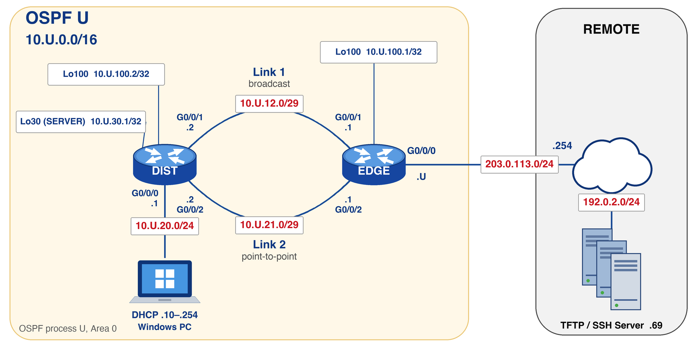

# Challenge Lab 02 — OSPF Troubleshooting and Verification

```text
Environment:      Cisco IOS-XE physical lab (EDGE and DIST routers), Day0-provisioned
Lab type:         Challenge Lab — individual, in-lab, graded (5% of the course, 10 raw points)
Time allowed:     180 minutes (scheduled lab session): plan about 160 minutes of work and 20 minutes for clean-up
Evidence files:   ch02-c00-{username}.txt  through  ch02-c03-{username}.txt
Due:              End of your scheduled Challenge Lab session
```

---

## Section A — Start Here

### A1 — Overview

You are not building this network. You are handed it.

At C00, you cable a two-router pod and use an automated provisioning tool (`day0_provision.py`) to load a **pre-built OSPF configuration** onto EDGE and DIST over the console port. You then confirm addressing, device access, and interface state. The configuration contains **three deliberate faults**, one per ticket. The faults use valid command syntax; a successful provisioning check does not mean that OSPF works as designed. Use operational evidence to identify and repair each fault.

Your job is to **prove what is broken, make the smallest change that repairs it, and prove the repair**, with before-and-after evidence a third party can grade without watching you.

> **Work the tickets in order (C01 → C02 → C03).** Each ticket assumes the earlier tickets are repaired. Complete each ticket's evidence before moving on.

> **Prepare before your session:** read this complete handout and review your notes and lab-book evidence from Labs 05 and 06. Bring those notes to the lab. The intended design is in B4; the limits on what you may change are in B3.

### A1.1 — Mini Quick-Ref

| Task | Command | Notes |
| --- | --- | --- |
| Show OSPF neighbours and their state | `show ip ospf neighbor` | State, role (DR/BDR/`-`), neighbour address, and the interface it is learned on. |
| Show OSPF interfaces in brief | `show ip ospf interface brief` | One row per interface that OSPF is running on: process, area, address, cost, state, neighbour count. |
| Show one or all OSPF interfaces in detail | `show ip ospf interface [<interface>]` | Network type, cost, priority, timers, DR/BDR, passive status. |
| Show process-wide OSPF settings | `show ip ospf` | Router ID, reference bandwidth, areas. |
| Show routing-protocol settings | `show ip protocols` | |
| Show the route selected for one destination | `show ip route <destination>` | Route source, administrative distance, metric, and every next hop. |
| Show only routes of one source | `show ip route ospf` / `show ip route static` | |
| Show interface state and addresses | `show ip interface brief \| exclude unassigned` | |
| Ping from a router with a chosen source | `ping <destination> source <interface>` | The source address decides which routes the **reply** depends on. |
| Remove a setting | repeat the command with `no` in front | Interface or global configuration mode. |
| Restart the OSPF process | `clear ip ospf process` | Privileged EXEC. Neighbours re-form after it. |
| PC reachability | `ping -n 4 <destination>` | Windows. |

### A1.2 — Evidence Collection

Copy device prompts and full command output into the checkpoint's evidence file **as you complete each step**.

```text
ch02-c00-{username}.txt     C00 baseline (gate)
ch02-c01-{username}.txt     C01 ticket
ch02-c02-{username}.txt     C02 ticket
ch02-c03-{username}.txt     C03 ticket
```

Rules that apply to every checkpoint:

- **Capture before you change anything.** Every ticket requires the state *before* your fix and the state *after* it. Evidence captured only after a repair cannot show what was wrong.
- **Re-test after every repair.** A correct fix with no new post-fix evidence earns no evidence credit.
- **Successful baseline and post-repair pings must show 100 percent success.** A first ping can lose a packet while the neighbour resolves; repeat it before collecting successful proof. Keep the failed **before-repair** pings required by a ticket: they are evidence of the fault, not successful reachability.
- **Capture from the live device.** The prompt must be visible in the captured output. Provisioning template files and configuration listings are not evidence. `show running-config` is not accepted as evidence.
- **Widen your terminal before capturing** (`terminal length 0` and `terminal width 0` on the devices; disable line wrap in your SSH client). A wrapped line splits addresses and breaks grading.
- **Save each checkpoint immediately on the PC's Desktop, and upload it as soon as the checkpoint is confirmed.** The upload path is described in D2.

### A3 — Objectives and Grading

By completing this challenge, you will:

- Diagnose and repair an OSPF adjacency failure.
- Diagnose and repair a route or path that does not match the intended design.
- Recognise and repair a configuration that works but deviates from an approved design.
- Capture before-and-after operational evidence of your work.

| Checkpoint | Focus                                               | Evidence that earns the points                                                                                 | Points |
| ---------- | --------------------------------------------------- | -------------------------------------------------------------------------------------------------------------- | -----: |
| C00        | Cable, provision, and verify the baseline           | Interface state, link and LAN reachability, DHCP lease, SSH access, `show tcp brief` on both devices           |      1 |
| C01        | Restore the missing OSPF neighbour                  | 1 for the fault state and test result before repair; 1 for the state after repair; 1 for the proof test        |      3 |
| C02        | Restore the intended routes and paths               | 1 for the fault state and test result before repair; 1 for the state after repair; 1 for the proof test        |      3 |
| C03        | Bring the configuration back to the approved design | 1 for the deviating value and baseline test before repair; 1 for the state after repair; 1 for the proof tests |      3 |
| **Total**  | **5% of the course**                                |                                                                                                                | **10** |

Marks assess hands-on diagnosis, repair, and operational verification. The short `!--` comment in each ticket documents your work and is not separately scored.

Partial credit is awarded for evidence supporting the relevant criterion. A successful ping without before-repair evidence does not earn diagnosis credit. A configuration dump does not replace operational evidence. Submit before the end of your scheduled 180-minute session.

---

## Section B — Topology and Addressing

### B1 — Topology



The value **U** is your assigned student addressing number (for example, U = 55 gives `10.55.12.1` and `203.0.113.55`).

| Link | Endpoint A | Endpoint B |
| --- | --- | --- |
| Upstream | EDGE `G0/0/0` | White jack (course upstream, gateway `203.0.113.254`) |
| Link 1 | EDGE `G0/0/1` | DIST `G0/0/1` |
| Link 2 | EDGE `G0/0/2` | DIST `G0/0/2` |
| User LAN | DIST `G0/0/0` | PC lab NIC (BLUE) |
| Console | PC COM port | The device being provisioned |

Port numbers match on both ends (1 to 1, 2 to 2). Trace each cable and verify both port labels.

### B2 — Addressing Table

| Device | Interface | Address | Notes |
| --- | --- | --- | --- |
| EDGE | G0/0/0 | `203.0.113.U/24` | Upstream; outside OSPF |
| EDGE | G0/0/1 | `10.U.12.1/29` | Link 1 |
| DIST | G0/0/1 | `10.U.12.2/29` | Link 1 |
| EDGE | G0/0/2 | `10.U.21.1/29` | Link 2 |
| DIST | G0/0/2 | `10.U.21.2/29` | Link 2 |
| DIST | G0/0/0 | `10.U.20.1/24` | PC gateway; DHCP pool `10.U.20.10` to `10.U.20.254` |
| EDGE | Loopback100 | `10.U.100.1/32` | |
| DIST | Loopback100 | `10.U.100.2/32` | |
| DIST | Loopback30 | `10.U.30.1/32` | Stands in for a server network |
| PC | Lab NIC | DHCP lease from DIST | |
| TFTP / SSH server | NIC | `192.0.2.69` | Course services; staff-managed. Staff hold a return route `10.U.0.0/16` through EDGE |

Device access: username `admin`, password `cisco`; the `enable` password is `class`.

### B3 — Baseline Requirements

| Item | Requirement |
| --- | --- |
| Pushed by `day0_provision.py` (EDGE and DIST) | Hostnames, SSH (version 2), `admin` / `cisco` with `enable` password `class`, every interface address in B2, the DHCP pool on DIST, the static routes, and the OSPF configuration |
| Built by you at C00 | Cabling, PC addressing (DHCP), and your evidence files |
| Injected faults | Three, one per ticket, all in OSPF and routing configuration. Confirm cabling, addressing, SSH, and interface state at C00. If those checks fail, raise your hand before starting C01. |
| Student scope | Cable and provision your pod at C00. During the tickets, change OSPF and routing configuration on EDGE and DIST, and restart the OSPF process (`clear ip ospf process`) where a repair requires it. Perform the supplied cleanup in D3 after submission. |
| Protected scope | Do not change interface IP addresses, the DHCP pool, SSH, users, or the upstream interface `G0/0/0`. Do not change the TFTP server or the upstream equipment. Do not run `erase`, `reload`, or `write erase`. Do not remove and rebuild the whole OSPF configuration to repair a ticket; restore only the value that is wrong. |

### B4 — Intended Design

You cannot recognise a deviation if you do not know what correct looks like. This is the approved design. It is not a copy of the live configuration, and it does not say where your pod differs.

**OSPF process**

- Process `U`, Area 0 everywhere.
- Router ID is the device's own Loopback100 address, set manually and unique: EDGE `10.U.100.1`, DIST `10.U.100.2`.
- `auto-cost reference-bandwidth 10000` (10 Gbps) on both routers, so a 1 Gbps link has cost 10.

**Link 1** (`10.U.12.0/29`)

- Activated in Area 0 on both ends, mask `/29` on both ends.
- Network type **broadcast** on both ends (DR/BDR elected).
- Cost 10 (from the reference bandwidth), hello 10, dead 40.
- EDGE priority 100, DIST priority 1 (default): **EDGE is the DR, DIST the BDR.**
- No other overrides.

**Link 2** (`10.U.21.0/29`)

- Activated in Area 0 on both ends.
- Network type **point-to-point** on both ends.
- Cost 10 (from the reference bandwidth), hello 10, dead 40.
- No priority or cost overrides.

**Interfaces in OSPF**

- EDGE: `G0/0/1`, `G0/0/2`, Loopback100. EDGE `G0/0/0` is not in OSPF.
- DIST: `G0/0/1`, `G0/0/2`, `G0/0/0`, Loopback100, Loopback30.
- Passive interface: DIST `G0/0/0` only.

**Default and static routes**

- EDGE has a static default to `203.0.113.254` and `default-information originate`.
- DIST learns the default through OSPF as `O*E2`.
- The only static routes are the EDGE default and the staff return route.

**Paths**

- Two equal-cost paths in each direction between DIST and EDGE.

### B5 — Reachability Table

Every row must work on a healthy network. Each destination is learned through OSPF over **both** links, so the route shows two next hops.

| From | To                  | Address      | Route should be            | Next hops |
| ---- | ------------------- | ------------ | -------------------------- | --------: |
| EDGE | DIST Loopback30     | `10.U.30.1`  | `O`                        |         2 |
| EDGE | DIST Loopback100    | `10.U.100.2` | `O`                        |         2 |
| EDGE | DIST PC LAN gateway | `10.U.20.1`  | `O`                        |         2 |
| DIST | EDGE Loopback100    | `10.U.100.1` | `O`                        |         2 |
| DIST | TFTP server         | `0.0.0.0`    | `O*E2` (the default route) |         2 |

---

## Section C — Lab Tasks and Evidence

### C00 — Cable the Pod, Provision the Baseline, and Confirm Access

#### Goal

Get the pre-built (faulted) configuration onto EDGE and DIST, bring the PC onto the DIST LAN, and record the live starting state before diagnosing anything.

#### Action

Work through the groups from top to bottom. The procedure is the shared [Day0 provisioning guide](../../resources/day0-provision-guide.md); this checkpoint gives only this lab's values.

**Prepare the PC**

- [ ] Follow the guide through the setup script, using `ch02` as the lab value.
- [ ] When the guide reaches the download, run exactly this block:

  ```powershell
  Set-Location "$env:USERPROFILE\Desktop"
  $lab = "ch02"
  scp cisco@192.0.2.69:configs/$lab.zip "$env:USERPROFILE\Desktop\"
  ```

- [ ] Run `. .\lab_setup.ps1 -LabName ch02` and read the status. `SETUP OK` means the device templates and your three evidence files (`ch02-c01`, `ch02-c02`, `ch02-c03`) are present. `ch02-c00-{username}.txt` is created later by `x_remote`.

> **Keep this PowerShell window open** for the whole challenge. Variables belong to the window. If you reopen it, run `. .\lab_setup.ps1 -LabName ch02` again; it keeps your existing evidence files. Type your actual `U` and username on the Cisco devices; they cannot read PowerShell variables.

**Cable the lab network**

- [ ] Move the PC's BLUE NIC cable from the white jack to **DIST `G0/0/0`**, and set the NIC back to **Obtain an IP address automatically** if you set a static address.
- [ ] Connect **EDGE `G0/0/0`** to the **white jack**.
- [ ] Cable **Link 1**: EDGE `G0/0/1` to DIST `G0/0/1`.
- [ ] Cable **Link 2**: EDGE `G0/0/2` to DIST `G0/0/2`.
- [ ] Trace each cable and verify both port labels against B1.

**Provision EDGE, then DIST**

- [ ] Close PuTTY. Only one application can use the console port.
- [ ] Connect the console cable to **EDGE**. Set `$device = "EDGE"`, then provision (the preview command takes the same arguments without `--port` and sends nothing):

  ```powershell
  python day0_provision.py --config day0-$lab.yaml --device $device --u $u --username $username --port $consolePort
  ```

- [ ] Move the console cable to **DIST**. Set `$device = "DIST"` and run the same command.
- [ ] Read each device's verification summary. Every line must show ✔ with these exceptions: while EDGE is provisioned first, its `G0/0/1` and `G0/0/2` rows may show down until DIST is provisioned. The `got` line must still show the correct B2 address.
- [ ] After DIST is provisioned, check both devices yourself (see Verification below). Every B2 interface must now be up/up. Do not re-push Day0 to clear a down row.

**Troubleshooting — if a check fails**

- [ ] **An interface is still down after DIST is provisioned.** Check the cable and both port labels against B1. If the cabling is correct, bring the interface down and up at **both ends** of the link, then recheck:

  ```text
  configure terminal
  interface GigabitEthernet0/0/N
  shutdown
  no shutdown
  end
  ```

- [ ] **The SSH check times out.** Key generation on the router can still be running when the check fires. Wait about a minute, then check from the console (PuTTY, after Day0 has finished):

  ```text
  show ip ssh
  ```

  It must report `SSH Enabled - version 2`. Do not re-push Day0. If it still fails after two minutes, keep the output and raise your hand.
- [ ] **Anything else shows ✘** (a rejected line, a wrong address). Do not re-push Day0 or add routing. Keep the error output and raise your hand.

**Confirm the PC lease and open SSH sessions**

- [ ] Run `ipconfig /release`, `ipconfig /renew`, then `ipconfig /all`. Confirm an address from `10.U.20.10` to `10.U.20.254`, gateway and DHCP server `10.U.20.1`.
- [ ] SSH into DIST (password `cisco`). This is the complete command, with the key exchange options Windows needs for these devices; it uses your `$u`:

  ```powershell
  ssh -o KexAlgorithms=+diffie-hellman-group14-sha1 -o HostKeyAlgorithms=+ssh-rsa "admin@10.${u}.20.1"
  ```

- [ ] SSH into EDGE from a second PowerShell window (password `cisco`):

  ```powershell
  ssh -o KexAlgorithms=+diffie-hellman-group14-sha1 -o HostKeyAlgorithms=+ssh-rsa "admin@203.0.113.${u}"
  ```

- [ ] Confirm every B2 interface is up/up and that each link peer answers a ping. Do **not** test OSPF yet.

**If provisioning, access, or a baseline check fails, raise your hand before starting C01.** These checks establish the starting environment; the OSPF faults come after C00. Keep the error output available for the instructor.


#### Verification

```text
EDGE# show ip interface brief | exclude unassigned
DIST# show ip interface brief | exclude unassigned
```

```text
EDGE# ping 10.U.20.1
EDGE# ping 10.U.12.2
EDGE# ping 10.U.21.2
DIST# ping 10.U.12.1
DIST# ping 10.U.21.1
```

#### Success Indicator / Failure Signal

| Verification Item | Success Indicator | Failure Signal |
| --- | --- | --- |
| Package and setup | `SETUP OK`, with `ch02-c01`, `ch02-c02` and `ch02-c03` evidence files created or kept | `SETUP FAILED: missing or invalid ...`, or an evidence file missing |
| Push completion | `day0_provision.py` reports both devices provisioned and its verify checks pass | Push errors, or verify checks fail |
| Interface state | Every B2 interface on EDGE and DIST shows `up` / `up` with its B2 address | Any `down`, `administratively down`, or a missing or wrong address |
| Link reachability | Each ping of a link peer: `Success rate is 100 percent` | Any loss |
| PC lease and LAN | `show ip dhcp binding` on DIST lists a lease in `10.U.20.0/24`; `EDGE# ping 10.U.20.1` reports `Success rate is 100 percent` | No lease, or any loss |
| SSH | `show ip ssh` reports `SSH Enabled - version 2` on both devices, and the evidence is collected over SSH | SSH disabled, version 1, or login rejected |

#### C00 — Collection of Information


**Collect both devices automatically with `x_remote`.** The supplied manifest `x-remote-c00.yaml` lists the commands below for EDGE and DIST. The PC needs no evidence of its own: its lease shows in DIST's `show ip dhcp binding`, and its LAN is tested from the routers.

- [ ] In the PowerShell window where your identity is defined, generate your personal copy. It replaces the U and username placeholders, including the output filename:

  ```powershell
  (Get-Content .\x-remote-c00.yaml -Raw).
      Replace('{U}', "$u").
      Replace('{USERNAME}', $username) |
      Set-Content .\x-remote-c00-personal.yaml -Encoding ascii
  ```

- [ ] Run the collection:

  ```powershell
  python x_remote.py x-remote-c00-personal.yaml
  ```

- [ ] Confirm `ch02-c00-{username}.txt` holds every command below with its output under the device heading. A file with a footer alone does not prove collection succeeded.
- [ ] End the file with one comment line stating what the evidence proves.

The file opens with its own header:

```diff
=== C00 – Cable the Pod, Provision the Baseline, and Confirm Access ===
```

Required commands:

```text
EDGE: show ip interface brief | exclude unassigned
EDGE: ping 10.U.12.2
EDGE: ping 10.U.21.2
EDGE: ping 10.U.20.1
EDGE: show ip ssh
EDGE: show tcp brief
DIST: show ip interface brief | exclude unassigned
DIST: ping 10.U.12.1
DIST: ping 10.U.21.1
DIST: show ip dhcp binding
DIST: show ip ssh
DIST: show tcp brief
```

> **Save locally and upload:** save `ch02-c00-{username}.txt` on the Desktop, then upload it as described in D2. Rerunning `x_remote` overwrites its output file; save a copy first if you have already added your comment line.

---

### C01 — Trouble Ticket: One OSPF Neighbour Missing

#### Ticket

*"Operations reports that EDGE and DIST should have two OSPF neighbours. Only one is established. The PC can still reach the TFTP server."*

#### Action

- [ ] Verify the OSPF neighbour state on EDGE and DIST.
- [ ] Confirm the state of both links between EDGE and DIST.
- [ ] Test connectivity between the two ends of each link.
- [ ] Confirm the OSPF interface parameters on both ends of the link that has no neighbour.
- [ ] Confirm the repair by re-checking neighbour state and the routes toward the peer.

#### Success Indicator / Failure Signal

| Verification Item | Success Indicator | Failure Signal |
| --- | --- | --- |
| OSPF neighbours | `show ip ospf neighbor` on **both** EDGE and DIST lists two neighbours, each in state `FULL` | Only one neighbour remains on either device, or a neighbour is in any state other than `FULL` |
| Peer reachability | `DIST# ping 10.U.100.1` reports `Success rate is 100 percent` | Any loss, or the ping fails |

#### Collection of Information

Your evidence file `ch02-c01-{username}.txt` was created by the setup script. It opens with this checkpoint's header, lists the required commands for each device, and has a slot for the output **before** and **after** the repair:

```diff
=== C01 – Trouble Ticket: One OSPF Neighbour Missing ===
```

Paste the prompt, the command, and the raw output into each slot. Do not edit output, and do not remove commands. Capture the BEFORE slots before any change.

Required on **both** EDGE and DIST, before and after the repair:

```text
show ip ospf neighbor
show ip ospf interface brief
show ip ospf interface
```

Also required:

```text
EDGE# ping 10.U.12.2             (before repair)
EDGE# ping 10.U.21.2             (before repair)
DIST# ping 10.U.100.1            (after repair; 100 percent)
```

Complete the one-line comment in the file, stating what was wrong and what you changed:

```text
!-- [PROBLEM]: <what was wrong> [SOLUTION]: <what you changed>
```

> **Save locally and upload:** save `ch02-c01-{username}.txt`, then upload it as described in D2 before starting C02.

---

### C02 — Trouble Ticket: Not Every Network Is Reachable

#### Ticket

*"Operations reports that not every network is reachable from EDGE and DIST as expected. Test each device against the reachability table (B5) and correct what does not match."*

#### Action

- [ ] Test reachability from each device to every destination in the reachability table (B5).
- [ ] Verify the route each device holds for every destination, and how many next hops it has.
- [ ] Confirm which source installed any route that does not match the table.
- [ ] Confirm the interface and routing parameters on the device that has the wrong route or path.
- [ ] Confirm the repair by re-testing every row of the table.

#### Success Indicator / Failure Signal

| Verification Item | Success Indicator | Failure Signal |
| --- | --- | --- |
| Routes | Every row of B5: `show ip route <address>` shows the route source in the table with **two** next hops, and `show ip route static` on EDGE lists no route for a B5 address | A B5 destination has no route, comes from a static route, or has one next hop |
| Reachability | Every ping in the list below reports `Success rate is 100 percent` | Any loss, or a ping fails |

#### Collection of Information

Your evidence file `ch02-c02-{username}.txt` was created by the setup script. It opens with this checkpoint's header, lists the required commands for each device, and has a slot for the output **before** and **after** the repair:

```diff
=== C02 – Trouble Ticket: Not Every Network Is Reachable ===
```

Paste the prompt, the command, and the raw output into each slot. Do not edit output, and do not remove commands. Capture the BEFORE slots after C01 is repaired and before any C02 change. A failed ping is expected evidence in some cases: keep it before the repair, and repeat each ping after the repair until it shows 100 percent.

Required on **EDGE**, before and after the repair:

```text
ping 10.U.30.1 source Loopback100
ping 10.U.100.2 source Loopback100
ping 10.U.20.1 source Loopback100
show ip route 10.U.30.1
show ip route 10.U.100.2
show ip route 10.U.20.1
show ip route static
show ip ospf interface brief
show ip ospf interface
```

Required on **DIST**, before and after the repair:

```text
ping 10.U.100.1 source Loopback100
ping 192.0.2.69
show ip route 10.U.100.1
show ip route 192.0.2.69
show ip ospf interface brief
show ip ospf interface
```

Complete the one-line comment in the file, stating what was wrong and what you changed:

```text
!-- [PROBLEM]: <what was wrong> [SOLUTION]: <what you changed>
```

> **Save locally and upload:** save `ch02-c02-{username}.txt`, then upload it as described in D2 before starting C03.

---

### C03 — Trouble Ticket: Configuration Differs From the Approved Design

#### Ticket

*"A routine audit reports that the EDGE and DIST routing configuration differs from the approved design (B4) in one place. Traffic is flowing normally."*

#### Action

- [ ] Compare the OSPF interface parameters on both ends of each link against the design table.
- [ ] Compare the router identities and the neighbour roles on each link against the design table.
- [ ] Compare the protocol-wide OSPF settings on both routers against the design table.
- [ ] Confirm that neighbours and routes are unchanged after the repair.
- [ ] Confirm that the repaired value matches the design table on every device you changed.

#### Success Indicator / Failure Signal

| Verification Item | Success Indicator | Failure Signal |
| --- | --- | --- |
| Design match | Every value in B4 matches on both devices in the `show ip ospf`, `show ip ospf interface`, and `show ip ospf neighbor` output | A value still differs from B4 |
| Neighbours | Both neighbours are `FULL` on both devices after the repair | A neighbour was lost during the repair |
| Routes and reachability | `show ip route 10.U.100.2` on EDGE and `show ip route 10.U.100.1` on DIST each show **two** next hops; both pings report `Success rate is 100 percent` | A route or next hop was lost during the repair, or a ping fails |

#### Collection of Information

Your evidence file `ch02-c03-{username}.txt` was created by the setup script. It opens with this checkpoint's header, lists the required commands for each device, and has a slot for the output **before** and **after** the repair:

```diff
=== C03 – Trouble Ticket: Configuration Differs From the Approved Design ===
```

Paste the prompt, the command, and the raw output into each slot. Do not edit output, and do not remove commands. Capture the BEFORE slots after C02 is repaired and before any C03 change.

Required on **both** EDGE and DIST, before and after the repair:

```text
show ip ospf
show ip ospf interface
show ip ospf neighbor
```

Also required, before and after the repair:

```text
EDGE# ping 10.U.100.2 source Loopback100
EDGE# show ip route 10.U.100.2
DIST# ping 10.U.100.1 source Loopback100
DIST# show ip route 10.U.100.1
```

The before-repair pings and routes are your baseline: they show the network working while a value differs from B4. The after-repair pings must show 100 percent success.

Complete the one-line comment in the file, stating what was wrong and what you changed:

```text
!-- [PROBLEM]: <what was wrong> [SOLUTION]: <what you changed>
```

> **Save locally and upload:** save `ch02-c03-{username}.txt`, then upload it as described in D2.

---

## Section D — Submission

### D1 — Submission Requirements

| File | Content | Saved on |
| --- | --- | --- |
| `ch02-c00-{username}.txt` | Baseline evidence | PC's Desktop, then the server |
| `ch02-c01-{username}.txt` | Ticket C01, before and after | PC's Desktop, then the server |
| `ch02-c02-{username}.txt` | Ticket C02, before and after | PC's Desktop, then the server |
| `ch02-c03-{username}.txt` | Ticket C03, before and after | PC's Desktop, then the server |

Each file must contain the header shown in its checkpoint's Collection of Information, device identification, commands, and raw command output. For C01–C03, keep the supplied before-repair and after-repair headings and slots, and complete the `!-- [PROBLEM]:` / `[SOLUTION]:` comment. C00 contains baseline evidence only. Do not edit command output.

### D2 — Submit and Validate

Upload each checkpoint file as soon as it is confirmed. From the PowerShell window where `$username` is defined:

```powershell
scp "ch02-c0*-$username.txt" cisco@192.0.2.69:/var/tftp/
```

Enter the server password `cisco`. Uploading all four names at once is safe; later uploads replace earlier copies. After the final upload, confirm that all four files landed:

```bash
ssh cisco@192.0.2.69 "ls -l /var/tftp/*{username}*"
```

Compare the listing against **all four filenames in D1**. Each must have a non-zero size. Do not erase your work or claim a successful submission without checking the server.

**If the upload fails** (for example, the PC lost its path to the server during a repair): keep every file saved on the Desktop, move the PC NIC cable to the **white jack** (EDGE `G0/0/0` is unplugged meanwhile), repeat the upload and validation commands, then return the PC NIC to DIST `G0/0/0` and EDGE `G0/0/0` to the white jack before you continue. A blocked upload never costs you the challenge.

### D3 — Clean Up Devices

After submission is confirmed, clean up EDGE and DIST with the provided script:

```text
EDGE# tclsh clean.tcl
DIST# tclsh clean.tcl
```

Expected output on each device:

```text
=== Lab Cleanup Script ===

-- Step 1: Scanning flash: for saved config files --
  No saved config files found on flash:.

-- Step 2: Removing VLANs 2-1001 --
  VLANs 2-1001 removed.

-- Step 3: Checking startup-config --
  No startup-config present.

=== Cleanup Complete - No Reload Needed ===
```

If the script is missing, report to the instructor before deleting files, erasing a configuration, or reloading. Then:

- Power off your devices.
- Reboot your PC.

---

## End of Challenge Lab 02 — OSPF Troubleshooting and Verification
