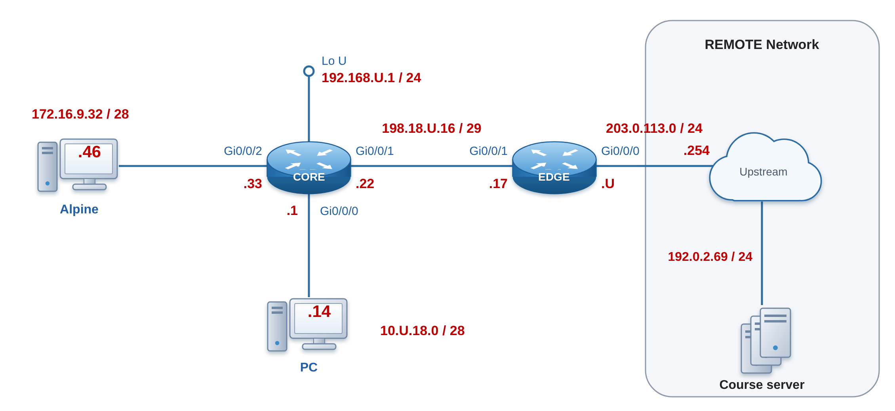

# Challenge Lab 03 — NAT Troubleshooting and Verification

```text
Environment:      Cisco IOS-XE physical lab (EDGE and CORE routers), Day0-provisioned; Windows PC (PowerShell) and Alpine
Lab type:         Challenge Lab — individual, in-lab, graded (5% of the course, 10 raw points)
Time allowed:     180 minutes (scheduled lab session): plan about 160 minutes of work and 20 minutes for clean-up
Evidence files:   ch03-c00-{username}.txt  through  ch03-c03-{username}.txt
Due:              End of your scheduled Challenge Lab session
```

---

## Section A — Start Here

### A1 — Overview

You are not building a NAT configuration. You are handed one.

At C00, you cable the Lab 10 pod and use the Day0 provisioning tool (`day0_provision.py`) to load the baseline **and a pre-built NAT configuration** onto EDGE and CORE over the console port. The NAT configuration contains **three deliberate faults**, one per ticket. Every fault is syntactically valid IOS: the push completes cleanly and nothing announces itself. You find the faults by testing and auditing the NAT configuration yourself.

Your job is to **prove what is broken, why it is broken, and how you know**, using the operational evidence a network operator uses during an outage call (`show ip nat translations`, `show ip nat statistics`). Make the smallest change that repairs each fault, and prove the repair with before-and-after evidence a third party can grade without watching you.

The three tickets cover three kinds of NAT fault:

1. **C01 — Selection.** The rule does not select the traffic it should (tested from Alpine).
2. **C02 — Outside-address mapping.** The pool the rule translates to is wrong (tested from the PC).
3. **C03 — Source and outside mapping.** The static port-forward does not map the way the policy says (tested from outside, through Alpine).

> **This challenge uses the Lab 10 topology, addressing plan and baseline.** The routers (EDGE and CORE), the OSPF design, the NTP and DHCP services, the PC network, the Alpine network and the way you reach the routers are the same as in Lab 10. Only the NAT configuration differs: Lab 10 has none at the start; here it is already loaded, and it is faulty.

> **Work the tickets in order (C01 → C02 → C03).** Complete each ticket's evidence before moving on. C02 needs no help from C01, but C03 is tested from Alpine and therefore needs C01 repaired.

> **Prepare before your session:** read this complete handout and review your Lab 09 and Lab 10 notes and evidence. Bring them to the lab. The intended design is in B4; the limits on what you may change are in B3.

### A1.1 — Mini Quick-Ref

| Task | Command | Notes |
| --- | --- | --- |
| Show live translations | `show ip nat translations` | EXEC mode. The port of a service (22, 23, 69) appears only in the **outside** columns; the inside host shows a random port. |
| Show NAT counters, interface roles, rule bindings and pool allocation | `show ip nat statistics` | EXEC mode. Lists the inside and outside interfaces, each rule as `access-list <n> pool <name>` or `interface <if>` with its `refcount`, the pools and the `static` count. |
| Clear dynamic translations before a test | `clear ip nat translation *` | Removes **dynamic** entries only; a static entry stays. Do this before every test so old entries do not mix with your evidence. |
| Show an ACL | `show access-list <number>` | EXEC mode. |
| Show a NAT pool's configuration | `show ip nat pool <name>` | Shows the pool's actual address range, and whether it exists under that name. |
| Confirm the inside/outside role on one interface | `show ip interface <intf> \| include NAT` | |
| Confirm what address DHCP handed an end device | `show ip dhcp binding` | Run on CORE. |
| Show TCP sessions and listeners on a router | `show tcp brief` | EXEC mode. |
| Give Alpine a second address | `ip addr add 172.16.9.44/28 dev eth0` | Run as root on Alpine. It is not persistent: a reboot removes it. Check it with `ip addr show eth0`. |
| Ping from the second address | `ping -c 4 -I 172.16.9.44 192.0.2.69` | `-I` sets the source address of the ping. |
| Open an SSH session from the second address | `ssh -b 172.16.9.44 cisco@192.0.2.69` | `-b` sets the source address of the connection. |
| Generate a translation attempt | `ssh`, `ping`, `telnet`, `tftp` | NAT does nothing for idle hosts. Use the protocol and source device each ticket specifies. |

### A1.2 — Evidence Collection

```text
ch03-c00-{username}.txt     C00 baseline (collected by x_remote)
ch03-c01-{username}.txt     C01 ticket
ch03-c02-{username}.txt     C02 ticket
ch03-c03-{username}.txt     C03 ticket
```

`lab_setup.ps1` creates the C01–C03 files from the lab package. The C00 file is created by `x_remote` in C00. Rules that apply to every checkpoint:

- **Capture before you change anything.** Every ticket requires the state *before* your fix and the state *after* it. Evidence captured only after a repair cannot show what was wrong.
- **Re-test after every repair.** After you change a rule, a pool or an ACL, clear the translations and generate the ticket's test traffic again. A correct fix with no new post-fix evidence earns no evidence credit.
- **Capture while the traffic is fresh.** Dynamic translations expire after about a minute. Generate the traffic, then capture the router output immediately. For TCP sessions (C03) keep the sessions open while you capture.
- **Run each test from the device the ticket names.** Where a ticket asks for a second test from CORE, run it on CORE with the stated source interface, not from the end host again.
- **Every successful ping must show 100 percent success.** A first ping can lose a packet while ARP resolves; repeat it before you collect successful proof. The failed tests required **before** a repair are evidence of the fault, not successful reachability.
- **Capture from the live device.** The prompt must be visible in the captured output. Provisioning templates and configuration listings are not evidence. `show running-config` is not accepted as evidence.
- **Widen your terminal before capturing** (`terminal length 0` and `terminal width 0` on the routers; disable line wrap in your SSH client). A wrapped line splits addresses and breaks grading.
- **Save each file on the PC's Desktop.** The files go to the course server together, as D2 describes.

### A3 — Objectives and Grading

By completing this challenge, you will:

- Confirm the Day0 baseline and collect verification evidence with `x_remote`.
- Diagnose and repair a NAT rule that selects the wrong traffic (Alpine network).
- Diagnose and repair a NAT rule that translates to the wrong pool (PC network).
- Diagnose and repair a static port-forward that maps the wrong way (CORE service).
- Capture before-and-after operational evidence of your work.

| Checkpoint | Focus | Evidence that earns the points | Points |
| ---------- | ----- | ------------------------------ | -----: |
| C00 | Confirm the baseline and collect verification evidence | `x_remote` output from EDGE and CORE: OSPF, routing, NTP, DHCP, TCP | 1 |
| C01 | Restore the Alpine network's path to the course server | 1 for the fault state and test result before repair; 1 for the state after repair; 1 for the proof tests | 3 |
| C02 | Restore the PC network's path to the course server | 1 for the fault state and test result before repair; 1 for the state after repair; 1 for the proof tests | 3 |
| C03 | Restore the outside access to CORE's private service | 1 for the fault state and test result before repair; 1 for the state after repair; 1 for the proof tests | 3 |
| **Total** | **5% of the course** | | **10** |

Marks assess hands-on diagnosis, repair and operational verification. The short `!--` comment in each ticket documents your work and is not separately scored. A successful test without before-repair evidence does not earn diagnosis credit. A configuration dump does not replace operational evidence. Submit before the end of your scheduled 180-minute session.

---

## Section B — Topology and Addressing

### B1 — Topology



| Network        | Subnet                        | Routing domain                       |
| -------------- | ----------------------------- | ------------------------------------ |
| Upstream       | `203.0.113.0/24`              | Outside OSPF                         |
| EDGE–CORE      | `198.18.U.16/29`              | OSPF Area 0                          |
| PC network     | `10.U.18.0/28`                | OSPF Area 0, passive                 |
| Alpine network | `172.16.9.32/28`              | OSPF Area 0, passive                 |
| CORE LoU       | `192.168.U.0/24`              | OSPF Area 0, passive, point-to-point |
| Public NAT block | `209.10.U.0/28`             | Public addresses on EDGE only        |

### B2 — Addressing Table (IPv4)

Replace `U` with your assigned U number (your Brightspace **U** grade; 1 to 253).

| Device             | Interface | IP Address (CIDR)  | Description                                  |
| ------------------ | --------- | ------------------ | -------------------------------------------- |
| **EDGE**           | Gi0/0/0   | `203.0.113.U/24`   | Outside interface to the Internet            |
| **EDGE**           | Gi0/0/1   | `198.18.U.17/29`   | Inside interface, OSPF neighbour to CORE     |
| **CORE**           | Gi0/0/0   | `10.U.18.1/28`     | Gateway of the PC network                    |
| **CORE**           | Gi0/0/1   | `198.18.U.22/29`   | OSPF neighbour to EDGE                       |
| **CORE**           | Gi0/0/2   | `172.16.9.33/28`   | Gateway of the Alpine network                |
| **CORE**           | LoU       | `192.168.U.1/24`   | Private network; its Telnet service is the C03 target |
| **Alpine**         | eth0      | `172.16.9.46/28`   | Inside host for the C01 tests (DHCP); second address `172.16.9.44/28` added by you in C01 |
| **PC**             | NIC       | `10.U.18.14/28`    | Inside host for the C02 tests (DHCP)         |
| **Course server**  | —         | `192.0.2.69`       | External server: SSH, TFTP and the outside Telnet client |

> **Alpine network.** All students use **172.16.9.32/28** for their Alpine subnet. DHCP on CORE gives Alpine **172.16.9.46/28**, identical across students, to show how private networks overlap behind NAT. The addresses `.34` to `.45` are never handed out by DHCP, so the second address `172.16.9.44` belongs to you alone.

### B3 — Baseline Requirements

| Item | Requirement |
| --- | --- |
| Pushed by `day0_provision.py` (EDGE and CORE) | The Lab 10 baseline: hostnames, domain name, `admin` / `cisco` with enable secret `class`, SSHv2 and Telnet on the VTY lines, every B2 address, OSPF process `U` (router IDs `U.0.0.17` EDGE and `U.0.0.22` CORE, CORE as DR, passive interfaces, reference bandwidth, convergence tuning), EDGE default route via `203.0.113.254` originated in OSPF, NTP (EDGE master), the DHCP server on CORE (one free lease per host network), **and the NAT configuration** |
| Built by you at C00 | Cabling, end-host addressing (DHCP), management sessions and your `x_remote` evidence file |
| Injected faults | Three, one per ticket, all in the NAT configuration on EDGE. Confirm cabling, addressing, SSH, OSPF and interface state at C00. If those checks fail, raise your hand before starting C01. |
| Provisioning tool | `day0_provision.py`, run from your **native host OS** (Windows PC), not from a VM. See the shared [Day0 provisioning guide](../../resources/day0-provision-guide.md). |
| Student scope | Cable and provision your pod at C00. During the tickets, change the NAT configuration on EDGE, clear translations and generate test traffic. Perform the supplied cleanup in D3 after submission. |
| Protected scope | Do not change interface IP addresses, OSPF, NTP, DHCP, SSH, users, or the upstream interface `G0/0/0` address. Do not change the course server or the upstream equipment. Do not run `erase`, `reload` or `write erase`. Do not remove and rebuild the whole NAT configuration to repair a ticket; restore only the value that is wrong. The instructor supplies the upstream, the course server and the return routing for `203.0.113.U` and the `209.10.U.0/28` block through EDGE. |

> **Check the DR before you continue.**
> - [ ] CORE must be the DR on the EDGE–CORE link (`show ip ospf neighbor` on EDGE shows CORE as `FULL/DR`).
> - [ ] If EDGE is the DR, run `clear ip ospf process` on **both** routers, wait for `FULL`, and check again. This is not a configuration change.

### B4 — Intended NAT Design

You cannot recognise a deviation if you do not know what correct looks like. This is the **design intention** for NAT on EDGE. It is not a copy of the live configuration, and it does not tell you which fault is present in your pod.

- **Interfaces.** `GigabitEthernet0/0/1` (toward CORE) is `ip nat inside`; `GigabitEthernet0/0/0` (toward the upstream) is `ip nat outside`.
- **NAT Rule 1 — PAT to the exit interface, Alpine network.** All hosts in `172.16.9.32/28` are selected by **ACL 16** and share EDGE's public address on `GigabitEthernet0/0/0` (`overload`).
- **NAT Rule 2 — Static port-forward, CORE's private service.** CORE's Telnet service on `192.168.U.1` port `23` is published on EDGE's public address `203.0.113.U` port `2323`, using TCP.
- **NAT Rule 3 — Dynamic PAT with a pool, PC network.** All hosts in `10.U.18.0/28` are selected by **ACL 18** and share the addresses of the pool **`NAT_POOL_PC`**, range `209.10.U.2` – `209.10.U.6`, mask `255.255.255.248`, with `overload`. Any pool whose range falls outside the pod's public block `209.10.U.0/28` is invalid, even if it exists and a rule references it.

### B5 — Management Access

| Target | How to reach it | Username / password |
|---|---|---|
| EDGE, CORE (Day0) | Console cable, 9600 baud, on the PC's COM port | `admin` / `cisco`; enable secret `class` |
| CORE (from C00) | `ssh admin@10.U.18.1` from the PC | `admin` / `cisco`; enable secret `class` |
| EDGE (from C00) | `ssh admin@198.18.U.17` from the PC | `admin` / `cisco`; enable secret `class` |
| Course server | `scp`, `ssh` and `tftp` to `192.0.2.69`, course network or working pod | `cisco` / `cisco` |

If Windows reports a key exchange error, use the flags in the C00 troubleshooting.

---

## Section C — Lab Tasks and Evidence

### C00 — Provision the Baseline, Confirm OSPF and Services, and Verify

#### Goal

Bring the EDGE/CORE topology to an operating baseline — addressing, OSPF, supporting services and the loaded NAT configuration — and collect verification evidence before you touch NAT.

#### Action

Complete the numbered actions in order. Use the checkboxes to track the subactions within each action.

1. **Prepare the PC.** Follow the **Day0 provisioning guide**, [day0-provision-guide.md](../../resources/day0-provision-guide.md), through the setup script, with `$lab = "ch03"`. For this challenge:

   - [ ] Use the guide's router commands (no --core-member).
   - [ ] The console port is `COM1`.
   - [ ] Setup must report `SETUP OK`, with the C01–C03 evidence files created. `ch03-c00-<username>.txt` is created later by `x_remote`.

   > **Keep this PowerShell window open** for the whole challenge. Variables belong to the window. If you reopen it, set `$lab = "ch03"` and run `. .\lab_setup.ps1` again; it keeps your existing evidence files. Type your actual `U` and username on the Cisco devices; they cannot read PowerShell variables.

2. **Cable the lab network.**

   - [ ] Cable the topology as in **B1**. Move the PC's BLUE NIC cable from the white jack to CORE `G0/0/0`, connect Alpine's network adapter to CORE `G0/0/2`, and connect EDGE `G0/0/0` to the course upstream jack.

3. **Provision EDGE, then CORE**, with the guide's router commands, one device at a time. EDGE is first so that the EDGE–CORE link is up when CORE is provisioned.

   - [ ] Read each device's verification summary against the table.
   - [ ] The only row allowed to show down is EDGE G0/0/1 while CORE is not yet provisioned, and its `got` line must show the **correct address** from B2.

     | Device | Row allowed to show down at this point | Rows that must show ✔ |
     |---|---|---|
     | EDGE | G0/0/1 (CORE) | SSH, OSPF process U with Router ID `U.0.0.17`, G0/0/0 up/up |
     | CORE | none | every line |

   - [ ] Anything else (a rejected line, a failed check, a wrong address, another down row): stop as the guide says. A down row not in the table is a cabling problem: see **Troubleshooting**.
   - [ ] **Final link check.** After CORE is provisioned, run the guide's `--verify-only` check on EDGE, then CORE. Every line must show ✔ on both, including EDGE `G0/0/1`.

   > The NAT configuration is loaded on EDGE by this step. Do not read it to find the faults: the tickets are tested with traffic and with the `show` evidence listed in each ticket.

4. **Connect the PC and Alpine with DHCP.** Each host network has exactly one free address, so every student gets the same host addresses.

   - [ ] **PC:** set the BLUE NIC to obtain its address automatically. It must receive **10.U.18.14/28** with gateway **10.U.18.1**.
   - [ ] **Alpine:** set Alpine to DHCP (`udhcpc -i eth0`, or `iface eth0 inet dhcp` in `/etc/network/interfaces`). It must receive **172.16.9.46/28** with gateway **172.16.9.33**.
   - [ ] On CORE, confirm both leases: `show ip dhcp binding`.
   - [ ] Enable real-time log output in your SSH sessions to the routers (`terminal monitor`). It is a per-session command, so repeat it each time you open a session.

5. **Open your management sessions** (see **B5**). From the PC, SSH to CORE and EDGE with `admin` / `cisco`:

   ```powershell
   ssh admin@10.${u}.18.1
   ssh admin@198.18.${u}.17
   ```

6. **Verify the baseline.** Review **B2** and **B3** and run the verification commands below on EDGE and CORE. Explore with any commands you need before you capture.

7. **CAPTURE with `x_remote`.** `x_remote` runs the C00 commands on EDGE and CORE over SSH and writes `ch03-c00-<username>.txt`. You type none of the commands; the supplied manifest `x-remote-c00.yaml` contains them. Run it from the Desktop, in the PowerShell window where `$u` and `$username` are defined.

   - [ ] Generate your personal copy of the manifest. It replaces the U and username placeholders, including the output filename:

     ```powershell
     (Get-Content .\x-remote-c00.yaml -Raw).
         Replace('{U}', "$u").
         Replace('{USERNAME}', $username) |
         Set-Content .\x-remote-c00-personal.yaml -Encoding ascii
     ```

   - [ ] Run the collection:

     ```powershell
     python x_remote.py x-remote-c00-personal.yaml
     ```

   - [ ] Open `ch03-c00-<username>.txt` and check it. It has one `Device:` banner per router (its address), a `|Command:` line above each output, and ends with `END OF DATA COLLECTION`. Confirm that every command has an output, on both routers. A file with only the ending line does not prove collection succeeded.
   - [ ] Do not edit the output. If a command is missing or failed, fix the cause and run the collection again.

   > **Hold your submission.** Reaching the course server (`192.0.2.69`) from the PC and from Alpine depends on the NAT rules you are about to repair. **Do not upload any file yet.** D2 says when.

#### Verification

Before collecting evidence, verify that the network works as designed. **Testing is your job: choose the commands, run them, and fix what does not match.** Use this design:

| Area | Design to verify |
|---|---|
| OSPF | As in **B3**: process, router IDs, CORE as DR, hello 3 / dead 6, reference bandwidth |
| Passive interfaces | CORE G0/0/0 (PC), G0/0/2 (Alpine) and Lo`U`; EDGE G0/0/0 (upstream) |
| Routes | EDGE has a default route via `203.0.113.254` and originates it in OSPF; EDGE learns the PC, Alpine and Lo`U` networks from CORE; Lo`U` appears as a /24 |
| Services | CORE is synchronized to EDGE (NTP); DHCP leases for the PC and Alpine |

Then test reachability and decide which results you expect:

| From | To | Expected now |
|---|---|---|
| PC | `10.U.18.1` (CORE) | Success |
| Alpine | `172.16.9.33` (CORE) | Success |
| PC and Alpine | `198.18.U.17` (EDGE) and `192.168.U.1` (CORE Lo`U`) | Success |

Each success must show 100%; re-run it until it does. Do **not** test the course server yet: that result belongs to the tickets.

#### Success Indicator / Failure Signal

| Verification Item | Success Indicator | Failure Signal |
|---|---|---|
| Day0 provisioning | `SETUP OK`; ✔ on every line of both Day0 summaries and of the final `--verify-only` check (EDGE `G0/0/1` may show down only until CORE is provisioned) | Any ✘, a wrong address, an interface down after both devices are provisioned, or Day0 re-pushed to get past a failure |
| Host gateways | PC `ping 10.U.18.1` and Alpine `ping 172.16.9.33` show 100% success | Any loss |
| OSPF neighbours | EDGE and CORE see each other in `FULL` | Neighbour missing or not `FULL` |
| Router-ID | Matches the B3 value | Router ID auto-selected |
| DR/BDR | CORE = DR on the EDGE–CORE link | Wrong device elected DR |
| Default route | `0.0.0.0/0` known across the OSPF domain | Default route missing |
| NTP | CORE synchronized to EDGE (stratum 5) | CORE not synchronized |
| Evidence files | `ch03-c00-<username>.txt` (from `x_remote`, ending with `END OF DATA COLLECTION`) and `ch03-c01` to `ch03-c03` exist on the Desktop | A file missing, a C00 file with no command output, or a C01–C03 slot left empty |

#### Troubleshooting

**Host has no address**
- [ ] The NIC or `eth0` is set to DHCP and cabled to CORE `G0/0/0` (PC) or `G0/0/2` (Alpine).
- [ ] On CORE, `show ip dhcp binding` shows the lease; if not, `show running-config | section dhcp` shows the pools `PC_NET` and `VM_NET`.

**OSPF neighbour missing, wrong DR, or an interface down**
- [ ] Check the cabling against **B1** and both port labels. Day0 loaded the OSPF values, so the cause is most often cabling or the link.
- [ ] If a link stays down with correct cabling, cycle the interface (shut, then no shut) at **both ends**. Do not re-push Day0.
- [ ] If EDGE is the DR instead of CORE, use the DR box in **B3**.

**NTP not synchronized**
- [ ] Confirm the NTP peer address matches **B2**, then wait a few minutes.

**SSH key exchange error from Windows** ("no matching key exchange method")
- [ ] Use:

  ```powershell
  ssh -o KexAlgorithms=+diffie-hellman-group14-sha1 -o HostKeyAlgorithms=+ssh-rsa "admin@10.${u}.18.1"
  ```

#### C00 — Collection of Information

`x_remote` writes `ch03-c00-<username>.txt`: EDGE (`198.18.U.17`) first, then CORE (`10.U.18.1`). It is complete when every command in it has an output (action 7).

Finish the file with your `!-- PROOF:` line: one sentence stating what shows the baseline is operating. Keep the file on your Desktop and continue to C01.

> **Rerunning:** `x_remote` overwrites its output file; save a copy first if you have already added your `!-- PROOF:` line.

---

## Trouble Tickets

Each ticket below is a short report, the way it would arrive from a user or from monitoring. It states what was observed, nothing more. Each ticket's Collection of Information names the protocol to test with and the device to run each test from. Use them as stated; do not substitute your own.

---

### C01 — Trouble Ticket: The Alpine Network Cannot Reach the Course Server

#### Ticket

*"A user on the Alpine network reports that the VM cannot reach the course server. An SSH connection from Alpine (`172.16.9.46`) to `192.0.2.69` does not complete. A technician pinged the course server from CORE, sourced from `GigabitEthernet0/0/2`, and every packet was lost."*

#### Action

- [ ] Test connectivity to the course server from Alpine and from CORE's Alpine-facing interface.
- [ ] Give Alpine a second address on its network and test from it as well.
- [ ] Verify the NAT interface roles on EDGE.
- [ ] Confirm which traffic the NAT rule for the Alpine network selects, and compare it with B4.
- [ ] Verify the translation entries and the rule's statistics after test traffic.
- [ ] Confirm the repair by clearing the translations and testing again.

#### Success Indicator / Failure Signal

| Verification Item | Success Indicator | Failure Signal |
| --- | --- | --- |
| Design match | What `show access-list` and `show ip nat statistics` display for this rule matches B4 | A value differs from B4 |
| Rule selection | The rule's `refcount` in `show ip nat statistics` is above 0 after test traffic | `refcount` stays 0 |
| NAT translation table | Three entries: TCP/22 from `172.16.9.46`, ICMP from `172.16.9.44`, ICMP from CORE's `172.16.9.33` | Fewer than three, or entries for only one source |
| Connection test | The SSH connection reaches the server's login, the ping from `172.16.9.44` shows `0% packet loss`, and the CORE ping reports `Success rate is 100 percent` | Connection times out, or any ping loss (if a translation entry exists and the connection still fails, the cause is past NAT: raise your hand) |

#### Collection of Information

Your evidence file `ch03-c01-{username}.txt` was created by the setup script. It opens with this checkpoint's header, lists the required commands for each device, and has a slot for the output **before** and **after** the repair:

```diff
=== C01 – Trouble Ticket: Alpine Network PAT ===
```

Paste the prompt, the command and the raw output into each slot. Do not edit output, and do not remove commands. Capture the BEFORE slots before any change.

Required on **EDGE**, before and after the repair:

```text
show ip nat translations
show ip nat statistics
show access-list <the ACL number bound to this rule>
```

Also required, before and after the repair. Use **SSH (TCP)** from Alpine's DHCP address, then a **ping** from its second address, then generate a third translation from **CORE**, sourced from its own Alpine-facing interface. Run the CORE test on CORE, not from Alpine again. Paste each test's output, including a failure message:

```text
Alpine:  ssh cisco@192.0.2.69
Alpine:  ping -c 4 -I 172.16.9.44 192.0.2.69
CORE:    ping 192.0.2.69 source GigabitEthernet0/0/2
```

Leave the SSH session open while you capture on EDGE. Repeat the after-repair ping until it shows 100 percent.

Complete the one-line comment in the file, stating what was wrong and what you changed:

```text
!-- [PROBLEM]: <what was wrong> [SOLUTION]: <what you changed>
```

> **Save locally.** Keep `ch03-c01-{username}.txt` on the Desktop. Do not upload yet.

---

### C02 — Trouble Ticket: The PC Network Cannot Reach the Course Server

#### Ticket

*"A user on the PC network reports that the PC cannot upload files to the course server. The TFTP upload from `10.U.18.14` times out. A technician pinged the course server from CORE, sourced from `GigabitEthernet0/0/0`, and every packet was lost."*

#### Action

- [ ] Test connectivity to the course server from the PC and from CORE's PC-facing interface.
- [ ] Confirm which traffic the NAT rule for the PC network selects, and compare it with B4.
- [ ] Confirm what the rule translates that traffic to: the pool it names and the addresses that pool holds.
- [ ] Verify the translation entries and the rule's statistics after test traffic.
- [ ] Confirm the repair by clearing the translations and testing again.

#### Success Indicator / Failure Signal

| Verification Item | Success Indicator | Failure Signal |
| --- | --- | --- |
| Design match | The rule's pool name, and the pool's range and mask in `show ip nat statistics` and `show ip nat pool`, match B4 | A name, range or mask differs from B4 |
| Rule selection | The rule's `refcount` is above 0 after test traffic | `refcount` stays 0 |
| NAT translation table | Two entries: UDP/69 from `10.U.18.14` and ICMP from CORE's `10.U.18.1`, both translated to an address in `209.10.U.2` – `209.10.U.6` | No entries, an address outside the range, or only one entry |
| Connection test | The TFTP upload completes, and the CORE ping reports `Success rate is 100 percent` | Upload times out, or any ping loss |

#### Collection of Information

Your evidence file `ch03-c02-{username}.txt` was created by the setup script:

```diff
=== C02 – Trouble Ticket: PC Network Pool ===
```

Required on **EDGE**, before and after the repair:

```text
show ip nat translations
show ip nat statistics
show access-list <the ACL number bound to this rule>
show ip nat pool <the pool name bound to this rule>
```

Also required, before and after the repair. Create the test file once, then run the upload from the **PC** (PowerShell), and generate a second translation from **CORE**:

```powershell
"TFTP test $username" | Set-Content "ch03-tftp-test-$username.txt"
tftp -i 192.0.2.69 PUT "ch03-tftp-test-$username.txt"
```

```text
CORE:    ping 192.0.2.69 source GigabitEthernet0/0/0
```

Run the traffic, then capture on EDGE right away: the translations expire after about a minute. Repeat the after-repair ping until it shows 100 percent.

Complete the one-line comment in the file:

```text
!-- [PROBLEM]: <what was wrong> [SOLUTION]: <what you changed>
```

> **Save locally.** After this repair the PC reaches the course server. D2 says when to upload.

---

### C03 — Trouble Ticket: CORE's Private Service Cannot Be Reached from Outside

#### Ticket

*"Monitoring reports that CORE's management service on the private network cannot be reached from outside. From the course server, a Telnet to `203.0.113.U` port `2323` does not reach CORE. The service answers locally on CORE at `192.168.U.1` port `23`."*

#### Action

- [ ] From the course server, test the published address and port, keeping the session open.
- [ ] Confirm the translation EDGE holds for this service, and compare it with B4.
- [ ] Confirm how EDGE counts its translation rules in `show ip nat statistics`.
- [ ] Confirm what CORE shows for the connection.
- [ ] Confirm the repair by repeating the test. Dynamic entries clear with `clear ip nat translation *`; check what that command does to a static entry before you rely on it.

#### Success Indicator / Failure Signal

| Verification Item | Success Indicator | Failure Signal |
| --- | --- | --- |
| Design match | The static entry in `show ip nat translations` matches B4: protocol, inside address and port, outside address and port | Any value differs from B4, or the entry is missing |
| Rule count | `show ip nat statistics` counts one static translation | `0 static` |
| Connection test | The Telnet from the course server to `203.0.113.U 2323` shows CORE's login prompt | Times out, is refused, or reaches a different device |
| CORE evidence | `show tcp brief` on CORE shows an `ESTAB` session from `192.0.2.69` on port 23 | No `ESTAB` session from `192.0.2.69` |

#### Collection of Information

Your evidence file `ch03-c03-{username}.txt` was created by the setup script:

```diff
=== C03 – Trouble Ticket: Static Port-Forward ===
```

The test needs a host **outside** your NAT. Use Alpine (it reaches the course server through the C01 repair), exactly as in Lab 10. From Alpine, SSH to the course server (password `cisco`), then Telnet to the published address and log in (`admin` / `cisco`). Keep the session open while you capture:

```bash
ssh cisco@192.0.2.69
```

```text
telnet 203.0.113.U 2323
```

Required, before and after the repair:

```text
EDGE:  show ip nat translations
EDGE:  show ip nat statistics
CORE:  show tcp brief
```

Also paste the result of the Telnet attempt (the failure message before the repair, the CORE login prompt after it).

Complete the one-line comment in the file:

```text
!-- [PROBLEM]: <what was wrong> [SOLUTION]: <what you changed>
```

> **Save locally.** Keep `ch03-c03-{username}.txt` on the Desktop.

---

## Section D — Submission

### D1 — Submission Requirements

| File | Content | Saved on |
| --- | --- | --- |
| `ch03-c00-{username}.txt` | Baseline evidence (`x_remote` output) plus your `!-- PROOF:` line | PC's Desktop, then the server |
| `ch03-c01-{username}.txt` | Ticket C01, before and after | PC's Desktop, then the server |
| `ch03-c02-{username}.txt` | Ticket C02, before and after | PC's Desktop, then the server |
| `ch03-c03-{username}.txt` | Ticket C03, before and after | PC's Desktop, then the server |

Each file must contain the header shown in its checkpoint's Collection of Information, device identification, commands and raw command output. For C01–C03, keep the supplied before-repair and after-repair headings and slots, and complete the `!-- [PROBLEM]:` / `[SOLUTION]:` comment. Do not edit command output. Do not submit screenshots.

### D2 — Submit and Validate

The PC reaches the course server only once the C02 repair works, so the upload happens in two steps. From the PowerShell window where `$username` is defined:

1. **After C02 is repaired,** upload C00, C01 and C02. Enter the server password `cisco` when prompted:

   ```powershell
   scp "ch03-c00-$username.txt" "ch03-c01-$username.txt" "ch03-c02-$username.txt" cisco@192.0.2.69:/var/tftp/
   ```

2. **After C03 is repaired,** upload all four files. Later uploads replace earlier copies:

   ```powershell
   scp "ch03-c0*-$username.txt" cisco@192.0.2.69:/var/tftp/
   ```

3. Validate with one non-interactive command:

   ```powershell
   ssh cisco@192.0.2.69 "ls -l /var/tftp/*$username*"
   ```

Compare the listing against **all four filenames in D1**. Each must have a non-zero size. A transfer that returns without error is not confirmation, and you do not claim a successful submission without checking the server.

**If the upload fails** (for example, the C02 repair is still outstanding and the PC has no path to the server): keep every file saved on the Desktop, move the PC NIC cable to the **white jack** (EDGE `G0/0/0` is unplugged meanwhile), repeat the upload and validation commands, then return the PC NIC to CORE `G0/0/0` and EDGE `G0/0/0` to the upstream jack before you continue. A blocked upload never costs you the challenge.

### D3 — Clean Up Devices

After submission is confirmed, clean up EDGE and CORE with the provided script:

```text
EDGE# tclsh clean.tcl
CORE# tclsh clean.tcl
```

Expected output on each router:

```text
=== Lab Cleanup Script ===

-- Step 1: Scanning flash: for saved config files --
  No saved config files found on flash:.

-- Step 2: Removing VLANs 2-1001 --
  VLANs 2-1001 removed.

-- Step 3: Checking startup-config --
  No startup-config present.

=== Cleanup Complete - No Reload Needed ===
```

If the script is missing, report to the instructor before deleting files, erasing a configuration or reloading. If it reports saved files or startup configuration, follow the script's own remediation output. Then:

- [ ] Power off your Cisco devices.
- [ ] Restore the PC to the course-network connection and addressing described in step 1 of the Day0 guide.
- [ ] Reboot your PC and shut down Alpine.

---

## End of Challenge Lab 03 — NAT Troubleshooting and Verification
