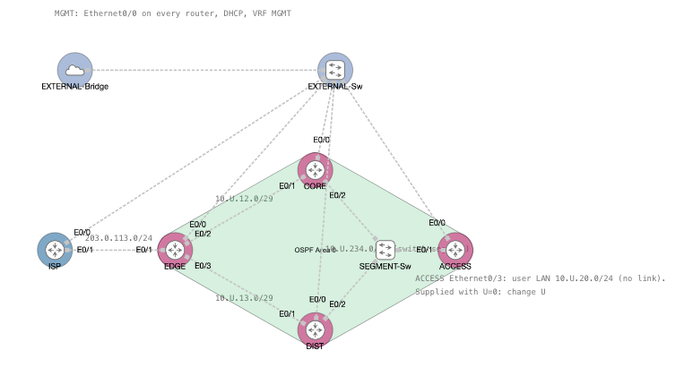

# Lab 06 — OSPF Path Selection and Network Operations

``` plaintext
Environment:
- Cisco CML-Free.
- Four IOL-XE routers (EDGE, CORE, DIST, ACCESS) plus an ISP router.
- Two unmanaged switches: one for the segment, one for management.
- Your own host, running `x_remote` over the external connector (used once, at the end).
```

## Section A — Start Here

**Get the lab files.** Download `l06-cml.zip` from the Lab 06 assignment in Brightspace and unzip it into a folder on your own host. It holds:

- `L06-OSPF-Path-Selection.yaml`: the lab, which you import into CML-Free.
- `l06-xremote.yaml`: the `x_remote` manifest, which you prepare in C00 and run once in C04. Run it with the `x_remote.py` you already have from the earlier labs: copy the manifest into the folder that holds `x_remote.py` and run it from there.
- `templates/l06-c01.txt` to `l06-c04.txt`: your evidence files. Each has a section for every state, with a sub-header for each router (see B5).

Download only from the Brightspace assignment. The package contains no scripts.

### A1 — Overview

Lab 06 studies how OSPF makes its decisions. You find out who becomes DR and BDR on a shared segment and why, and which path a route takes when interface costs change. You prove each answer from command output, not from the configuration you typed.

#### A1.1 — Mini Quick-Ref

| Question                                                   | Command                                                         |
| ---------------------------------------------------------- | --------------------------------------------------------------- |
| Which identity is active?                                  | `show ip ospf`                                                  |
| Which interfaces participate, and at what cost?            | `show ip ospf interface brief`                                  |
| Which neighbours are established?                          | `show ip ospf neighbor`                                         |
| What network type, timers, role, priority, and cost apply? | `show ip ospf interface <interface>`                            |
| Which network type is this interface using?                | `show ip ospf interface <interface> \| include Network Type`    |
| Which role does this router hold on the segment?           | `show ip ospf interface <interface> \| include State\|[Dd]esignated` |
| Which route and next hop are installed?                    | `show ip route <destination> <mask>`                            |
| Which forwarding next hops are installed?                  | `show ip cef <destination>`                                     |
| Does the user path work?                                   | ACCESS `ping <destination> source Ethernet0/3`                  |
| What bandwidth is behind a cost?                           | `show interfaces <interface> \| include BW`                     |

### A2 — Why This Lab Is Important

- Operational networks need more than accepted commands: you connect each change to an observed protocol state and a test of the intended path.
- A network that works can still be inconsistent. Standard process numbers and Router IDs make every router readable and every neighbour table traceable.
- DR and BDR roles decide who coordinates a broadcast segment. You must be able to predict, and then prove, who holds them, and know why a link with only two routers does not need them.
- Priority ranks candidates when a role must be filled. Cost ranks routes. Confusing the two is a common design error.
- Equal-cost paths and link failure show whether the network keeps forwarding. The proof is neighbour state, then route and forwarding entries, then successful traffic.
- A cost is a decision made on one router that other routers react to. With four routers you can see that effect, not only predict it.

### A3 — Objectives / Evidence Map

| Objective | Checkpoint | Points |
|---|---|---:|
| Confirm the virtual network, your `U` addresses, and host access | C00 | 0 — gate (nothing submitted) |
| Find and fix an inconsistent OSPF build: process number, Router ID source, passive LAN, default route | C01 | 3 |
| Prove non-preemption, DR failure, and priority-zero eligibility on the segment, and apply the point-to-point rule | C02 | 5 |
| Calculate automatic costs before and after a reference-bandwidth change | C03 | 3 |
| Create ECMP, prove failure and recovery with one interface change, and capture the final network | C04 | 4 |
| **Total** | | **15** |

C00 is a mandatory unscored gate. Each scored objective requires all evidence listed in its checkpoint; successful configuration alone earns no credit.

## Section B — Topology and Addressing

### B1 — Topology



EDGE–CORE and EDGE–DIST are two-router links. CORE, DIST, and ACCESS each have one interface on SEGMENT-Sw: one shared broadcast segment. Every router also has `Ethernet0/0` to EXTERNAL-Sw, which connects to EXTERNAL-Bridge (management, VRF MGMT, DHCP from your own network).

### B2 — Addressing Table

Wherever this lab writes `10.U.`, type your own `U` value as the second octet. The routers are supplied with `U = 0`, which is not a valid student value: a data interface address that still starts with `10.0.` means it was not changed. Your `Ethernet0/0` address is a DHCP address from your own network and can legitimately start with `10.0.`. You change the data interface addresses in C00, before you start the lab.

| Device | Interface | Address / role | Routing domain |
|---|---|---|---|
| ISP | Ethernet0/1 | `203.0.113.254/24`; upstream gateway | Outside OSPF |
| ISP | Loopback69 | `192.0.2.69/32`; course server stand-in; the ISP also holds a static `10.0.0.0/8` return route through EDGE (covers every `U`) | Outside OSPF |
| EDGE | Ethernet0/1 | `203.0.113.1/24`; upstream | Outside OSPF |
| EDGE | Ethernet0/2 | `10.U.12.1/29` | Area 0; broadcast until C02, then point-to-point |
| CORE | Ethernet0/1 | `10.U.12.2/29` | Same link as EDGE Ethernet0/2 |
| EDGE | Ethernet0/3 | `10.U.13.1/29` | Not in OSPF until C02; point-to-point from the moment you enable it |
| DIST | Ethernet0/1 | `10.U.13.3/29` | Same link as EDGE Ethernet0/3 |
| CORE | Ethernet0/2 | `10.U.234.2/29`; segment | Area 0; broadcast throughout; DR, BDR, and DROTHER |
| DIST | Ethernet0/2 | `10.U.234.3/29`; segment | Same segment |
| ACCESS | Ethernet0/1 | `10.U.234.4/29`; segment | Same segment |
| ACCESS | Ethernet0/3 | `10.U.20.1/24`; user LAN gateway, nothing attached | Area 0; advertised, passive |
| EDGE / CORE / DIST / ACCESS | Loopback100 | `10.U.100.1/32`, `.2`, `.3`, `.4`; Router ID source and cost-test destination (EDGE's) | Area 0 |
| EDGE / CORE / DIST / ACCESS | OSPF Router ID (set by the standard in C01) | The Loopback100 address on each device | Area 0 |
| DIST | Loopback30 | `10.U.30.1/32`; server | Area 0 |
| CORE, DIST | Ethernet0/3 | Unused | None |
| ACCESS | Ethernet0/2 | Unused | None |
| All five routers | Ethernet0/0 | DHCP address from EXTERNAL-Bridge, in VRF MGMT; you use it to SSH from your own host | Management network: never in OSPF |
| EDGE, CORE, DIST, ACCESS | OSPF process number | Your own `U` value (set by the standard in C01) | Area 0 |

Every data interface carries `bandwidth 1000000`. The IOL image reports its Ethernet interfaces as 10 Mbps, and OSPF derives cost from the bandwidth, so the supplied configuration sets 1 Gbps to give costs of 1 before the reference-bandwidth change and 10 after. Do not change or remove it.

### B3 — Check After the Lab Boots

Before C01, confirm on each router:

- [ ] The prompt shows `<username>-EDGE`, `<username>-CORE`, `<username>-DIST`, or `<username>-ACCESS`.
- [ ] Every B2 address carries your `U`. Ignore `Ethernet0/0`: it is a DHCP address from your own network.
- [ ] Ethernet0/0 has a DHCP address in VRF `MGMT`.
- [ ] There is no OSPF process yet.

Rules for the whole lab:

- [ ] Do not clear OSPF to repair a problem unless a step says to.
- [ ] Do not Wipe a node after C00, because it erases your work.

### B4 — Management Access

| Target | How to reach it | Username / password |
|---|---|---|
| Any router | CML console (the node's console tab) | `admin` / `cisco`; enable secret `class` |
| EDGE, CORE, DIST, ACCESS, ISP | `ssh admin@<Ethernet0/0 DHCP address>` from your own host | `admin` / `cisco`; enable secret `class` |
| `x_remote` | Reads the same four DHCP addresses from your edited manifest | `admin` / `cisco` |

### B5 — Your Evidence Files

You prepared your four files in C00 (`l06-c01-<username>.txt` to `l06-c04-<username>.txt`). Each file has a banner for every state of its checkpoint, such as `C01 FOUND`, and a sub-header for each router you capture in that state. The commands are in the steps.

- Under each router sub-header, paste the console output of the step's commands, **including the device prompt** (`<username>-EDGE#`). Do not edit the output.
- Keep the sections in file order.
- `x_remote` writes its own file, `l06-xremote-<username>.txt`, at the end of C04. Submit it as it is; do not paste it into another file.

## Section C — Lab Tasks and Evidence

### C00 — Import, start, set your addresses, and prove access

#### Goal

Bring the virtual network up, give every router your identity and your `U` addresses, and prove that your host can reach the routers before any OSPF exists.

#### Why This Matters

A failed SSH login, a wrong subnet, or a down link must not be mistaken for an OSPF fault. This checkpoint separates the platform from the protocol: an address mistake found here costs a minute, and the same mistake found in C01 looks like a neighbour that will not form.

#### Action

1. **Unzip `l06-cml.zip`** (see *Get the lab files* at the start of Section A). **Import** `L06-OSPF-Path-Selection.yaml` into CML-Free and open the lab. **Do not start any node yet.** The same instructions are in the lab notes panel.
2. **Find your `U` value** in Brightspace Grades, grade item **U**. Use it as-is. It is the second octet of every `10.U.` address and your OSPF process number from C01 onward.
3. **Edit each router's configuration before it starts.** For each of EDGE, CORE, DIST, and ACCESS, select the node, open its **Config** tab, and make two kinds of change. Save each node before you move on:
   - **Hostname.** Put your username in front of the name: `hostname EDGE` becomes `hostname <username>-EDGE`. Do the same on `CORE`, `DIST`, and `ACCESS`. Leave ISP alone.
   - **Addresses.** Change the `0` in the second octet to your own `U`, on exactly these lines. For `U = 17`, `10.0.12.1` becomes `10.17.12.1`:

   | Router | Interface | Supplied address | Becomes |
   |---|---|---|---|
   | EDGE | `Ethernet0/2` | `10.0.12.1 255.255.255.248` | `10.U.12.1` |
   | EDGE | `Ethernet0/3` | `10.0.13.1 255.255.255.248` | `10.U.13.1` |
   | EDGE | `Loopback100` | `10.0.100.1 255.255.255.255` | `10.U.100.1` |
   | CORE | `Ethernet0/1` | `10.0.12.2 255.255.255.248` | `10.U.12.2` |
   | CORE | `Ethernet0/2` | `10.0.234.2 255.255.255.248` | `10.U.234.2` |
   | CORE | `Loopback100` | `10.0.100.2 255.255.255.255` | `10.U.100.2` |
   | DIST | `Ethernet0/1` | `10.0.13.3 255.255.255.248` | `10.U.13.3` |
   | DIST | `Ethernet0/2` | `10.0.234.3 255.255.255.248` | `10.U.234.3` |
   | DIST | `Loopback100` | `10.0.100.3 255.255.255.255` | `10.U.100.3` |
   | DIST | `Loopback30` | `10.0.30.1 255.255.255.255` | `10.U.30.1` |
   | ACCESS | `Ethernet0/1` | `10.0.234.4 255.255.255.248` | `10.U.234.4` |
   | ACCESS | `Ethernet0/3` | `10.0.20.1 255.255.255.0` | `10.U.20.1` |
   | ACCESS | `Loopback100` | `10.0.100.4 255.255.255.255` | `10.U.100.4` |

   That is thirteen addresses. Change only the second octet; the rest of each line stays as supplied. Leave ISP, every `Ethernet0/0`, and EDGE `Ethernet0/1` alone. Before you start the lab, check that none of the 13 lines above still shows `10.0.`.
4. **Note your own host's IP address** on the network `EXTERNAL-Bridge` will use. Every router's `Ethernet0/0` sits in VRF `MGMT`, the management network. It never takes part in OSPF: you use it only to SSH from your own host and for `x_remote`. Its DHCP addresses come from your host's network.
5. **Start all nodes:** the five routers, `EXTERNAL-Bridge`, `EXTERNAL-Sw`, and `SEGMENT-Sw`. Wait about three minutes for the routers to boot and finish creating their SSH keys.
6. **Check every router's interfaces:**

   ```text
   show ip interface brief | exclude unassigned
   ```

   Every B2 address shows your `U` and is up/up; none of the 13 changed addresses still starts with `10.0.`. `Ethernet0/0` shows an address from your own host's network. Record the five `Ethernet0/0` addresses.
7. **Ping across every link** from the consoles. These are console checks; they are not collected. Each must show `Success rate is 100 percent (5/5)`:

   | From | Command |
   |---|---|
   | EDGE | `ping 10.U.12.2` |
   | EDGE | `ping 10.U.13.3` |
   | CORE | `ping 10.U.234.3` |
   | CORE | `ping 10.U.234.4` |
   | EDGE | `ping 192.0.2.69` |

8. **Test host access.** From your own host (not a console), `ping` and `ssh admin@<address>` to at least one router. Password `cisco`.
9. **Prepare your files** so everything is ready for the checkpoints. Copy `l06-xremote.yaml` into the folder that holds your `x_remote.py`; the manifest commands below run from that folder.

   - **Rename the four evidence templates** in `templates`: `l06-c01.txt` becomes `l06-c01-<username>.txt`, and so on to `l06-c04-<username>.txt`. In each file, fill in `STUDENT:` and `U:` on the first line.
   - **Edit the manifest `l06-xremote.yaml`:** replace `{EDGE-DHCP-address}`, `{CORE-DHCP-address}`, `{DIST-DHCP-address}`, and `{ACCESS-DHCP-address}` with the four `Ethernet0/0` addresses from action 6, replace `{U}` with your `U` value everywhere it appears, and replace `{USERNAME}` in the `output_file` line with your username.
   - **Validate the manifest.** This does not connect to any router. You run the collection itself once, at the end of C04:

     ```bash
     python3 x_remote.py --check l06-xremote.yaml
     ```

#### How to Save Your Lab

You can pause the lab and continue later. Pause between steps where you can, never in the middle of a capture.

1. Finish the step or capture you are in.
2. On each of EDGE, CORE, DIST, and ACCESS, save the configuration:

   ```text
   write memory
   ```

3. In CML, **Stop** the lab. Do not **Wipe** a node: Wipe erases your work and returns it to the supplied baseline.
4. To continue, **Start** the lab and wait about three minutes. Check `show ip interface brief | exclude unassigned` and `show running-config | section ospf` on each router: your addresses and OSPF configuration should be back.
5. The DHCP address on `Ethernet0/0` can change after a restart. Check the four addresses and update `l06-xremote.yaml` before you use `x_remote` in C04.

#### Verification

Read the console output from actions 6–7 and the terminal output from actions 8–9.

#### Success Indicator / Failure Signal

| Verification Item | Success Indicator | Failure Signal |
|---|---|---|
| Nodes | All eight nodes started; five router consoles open | A node stuck starting, or a console that will not open |
| Addresses | Every B2 address present, up/up, and carrying your `U` (set in action 3); `Ethernet0/0` has a DHCP address on your host's network | One of the 13 addresses still starting with `10.0.`, a missing address, a down row, or no DHCP address |
| Links | All five console pings show `Success rate is 100 percent (5/5)` | Any loss: re-check the addresses at both ends of that link |
| Host access | Ping and SSH succeed from your own host | Timeout, or `Permission denied` |
| Files | Four renamed evidence files with `STUDENT:` and `U:` filled in; `--check` reports the manifest valid | A template still named `l06-cNN.txt`, a placeholder left in the manifest, or a layout error |
| Hostname | Every prompt shows `<username>-EDGE`, `<username>-CORE`, `<username>-DIST`, or `<username>-ACCESS` | An unrenamed hostname |

#### Troubleshooting

- **A ping fails across a link:** compare the address and mask at both ends of that link with B2, and check that both interfaces are up/up. A typo in one octet is the usual cause.
- **One of the 13 addresses still starts with `10.0.`:** you missed a line in action 3. Stop that router's node and **Wipe** it (nothing of yours is on it yet), correct the line in its Config tab, and start it again. Wipe is allowed here only because you have not started C01.
- **A router has no DHCP address on `Ethernet0/0`:** confirm `EXTERNAL-Bridge` is started and bridged to your host's network. Then toggle the DHCP client on that interface: add or remove `ip dhcp client broadcast-flag clear`, then `shutdown` and `no shutdown`.
- **The routers get addresses only on some networks:** try a different network before debugging further.
- **SSH works from the console but not from your host:** check that the address you used is the VRF `MGMT` address.
- **A router will not boot or a console will not open:** refresh the CML page once, and report the lab name, node name, and visible error before you use Wipe.

#### Collection of Information

No submission is required for this checkpoint. C00 is worth 0 points; the success indicators above are your check. `x_remote` runs once, at the end of C04.

### C01 — Find and fix an inconsistent OSPF build

#### Goal

Build OSPF the way an unplanned network is often built, with different process numbers and different Router ID sources. Predict and see that it works anyway. Then rebuild it to a documented standard and compare the two.

#### Why This Matters

OSPF accepts mixed settings, which is why they survive in real networks. Each choice has a cost:

- **Process number.** It is local to one router and never has to match a neighbour's. Mixed numbers still make every router harder to read and compare. The standard is your `U` everywhere.
- **Router ID.** A router chooses it by rule: the manual `router-id`, otherwise the highest loopback address, otherwise the highest active interface address. The last two change when interfaces change, and the choice is made only when the process starts. The standard is one mechanism everywhere: a manual `router-id` set to the Loopback100 address. Only interfaces in the same routing table as the process count: `Ethernet0/0` is in VRF `MGMT`, so its DHCP address is ignored even when it is the highest address on the router (see *The management interface* below).
- **User LAN.** The ACCESS LAN has hosts but no routers. A broadcast interface that is not passive waits out an election and sends Hellos to the hosts. Passive advertises the LAN and does neither.
- **Default route.** An adjacency does not supply one. EDGE has to originate it.

| Item | Part A: unplanned | Part B: standard |
|---|---|---|
| Process number | EDGE 1, DIST 10, ACCESS 20, CORE 100 | Your `U` on all four |
| Router ID source | EDGE manual `0.0.0.1`; DIST and ACCESS highest loopback; CORE highest interface | Manual `router-id` = Loopback100 on all four |
| User LAN | Active, hellos, election | Passive |
| Default route | Not propagated | EDGE `default-information originate` |

All links stay at the default broadcast type in this checkpoint. The segment has three routers, so it elects a DR and a BDR; the third router is a DROTHER.

**Why EDGE–DIST is not in OSPF yet.** It is held back on purpose; it is not an error. With one way into the network, every route on EDGE uses the same next hop, and the output is easy to predict. EDGE–DIST joins OSPF in C02, where you set it up as a point-to-point link, and the triangle it forms is the path-cost lab in C03 and C04. With no adjacency on that link, nothing advertises `10.U.13.0/29`, so EDGE learns every other network only through CORE.

| Interface | Why it is not in OSPF in this checkpoint |
|---|---|
| EDGE `Ethernet0/1` | Upstream link to the ISP, outside OSPF |
| Every `Ethernet0/0` | Management network (VRF `MGMT`), used to SSH from your host |
| EDGE `Ethernet0/3` and DIST `Ethernet0/1` | The EDGE–DIST link, held back until C02 |
| CORE and DIST `Ethernet0/3`, ACCESS `Ethernet0/2` | Unused |

**The management interface.** `Ethernet0/0` on every router is in a separate VRF called `MGMT`. It has its own routing table and a DHCP address from your host's network, so you can reach the routers (SSH from your host, `x_remote`) whatever OSPF is doing. OSPF runs in the default routing table and never sees this interface: its address is not a Router ID candidate, and it is never advertised. You can see this on any router:

```text
show ip vrf interfaces
show ip route
```

The first lists `Et0/0` under VRF `MGMT`. The second shows the default table, which has no route for your host's network.

#### Action

**Part A — An unplanned OSPF network**

*What this part shows:* networks that grow without a plan or a standard end up like this one. Each router has its own process number, the Router IDs come from whichever rule happened to apply, and an interface faces hosts without being passive. OSPF accepts all of it and the network works, but it is hard to read, hard to troubleshoot, and a Router ID can change when an interface does. You build such a network on purpose, then predict and verify what it does.

1. **Build the unplanned network on the consoles.** Enable OSPF on the interfaces listed for each device, using that device's own process number. Create the process and set the manual Router ID **before** you enable interfaces:

   | Device | Process | Router ID | Interfaces in OSPF |
   |---|---|---|---|
   | EDGE | `1` | Set manually to `0.0.0.1` | Loopback100, `Ethernet0/2` |
   | DIST | `10` | Not set | Loopback100, Loopback30, `Ethernet0/2` |
   | ACCESS | `20` | Not set | Loopback100, `Ethernet0/1`, `Ethernet0/3` |
   | CORE | `100` | Not set; delete Loopback100 first | `Ethernet0/1`, `Ethernet0/2` |

   Leave everything else at its default: no network types, priorities, costs, passive, or default originate, and no `network` command (using it is penalized). The interfaces in the table above are the only ones in OSPF; the others stay out for the reasons given in *Why This Matters*.

2. **Predict, before you run any `show` command.** Write your answers in your lab book. They are not graded, but they show what this part teaches:

   - [ ] What Router ID will EDGE, CORE, DIST, and ACCESS each choose, and why?
   - [ ] Will routers that use different process numbers still become neighbours?
   - [ ] Which router will be DR on the segment when CORE, DIST, and ACCESS start together, and which will be BDR? What would change if one of them started a minute earlier?
   - [ ] What will DIST's route to EDGE's loopback use as its next hop? What will CORE know about `10.U.13.0/29`?

3. **Wait about 60 seconds.** Each broadcast link waits about 40 seconds before it elects.
4. **Verify before you capture** (not collected). On each router run these commands, without the `include` filters, and compare the Router IDs, the roles in each neighbour entry, and the routes with your prediction:

   ```text
   show ip ospf
   show ip ospf neighbor
   show ip ospf interface brief
   show ip route ospf | begin Gateway
   ```

5. **CAPTURE the FOUND state.** In `l06-c01-<username>.txt`, find the `C01 FOUND` section and paste the output of these commands.

   On EDGE, CORE, DIST, and ACCESS:

   ```text
   show ip ospf | include Routing Process|Router ID
   show ip ospf neighbor
   show ip ospf interface brief
   show ip route ospf | begin Gateway
   ```

   On CORE also:

   ```text
   show ip route 10.U.13.0 255.255.255.248
   ```

   On ACCESS also:

   ```text
   show ip ospf interface Ethernet0/3 | include Network Type|State|Passive|No Hellos
   ```

   CORE has no default route and no `10.U.13.0/29` route yet. `Gateway of last resort is not set` and `% Network not in table` are the evidence.

6. **Compare in your lab book** (not submitted). For each router, name the Router ID source (manual, highest loopback, or highest interface) and say which prediction was wrong, if any. Say which router is DR on the segment and why.

**Part B — OSPF best practices**

*What this part shows:* the same network built to a documented standard: one process number, one Router ID mechanism, a passive user LAN, and an originated default route. The topology and the routes are the same; what changes is that you can state every value in advance and nothing depends on which interface happens to be up. Remove the old OSPF first, so no leftover line brings the old process back.

7. **Remove all the OSPF configuration** from EDGE, CORE, DIST, and ACCESS:

   - [ ] Remove the OSPF activation from every interface that has it (`no ip ospf <old process> area 0`).
   - [ ] Then remove the old process (`no router ospf <old process>`).
   - [ ] Check with `show running-config | section ospf` that no `ip ospf` line and no `router ospf` remains. This check is for you; it is not evidence.

   Removing the process alone leaves the interface lines in place, and they can bring the old process back. That is why the interfaces come first.

8. **Configure the standard** on all four devices:

   | What to configure | Where | Why |
   |---|---|---|
   | Loopback100 `10.U.100.2/32` | CORE (restore it) | Every router needs the Router ID source |
   | OSPF process `U` | All four | One number everywhere makes every router readable and comparable |
   | Router ID set manually to the Loopback100 address (`10.U.100.N`) | All four | A loopback never goes down, and a manual value does not depend on which interfaces are up when the process starts |
   | User LAN passive, set before the LAN is activated | ACCESS `Ethernet0/3` | The LAN is advertised, but no Hellos or election go toward hosts |
   | Area 0 on Loopback100 (all), Loopback30 (DIST), `Ethernet0/3` (ACCESS), EDGE–CORE, and the segment interfaces (CORE and DIST `Ethernet0/2`, ACCESS `Ethernet0/1`) | All four | The same interfaces as Part A, now under process `U` |
   | `default-information originate`, without `always` | EDGE | An adjacency does not supply a default route; EDGE already has the static default |

   Leave the network types at their default. EDGE–DIST stays out of OSPF. If a device says the change needs `clear ip ospf process`, run it on that device only.

9. **Predict, before you run any `show` command.** In your lab book: what is each Router ID now? Does the DR change? What will ACCESS and CORE learn that they did not know in Part A?
10. **Wait about 60 seconds** for the neighbours to re-form. Then verify (not collected) with the commands from step 4 on each router.
11. **CAPTURE the STANDARD state.** Find the `C01 STANDARD` section and paste the output of these commands.

    On EDGE, CORE, DIST, and ACCESS:

    ```text
    show ip ospf | include Routing Process|Router ID
    show ip ospf neighbor
    show ip ospf interface brief
    show ip route ospf | begin Gateway
    ```

    On ACCESS also:

    ```text
    show ip ospf interface Ethernet0/3 | include Network Type|State|Passive|No Hellos
    ping 192.0.2.69 source Ethernet0/3 repeat 3 timeout 1
    ping 10.U.100.1 source Ethernet0/3 repeat 3 timeout 1
    ```

12. **Optional console check, not collected.** On the ACCESS console, `traceroute 192.0.2.69 source Ethernet0/3 numeric`. The first hop is a segment address of CORE or DIST (`10.U.234.2` or `10.U.234.3`), depending on cost.
13. **Compare Part A and Part B in your lab book** (not submitted). State what changed, and why each standard is easier to read, manage, and troubleshoot.

#### Verification

Use any commands you need to investigate. Then review your C01 file before you move on:

- [ ] Both sections exist and each capture shows the prompt of every router it names.
- [ ] Each result matches its row in the table below.

#### Success Indicator / Failure Signal

| State | Verification Item | Success Indicator | Failure Signal |
|---|---|---|---|
| FOUND | Mixed process numbers and Router IDs | `Routing Process "ospf 1" with ID 0.0.0.1` (EDGE), `"ospf 100" with ID 10.U.234.2` (CORE), `"ospf 10" with ID 10.U.100.3` (DIST), `"ospf 20" with ID 10.U.100.4` (ACCESS) | Any process number or Router ID not as built |
| FOUND | Broadcast links | EDGE lists CORE (`10.U.234.2`, address `10.U.12.2`) as `FULL/DR` or `FULL/BDR`. On the segment each of CORE, DIST, and ACCESS lists the other two as `FULL`, with one DR, one BDR, and one DROTHER between them (the roles depend on Router IDs and start order) | `FULL/-`, a network type was set, or a segment neighbour is not `FULL` |
| FOUND | User LAN active | ACCESS `Ethernet0/3`: `Network Type BROADCAST`, `State DR`, and no passive line | Already passive |
| FOUND | One way in | Every OSPF route on EDGE uses next hop `10.U.12.2`; DIST's route to `10.U.100.1/32` uses next hop `10.U.234.2` | A route through the unenabled EDGE–DIST link |
| FOUND | Nothing propagated | CORE: `Gateway of last resort is not set` and `% Network not in table` for `10.U.13.0/29`; DIST and ACCESS have no default route | A default or the EDGE–DIST prefix is already present |
| FOUND | Interfaces in OSPF | `show ip ospf interface brief` lists only the Part A interfaces on each router; EDGE `Ethernet0/3` and DIST `Ethernet0/1` are absent | The EDGE–DIST link is listed |
| STANDARD | One process and one mechanism | `Routing Process "ospf U" with ID 10.U.100.N` (N = 1 EDGE, 2 CORE, 3 DIST, 4 ACCESS) on all four | Old process number, or a Router ID not equal to Loopback100 |
| STANDARD | Adjacencies re-formed | EDGE lists CORE only; CORE lists EDGE, DIST, and ACCESS; DIST lists CORE and ACCESS; ACCESS lists CORE and DIST; every one `FULL` (`FULL/DR`, `FULL/BDR`, or `FULL/DROTHER` on the segment), by Loopback100 Router ID | A neighbour missing, or DIST listed on EDGE |
| STANDARD | Interfaces in OSPF | Each router lists its Part B interfaces in Area 0 (including ACCESS `Ethernet0/3`); EDGE `Ethernet0/3` and DIST `Ethernet0/1` are still absent | The EDGE–DIST link is listed |
| STANDARD | User LAN passive | ACCESS `Ethernet0/3` shows `No Hellos (Passive interface)` | Not passive |
| STANDARD | Default propagated | An `O*E2` default route on CORE, DIST, and ACCESS (`O*E2` is an OSPF external type-2 route), and `Gateway of last resort` set | No default, or an `S*` static default |
| STANDARD | Service | ACCESS pings to `192.0.2.69` and `10.U.100.1` show `Success rate is 100 percent (3/3)` | Any loss |
| Both | Identity | Every prompt shows `<username>-<ROLE>#` | An unrenamed hostname, or one of the 13 addresses still starting with `10.0.` |

`default-information originate` must not use `always`, and EDGE–DIST must still be out of OSPF at both ends; both are checked by eye.

#### Troubleshooting

- **A Router ID did not change:** the new process did not start with it. Check the Router ID line in `show ip ospf`.
- **The old process number is back in `show ip ospf`:** an interface still carries its `ip ospf <old> area 0` line. Remove it with its `no` form on every interface, then remove the old process again.
- **A device says the change needs `clear ip ospf process`:** run it on that device only.
- **A neighbour is missing:** compare process activation, area, and subnet at both ends, and wait through the 40-second election.
- **Limits:** do not clear OSPF on any other device, and do not enable EDGE–DIST in this checkpoint.
- **A ping shows less than `100 percent (3/3)`:** the first packet can be lost while ARP resolves. Run the ping again and paste the run that shows `Success rate is 100 percent (3/3)`.

#### Collection of Information

Keep `l06-c01-<username>.txt` with its two captures. Upload all five files together after C04, as Section D says.

### C02 — Observe elections and apply the point-to-point rule

#### Goal

Prove that a router's role on a segment comes from the order of events, its priority, and its eligibility, not from its Router ID alone, and apply the rule that decides which links elect and which do not.

#### Why This Matters

Priority ranks eligible candidates when a role must be filled. It does not evict a healthy incumbent. Router ID breaks a priority tie; a larger Router ID alone does not mean an arriving router will become DR. The DR coordinates OSPF database exchange on its segment; it is not automatically the preferred data-plane gateway. Priority 0 makes a router ineligible for either role.

The segment has three routers, so all three roles appear: DR, BDR, and DROTHER. If the DR disappears the BDR is promoted, and a new BDR is elected from the eligible DROTHERs. If no DROTHER is eligible, there is a DR and no BDR. The roles you see are decided by the order of events, not by the router's name.

Elections exist only on broadcast links. A **point-to-point** link has exactly two routers, so there is no election, no Wait interval, and no DR or BDR: the neighbour is `FULL/-`. The rule is simple: **two routers on a link means point-to-point; more than two means broadcast with an election.**

Treat a virtual link as a cable: do not `shutdown` it to fail the DR. A shutdown on one end leaves the other end up, so the neighbour would wait out its dead interval without a failed link to explain it. Remove the OSPF activation instead.

#### Action

**Part 1 — Elections on the segment.** CORE, DIST, and ACCESS are on the segment. Their interfaces are CORE `Ethernet0/2`, DIST `Ethernet0/2`, and ACCESS `Ethernet0/1`. Leave the network type at its default, broadcast, and the priority at its default unless a step says otherwise.

1. **Write your prediction in your lab book** (not submitted) before you change anything. State which router you expect to be DR on the segment when CORE, DIST, and ACCESS join in that order, one at a time, and why. DIST and ACCESS have larger Router IDs than CORE.
2. **Reset the segment.** On CORE, DIST, and ACCESS, remove only the OSPF activation from the segment interface (`no ip ospf U area 0`). Wait about 45 seconds. ACCESS is cut off from the network until step 3; no C02 capture needs it.
3. **Activate the segment one router at a time**, waiting about 40 seconds after each: first CORE `Ethernet0/2`, then DIST `Ethernet0/2`, then ACCESS `Ethernet0/1`, each with `ip ospf U area 0`.
4. **Verify, then CAPTURE the INCUMBENT state.** Before every segment capture in this checkpoint, verify (not collected): run `show ip ospf interface <interface>` without a filter and read `State`, `Priority`, and the DR and BDR lines. Then, in your file, find the `C02 INCUMBENT` section and paste the **segment capture** (the same commands for every election state).

   On CORE and DIST:

   ```text
   show ip ospf neighbor
   show ip ospf interface Ethernet0/2 | include not enabled|State|Priority|[Dd]esignated
   ```

   On ACCESS:

   ```text
   show ip ospf neighbor
   show ip ospf interface Ethernet0/1 | include not enabled|State|Priority|[Dd]esignated
   ```

5. **Raise ACCESS's priority above the others** and wait about a minute. Do not restart OSPF. ACCESS has the largest Router ID and, now, the highest priority:

   ```text
   interface Ethernet0/1
    ip ospf priority 200
   ```

6. **CAPTURE the PRIORITY state** under the `C02 PRIORITY` section, with the segment capture.
7. **Fail the DR without dropping the link.** On CORE, remove only the OSPF activation from `Ethernet0/2`. Do not shut the interface:

   ```text
   interface Ethernet0/2
    no ip ospf U area 0
   ```

   Wait at least 45 seconds, until DIST's dead interval expires. Run `show ip ospf interface Ethernet0/2` on the DIST console until it reports `State DR`.

8. **CAPTURE the DR-FAILED state** under the `C02 DR-FAILED` section, with the segment capture.
9. **Return CORE as an ineligible router.** CORE's activation was removed in step 7, so set priority 0 first, then activate:

   ```text
   interface Ethernet0/2
    ip ospf priority 0
    ip ospf U area 0
   ```

   Wait about 40 seconds, until CORE lists DIST and ACCESS as `FULL`. Then fail the DR again: on DIST, remove the OSPF activation from `Ethernet0/2` (`no ip ospf U area 0`) and wait at least 45 seconds, until ACCESS reports a role.

10. **CAPTURE the PRIORITY-ZERO state** under the `C02 PRIORITY-ZERO` section, with the segment capture.
11. **Restore the segment.** On DIST, `ip ospf U area 0` on `Ethernet0/2`. On CORE `Ethernet0/2` and ACCESS `Ethernet0/1`, `no ip ospf priority`. Wait about 45 seconds, until CORE, DIST, and ACCESS list each other as `FULL`. Roles after this step are not graded.

**Part 2 — Apply the type rule.**

12. **Count the routers on every link.** EDGE–CORE has two, EDGE–DIST has two, and the segment has three. Set point-to-point on both ends of both two-router links, back to back, so neither link is left with one end changed. EDGE–CORE is already in OSPF as broadcast; EDGE–DIST joins OSPF with its type set before it is activated.

    On EDGE:

    ```text
    interface Ethernet0/2
     ip ospf network point-to-point
    interface Ethernet0/3
     ip ospf network point-to-point
     ip ospf U area 0
    ```

    On CORE:

    ```text
    interface Ethernet0/1
     ip ospf network point-to-point
    ```

    On DIST:

    ```text
    interface Ethernet0/1
     ip ospf network point-to-point
     ip ospf U area 0
    ```

    Leave the segment broadcast, and leave ACCESS `Ethernet0/3`, the user LAN, as it is: it is a LAN and stays passive. Wait about 45 seconds.

13. **Verify, then CAPTURE the P2P state.** Verify (not collected) with `show ip ospf neighbor` on each router. Then, under the `C02 P2P` section, paste the output of these commands.

    On EDGE, CORE, DIST, and ACCESS:

    ```text
    show ip ospf neighbor
    show ip ospf interface brief
    ```

    On ACCESS also:

    ```text
    ping 192.0.2.69 source Ethernet0/3 repeat 3 timeout 1
    ```

14. **Explain it in your lab book** (not submitted). Say whether your prediction was right. Explain why ACCESS did not replace CORE despite the largest Router ID and the highest priority, which router was promoted when the DR failed, what priority 0 changed, and which links are point-to-point and why.

#### Verification

Use any commands you need to investigate. Then review your C02 file before you move on:

- [ ] All five sections exist (INCUMBENT, PRIORITY, DR-FAILED, PRIORITY-ZERO, P2P) and each capture shows the prompt of every router it names.
- [ ] Each result matches its row in the tables below.

#### Success Indicator / Failure Signal

| State | CORE (`Ethernet0/2`) | DIST (`Ethernet0/2`) | ACCESS (`Ethernet0/1`) | Failure signal |
|---|---|---|---|---|
| INCUMBENT | `State DR, Priority 1` | `State BDR, Priority 1` | `State DROTHER, Priority 1` | ACCESS is DR or BDR, or the activation order was not CORE, DIST, ACCESS |
| PRIORITY | `State DR, Priority 1` | `State BDR, Priority 1` | `State DROTHER, Priority 200` | ACCESS took over (priority treated as pre-emptive), or priority still 1 |
| DR-FAILED | `OSPF not enabled on Ethernet0/2` | `State DR` | `State BDR, Priority 200` | DIST still BDR (dead interval not expired), or CORE still listed as a neighbour |
| PRIORITY-ZERO | `State DROTHER, Priority 0` | `OSPF not enabled on Ethernet0/2` | `State DR` and `No backup designated router` | CORE is BDR or DR despite priority 0, or a BDR is shown |

With one eligible router left and one ineligible, there is a DR and no BDR; that is expected, not a fault.

| State | Verification Item | Success Indicator | Failure Signal |
|---|---|---|---|
| P2P | Links | EDGE lists CORE (`10.U.100.2`, address `10.U.12.2`) and DIST (`10.U.100.3`, address `10.U.13.3`) as `FULL/-`; the interface brief shows `P2P` for `Ethernet0/2` and `Ethernet0/3` | A `FULL/DR` or `FULL/BDR` on an EDGE link, a type set on one end only, or a neighbour missing |
| P2P | Segment | CORE, DIST, and ACCESS list each other as `FULL`, with a role (`FULL/DR`, `FULL/BDR`, or `FULL/DROTHER`) and never `FULL/-` | `FULL/-` on the segment (point-to-point set on a three-router segment) |
| P2P | Service | The ACCESS ping to `192.0.2.69` shows `Success rate is 100 percent (3/3)` | Any loss |

#### Troubleshooting

**Elections (Part 1)**

- **Roles differ from the table:** preserve the output and check the activation order in step 3. The segment must be activated CORE, then DIST, then ACCESS, with the wait after each.
- **Check the stage and the actual interface** before you change priorities. Raising priority is not a corrective action for non-preemption.
- **A role looks wrong in `show ip ospf neighbor`:** that table reports the **neighbour's** role. Use the router's own interface output to identify its own role.
- **DIST still shows BDR in DR-FAILED:** wait 15 more seconds and collect again.
- **Limits:** never `shutdown` the link to simulate the failure, and do not force a process-wide reset during the experiment.

**Point-to-point (Part 2)**

- **A neighbour will not come back, or shows a role other than `FULL/-` on an EDGE link:** check `show ip ospf interface <interface> | include Network Type` on both ends of that link. Both ends must show `POINT_TO_POINT`.
- **You changed only one end of a link:** set the same type on the other end.
- **The segment shows `FULL/-`:** point-to-point was set on a three-router segment. Put the segment interface back to the default with `no ip ospf network`.
- **A ping shows less than `100 percent (3/3)`:** the first packet can be lost while ARP resolves. Run the ping again and paste the run that shows `Success rate is 100 percent (3/3)`.

#### Collection of Information

Keep `l06-c02-<username>.txt` with its five captures. Upload all five files together after C04, as Section D says.

### C03 — Measure default costs and change reference bandwidth

#### Goal

Calculate the two CORE-to-EDGE path costs before and after a consistent reference-bandwidth change, and match the result to CORE's installed route.

#### Why This Matters

Election priority matters only on broadcast links, and C02 limited it to the segment; OSPF cost controls route preference. Automatic cost is the reference bandwidth divided by the interface bandwidth, with a minimum cost of 1. An explicit interface cost overrides the automatic calculation. The advertised loopback cost is part of the path total.

Changing reference bandwidth must be consistent on every router.

#### Action

1. **Verify, then CAPTURE the BEFORE state.** All four routers still use the default reference bandwidth, 100 Mbps. Verify (not collected): run `show ip ospf` on one router and read the reference bandwidth line. Then, in `l06-c03-<username>.txt`, find the `C03 BEFORE` section and paste the output of these commands.

   On EDGE, CORE, DIST, and ACCESS:

   ```text
   show ip ospf | include Reference
   show ip ospf interface brief
   ```

   On CORE and ACCESS also:

   ```text
   show ip route 10.U.100.1 255.255.255.255
   ```

2. **Read the costs from the `Cost` column of `show ip ospf interface brief`,** not from an assumption. Then calculate both paths from CORE to EDGE Loopback100:

   ```text
   A = CORE outgoing OSPF cost toward EDGE (Ethernet0/1, the 10.U.12.0/29 link)
   B = CORE outgoing OSPF cost onto the segment (Ethernet0/2, toward DIST)
   C = DIST outgoing OSPF cost toward EDGE (Ethernet0/1)
   L = EDGE Loopback100 OSPF cost
   Direct path    = A + L
   Alternate path = B + C + L
   ```

   Only the outgoing cost of each link counts; the receiving interface adds nothing. Write your numbers in your lab book as `A=_ B=_ C=_ L=_ direct=_ alternate=_`. Match the lower total to the metric on CORE's `10.U.100.1/32` route. Do not calculate these internal path costs from the external type-2 default metric.

3. **On EDGE, CORE, DIST, and ACCESS, change the reference bandwidth** under process `U`. IOS warns that it must be consistent on every router; that is the reason you change all four:

   ```text
   router ospf U
    auto-cost reference-bandwidth 10000
   ```

   Wait about 10 seconds.

4. **CAPTURE the AFTER state** under the `C03 AFTER` section, with the same commands. Recalculate in your lab book.
5. **Look at ACCESS** in both captures: its `show ip route 10.U.100.1 255.255.255.255`. ACCESS is not on the CORE–EDGE triangle, but it reaches both CORE and DIST through the segment. Note how many next hops it has.
6. **Explain in your lab book** (not submitted) how election priority differs from route cost, using what C02 showed about priority and the CORE route metric in both states.

For an observed 1-Gbps interface without override, the automatic cost changes from 1 to 10. If A=B=C=10 and L=1, the direct total is 11 and the alternate total is 21. These are examples; your lab-book calculation should match your device output. Run `show interfaces Ethernet0/1 | include BW` if you want to see the bandwidth behind a cost.

#### Verification

Use any commands you need to investigate. Then review your C03 file before you move on:

- [ ] Both sections exist and each capture shows the prompt of every router it names.
- [ ] Each result matches its row in the table below.

#### Success Indicator / Failure Signal

| Verification Item | Success Indicator | Failure Signal |
|---|---|---|
| Reference bandwidth | `Reference bandwidth unit is 100 mbps` in BEFORE and `10000 mbps` in AFTER, on all four routers | Mixed values, or a missing baseline |
| BEFORE costs | Every transit and segment interface costs `1`, DIST `Ethernet0/1` costs `1`, EDGE Loopback100 costs `1` | Costs that do not match your lab-book calculation inputs |
| AFTER costs | Every transit and segment interface costs `10`, DIST `Ethernet0/1` costs `10`, EDGE Loopback100 still costs `1` | A cost still at `1` (old override, or a router not changed) |
| Installed route | CORE's `10.U.100.1/32` route shows `metric 2` BEFORE and `metric 11` AFTER, equal to the lower path total, through `10.U.12.1` | A default-route lookup, or a metric that does not match your sums |
| ACCESS next hops | ACCESS's route to `10.U.100.1/32` lists two next hops, `10.U.234.2` and `10.U.234.3`, with `metric 3` BEFORE and `metric 21` AFTER | One next hop, or a metric that does not follow the costs |
| Link type | EDGE–CORE and EDGE–DIST show `P2P` in the interface brief in both states; the segment interfaces show a DR, BDR, or DROTH role | An EDGE link still broadcast, or priority offered as the reason for a path |

The cost and metric values above are the expected results for the preset 1-Gbps interfaces; a different measured value is still correct if your lab-book calculation matches your device output.

#### Troubleshooting

- **A cost did not change:** check the active process, the interface bandwidth, and the effective OSPF cost. It can mean an old override, or a router you did not change.
- **Before you go on:** preserve the output and resolve the unchanged cost before C04.
- **Limits:** do not change priorities to alter the forwarding path.

#### Collection of Information

Keep `l06-c03-<username>.txt` with its two captures. Upload all five files together after C04, as Section D says.

### C04 — Create ECMP, verify failure and recovery, and capture the final network

#### Goal

Install two equal-cost forwarding next hops on CORE, prove the surviving path after one link failure, restore the documented final state, explain what the cost change did to ACCESS, and capture the complete network once.

#### Why This Matters

The routing table and CEF show installed next hops; a single traceroute need not exercise both equal-cost paths. Recovery proof combines neighbour state, route and forwarding entries, and successful traffic after convergence. A failure during convergence does not count as the result.

A cost you set on CORE is also a cost every other router adds up. ACCESS did not change, but its best path can.

The end-of-lab snapshot shows the whole network at once: it is the one place all four routers appear in a single tool-generated record, so it also proves that the network you describe in your captures is the network you built.

#### Action

1. **Calculate `N = B + C`** from your C03 AFTER values, so the new direct total `N + L` equals the alternate total `B + C + L`. Write N in your lab book; you apply it in step 2.
2. **Apply N on CORE's interface toward EDGE only.** Replace `N` with your calculated integer; do not type the letter:

   ```text
   interface Ethernet0/1
    ip ospf cost N
   ```

   Wait about 10 seconds.

3. **Verify, then CAPTURE the ECMP state.** Verify (not collected): on CORE run `show ip route 10.U.100.1 255.255.255.255` and read the metric and the next hops. Then find the `C04 ECMP` section and paste the **path capture** (the same commands for every C04 state).

   On CORE:

   ```text
   show ip ospf neighbor
   show ip route 10.U.100.1 255.255.255.255
   show ip cef 10.U.100.1
   ```

   On EDGE:

   ```text
   show ip interface brief | include Ethernet0/2
   ```

   On ACCESS:

   ```text
   show ip route 10.U.100.1 255.255.255.255
   ping 192.0.2.69 source Ethernet0/3 repeat 3 timeout 1
   ping 10.U.100.1 source Ethernet0/3 repeat 3 timeout 1
   ```

4. **Fail the direct link.** On the EDGE console, shut only `Ethernet0/2`. The EDGE–DIST link and the segment stay up:

   ```text
   interface Ethernet0/2
    shutdown
   ```

   Wait about 60 seconds. CORE's interface stays up, because a virtual link does not signal the failure; CORE removes EDGE only when its 40-second dead interval expires.

5. **CAPTURE the LINK-DOWN state** under the `C04 LINK-DOWN` section, with the path capture. CORE must keep the path through `10.U.234.3` only.
6. **Optional console check, not collected.** On the CORE console, `traceroute 10.U.100.1 source Loopback100 numeric`. The path is `10.U.234.3`, then the loopback.
7. **Restore the link** on EDGE with `no shutdown` under `Ethernet0/2`. Wait for the direct adjacency and both next hops to return.
8. **CAPTURE the RESTORED state** under the `C04 RESTORED` section, with the path capture.
9. **Remove only the explicit cost override** on CORE. Keep the reference bandwidth at 10000 on all four routers:

   ```text
   interface Ethernet0/1
    no ip ospf cost
   ```

   Wait about 10 seconds.

10. **CAPTURE the FINAL state** under the `C04 FINAL` section, with the path capture.
11. **Explain it in your lab book** (not submitted). Link the loss of the EDGE–CORE adjacency to the removed next hop and the surviving forwarding path, say what shows the final cost matches C03 AFTER, and say why ACCESS's next hops changed between ECMP and FINAL although ACCESS was never touched.
12. **Capture the complete network with `x_remote`.** This is the only `x_remote` run in the lab. Check that the DHCP addresses in your manifest are still current (`show ip interface brief | exclude unassigned` on each router). If one changed, edit the manifest and run `python3 x_remote.py --check l06-xremote.yaml`. Then run the collection once. It writes `l06-xremote-<username>.txt`:

    ```bash
    python3 x_remote.py l06-xremote.yaml
    ```

    The file is submitted as it is (D1).

#### Verification

Use any commands you need to investigate. Then review your C04 file before you move on:

- [ ] All four sections exist (ECMP, LINK-DOWN, RESTORED, FINAL), each with its router sub-headers filled.
- [ ] `l06-xremote-<username>.txt` exists and holds four router sections.
- [ ] Each result matches its row in the table below.

#### Success Indicator / Failure Signal

| State | Success Indicator | Failure Signal |
|---|---|---|
| ECMP | CORE's route shows `metric 21` with both `10.U.12.1` and `10.U.234.3` as next hops, CEF lists both; ACCESS has one next hop, `10.U.234.3`, at `metric 21`; ACCESS pings show `Success rate is 100 percent (3/3)` | One CORE next hop, or a metric other than your equal totals |
| LINK-DOWN | EDGE `Ethernet0/2` is `administratively down`; CORE no longer lists EDGE as a neighbour; CORE's route and CEF list only `10.U.234.3` with `metric 21`; ACCESS pings succeed | The wrong link removed, `10.U.12.1` still installed, or persistent loss after 60 seconds |
| RESTORED | EDGE `Ethernet0/2` is up/up, CORE lists EDGE (`10.U.100.1`) as `FULL/-`, and both next hops return | The link or adjacency left down, or one next hop missing |
| FINAL | CORE's route shows `metric 11` through `10.U.12.1` only, ACCESS again lists two next hops (`10.U.234.2` and `10.U.234.3`) at `metric 21`, and its pings succeed | The explicit override remains, or the path does not match C03 AFTER |
| `l06-xremote-<username>.txt` | Four router sections; each `show version \| include uptime` line shows `<username>-<ROLE>`; each `show tcp brief` shows your SSH session; every address carries your `U` | An unrenamed hostname, one of the 13 addresses still starting with `10.0.`, a missing section, or an old file |

Metric values are the expected results for the preset 1-Gbps interfaces and follow from your C03 numbers. A transient failure during convergence does not satisfy the required post-convergence ping. The surviving-path claim in LINK-DOWN is checked by eye: the absence of `10.U.12.1` is part of the proof.

#### Troubleshooting

- **Check first:** the deliberately changed interface, the surviving adjacency, the exact destination prefix, and the two path sums.
- **CORE still lists EDGE in LINK-DOWN:** the dead interval has not expired. Wait 15 more seconds and capture again.
- **`x_remote` cannot connect:** a DHCP address changed. Re-check the four addresses and edit the manifest.
- **Limits:** do not change priorities, wipe a node, or clear every OSPF process to repair this bounded change.
- **A ping shows less than `100 percent (3/3)`:** the first packet can be lost while ARP resolves. Run the ping again and paste the run that shows `Success rate is 100 percent (3/3)`.

#### Collection of Information

Keep `l06-c04-<username>.txt` with its four captures, and continue to D2.

## Section D — Submission

### D1 — Submission Requirements

Submit five files: one per checkpoint, and the `x_remote` file.

| Checkpoint | File | Contents |
|---|---|---|
| C01 | `l06-c01-<username>.txt` | `C01 FOUND`, `C01 STANDARD` |
| C02 | `l06-c02-<username>.txt` | `C02` INCUMBENT, PRIORITY, DR-FAILED, PRIORITY-ZERO, and P2P |
| C03 | `l06-c03-<username>.txt` | `C03 BEFORE`, `C03 AFTER` |
| C04 | `l06-c04-<username>.txt` | `C04` ECMP, LINK-DOWN, RESTORED, and FINAL |
| Network snapshot | `l06-xremote-<username>.txt` | The `x_remote` log from the end of C04, unedited |

C00 has no submission. The captures are your own console output, unedited; the `x_remote` file is the log the tool wrote. Only operational evidence is submitted: your explanations and calculations stay in your lab book.

Do not submit running configurations or screenshots. Keep your local copies and lab-book notes for Challenge 02.

### D2 — Submit to Brightspace

Your submission is your responsibility. When you have finished C04, upload all five files together to the L06-Dropbox folder (Lab 06 submission). Before you submit, prove:

1. The L06-Dropbox folder (Lab 06 submission) shows all five files as successfully uploaded.
2. Each uploaded file name is exactly as listed in D1, with your username.
3. Each file has non-zero size. Open `l06-xremote-<username>.txt` from Brightspace (or your local copy) and confirm that real command output is visible for all four routers, not only an end-of-collection banner.

If a collection fails, retain the exact error and contact your instructor before the deadline. Do not fabricate or manually assemble a console capture or the `x_remote` file.

### D3 — Clean Up

After submission is confirmed:

- [ ] Stop the lab. You may wipe the nodes to return them to the supplied baseline.
- [ ] Keep your local evidence files until your grade is posted.

---

## End of Lab 06 — OSPF Path Selection and Network Operations
