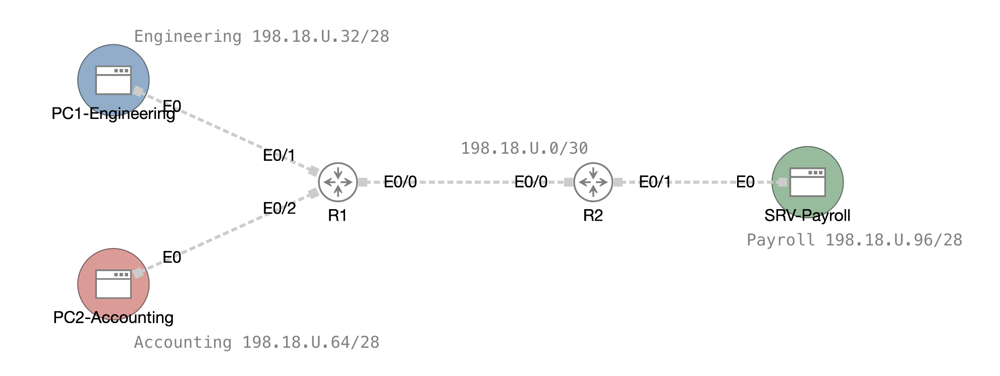

# Lab 09 — Standard ACLs: Follow the Traffic

```plaintext
Environment: Cisco CML (CML-Free).
- Two IOL-XE routers (R1, R2).
- Three Alpine Linux hosts (PC1, PC2, SRV).
- Five nodes in total. Console access only.
```

## Section A — Start Here

**Get the lab files.** Download `l09-cml.zip` from the Lab 09 assignment in Brightspace and unzip it into a folder on your own host. It holds:

- `L09-Standard-ACLs.yaml`: the lab, which you import into CML-Free.
- `templates/l09-c01.txt` to `l09-c03.txt`: your evidence files. Each has a section for every collection in its checkpoint, with a sub-header for each device.

Download only from the Brightspace assignment. The package contains no scripts.

### A1 — Overview

The network is already built and routing. Your job is to **control** it with three small standard ACLs, and to **prove where each packet is stopped**.

| Checkpoint | Policy | ACL | Device |
|---|---|---|---|
| C01 | A whole network (Accounting) must not reach the server network (Payroll) | `BLOCK-ACCOUNTING` on an interface | R2 |
| C02 | One computer (PC1) must not reach Accounting | `BLOCK-PC1` on an interface | R1 |
| C03 | Only one computer (PC1) may open a management session to R2 | `MGMT-R2` on the VTY lines | R2 |

All three are **named standard ACLs**. They match the **source address only**.

The purpose of this lab is not to memorize syntax. It is to decide where an ACL belongs, and then to follow a packet hop by hop until you can say which device dropped it, on which interface, in which direction, and why.

### A1.1 — Mini Quick-Ref

| Task | Command | Notes |
|---|---|---|
| Create a named standard ACL | `ip access-list standard NAME` | Then add `permit` / `deny` lines |
| Match a whole network | `deny 198.18.U.64 0.0.0.15` | Address, then wildcard mask |
| Match one computer | `deny host 198.18.U.46` | Same as wildcard `0.0.0.0` |
| Match everything | `permit any` | |
| Apply to an interface | `ip access-group NAME in\|out` | Under `interface` |
| Apply to the VTY lines | `access-class NAME in` | Under `line vty 0 4` |
| Show ACLs and hit counters | `show ip access-lists NAME` | EXEC mode |
| Clear the counters | `clear access-list counters NAME` | EXEC mode |
| Show the interface binding | `show ip interface Ethernet0/N \| include access list` | EXEC mode |
| Show who is logged in | `show users` | EXEC mode |
| Follow the path from a host | `traceroute -n <address>` | On the Alpine hosts |
| Ping from a host | `ping -c 4 <address>` | The Alpine `ping` never stops by itself |

### A1.2 — How to Follow the Traffic

For every test in this lab, do the same five things. This is the method you are being graded on.

1. **Predict.** Before you run anything, write one line: which device drops the packet, on which interface, in which direction?
2. **Zero the counters.** `clear access-list counters NAME`.
3. **Send the traffic.** Use the exact commands in the checkpoint.
4. **Read the counters.** Each ACL line counts the packets that matched it. A counter that moved is proof the packet reached that line.
5. **Explain.** Write one line: where it was dropped and why. Include the **return packet**: an ACL has no memory, so a reply is a new packet that is tested on its own.

### A1.3 — Evidence Collection

This lab uses **manual** evidence collection: you copy device prompts and command output directly into your evidence file as you complete each checkpoint.

Each checkpoint has its own file, `l09-c01-<username>.txt` to `l09-c03-<username>.txt`, built from the templates in `l09-cml.zip`. You upload all three files together, in one submission, after C03 (see Section D).

### A2 — Why This Lab Is Important

- **Source-based control.** A standard ACL is the simplest packet filter: one question, "who sent this?"
- **Placement.** The same ACL on a different interface blocks different traffic. You will see why standard ACLs belong close to the destination.
- **Stateless filtering.** Replies are filtered like any other packet. Following the return path is the most common skill gap in ACL troubleshooting.
- **Management plane.** A data-plane ACL protects what is behind a router. `access-class` protects the router itself.

### A3 — Objectives / Evidence Map

| Objective | Checkpoint | Points |
|---|---|---:|
| Confirm the baseline and that the network is stable before applying ACLs | C00 | 0 — gate (collected, not scored) |
| Block a whole network and follow the traffic | C01 | 2 |
| Block a single computer and follow the traffic | C02 | 2 |
| Restrict the VTY lines of a router to one computer | C03 | 1 |
| **Total (bonus)** | | **5** |

C00 is a mandatory unscored gate. Each scored objective requires all evidence listed in its checkpoint; successful configuration alone earns no credit.

### A4 — Grading (Bonus Lab)

Lab 09 is an **optional bonus lab**. Its 5 points are worth **1% of the course** and are added on top of the 100% (up to 1% above 100). Nothing is deducted if you do not submit it.

The usual 10-point base for a lab does not apply here: the 5-point total is set by your instructor for this lab.

| Checkpoint | Evidence file | Points |
|---|---|---:|
| C00 | collected in `l09-c01-<username>.txt` | 0 |
| C01 | `l09-c01-<username>.txt` | 2 |
| C02 | `l09-c02-<username>.txt` | 2 |
| C03 | `l09-c03-<username>.txt` | 1 |
| **Total** | | **5** |

---

## Section B — Topology and Addressing

### B1 — Topology



| Link | From | To |
|---|---|---|
| Transit | R1 `Ethernet0/0` | R2 `Ethernet0/0` |
| Engineering | R1 `Ethernet0/1` | PC1 `eth0` |
| Accounting | R1 `Ethernet0/2` | PC2 `eth0` |
| Payroll | R2 `Ethernet0/1` | SRV `eth0` |

### B2 — Addressing Table

| Network | Subnet | Router address | Host address |
|---|---|---|---|
| Transit | `198.18.U.0/30` | R1 `.1`, R2 `.2` | |
| Engineering | `198.18.U.32/28` | R1 `Ethernet0/1` `.33` | PC1 `.46` |
| Accounting | `198.18.U.64/28` | R1 `Ethernet0/2` `.65` | PC2 `.78` |
| Payroll | `198.18.U.96/28` | R2 `Ethernet0/1` `.97` | SRV `.110` |

Routers take the **first usable** address of each subnet; hosts take the **last usable**. Every host uses its router interface as its default gateway.

| Device | Interface | Address |
|---|---|---|
| R1 | `Ethernet0/0` | `198.18.U.1/30` |
| R1 | `Ethernet0/1` | `198.18.U.33/28` |
| R1 | `Ethernet0/2` | `198.18.U.65/28` |
| R2 | `Ethernet0/0` | `198.18.U.2/30` |
| R2 | `Ethernet0/1` | `198.18.U.97/28` |
| PC1 | `eth0` | `198.18.U.46/28`, gateway `198.18.U.33` |
| PC2 | `eth0` | `198.18.U.78/28`, gateway `198.18.U.65` |
| SRV | `eth0` | `198.18.U.110/28`, gateway `198.18.U.97` |

### B3 — Baseline Requirements

Wherever this lab writes `U`, type your own `U` value. The nodes are supplied with `U = 0`, which is not a valid student value: an address that still ends the third octet in `.0.` (such as `198.18.0.1`) means it was not changed. You change the addresses in C00, before you start the lab.

| Item | State | Supplied or built by you |
|---|---|---|
| Hostnames, `admin` user, enable secret, SSH, console and VTY settings | Working | Supplied; you add `<username>-` to each hostname |
| Addressing | Per B2 | Supplied with `U = 0`; you change it to your `U` (C00) |
| OSPF | Process 1, area 0, LAN interfaces passive | Supplied; nothing to change |
| ACLs | None | You build them in C01 to C03 |

| Scope | Rule |
|---|---|
| Student scope | Hostnames and addresses (C00); the three ACLs and their bindings |
| Protected scope | The supplied users, passwords, SSH, console and VTY transport settings; OSPF; the links between nodes |

### B4 — Management Access

| Target | How to reach it | Username / password |
|---|---|---|
| R1, R2 | CML console (the node's console tab) | `admin` / `cisco`; enable secret `class` |
| PC1, PC2, SRV | CML console (the node's console tab) | `cisco` / `cisco` |
| R2 over SSH | `ssh admin@198.18.U.2` from PC1 or PC2 (C03) | `admin` / `cisco` |

### B5 — Your Evidence Files

You prepare your three files in C00 (`l09-c01-<username>.txt` to `l09-c03-<username>.txt`). Each file has a section header for each collection, such as `=== C01 – Policy #1 - BLOCK-ACCOUNTING Verification ===`, and a sub-header for each device you capture. The commands are in the steps.

- Under each device sub-header, paste the console output of the step's commands, **including the device prompt** (`<username>-R2#`). Do not edit the output.
- Keep the sections in file order.
- Each checkpoint also asks for two lines that you write yourself, starting with `!--`: your prediction before the test, and your explanation after it.

---

## Section C — Lab Tasks and Evidence

### C00 — Import, Set Your Addresses, and Prove the Network Is Stable

#### Goal

Confirm the network is fully operational before any ACL is applied.

#### Why This Matters

Every ACL result in this lab is read from a counter or a ping. If routing or addressing is not already correct, a failed ping after an ACL proves nothing.

#### Action

1. **Unzip `l09-cml.zip`** and **import** `L09-Standard-ACLs.yaml` into CML-Free. Open the lab. **Do not start any node yet.** The same instructions are in the lab notes panel.
2. **Find your `U` value** in Brightspace Grades, grade item **U**. Use it as-is.
3. **Edit each node before it starts.** Select the node, open its **Config** tab, make the changes below, and save.
   - **Hostname.** Put your username in front of the name: `hostname R1` becomes `hostname <username>-R1`. Do the same on `R2`, `PC1`, `PC2`, and `SRV`.
   - **Addresses.** Change the supplied `0` to your own `U` on exactly these eleven lines. For `U = 17`, `198.18.0.1` becomes `198.18.17.1`:

   | Node | Line | Supplied | Becomes |
   |---|---|---|---|
   | R1 | `interface Ethernet0/0` | `198.18.0.1 255.255.255.252` | `198.18.U.1` |
   | R1 | `interface Ethernet0/1` | `198.18.0.33 255.255.255.240` | `198.18.U.33` |
   | R1 | `interface Ethernet0/2` | `198.18.0.65 255.255.255.240` | `198.18.U.65` |
   | R2 | `interface Ethernet0/0` | `198.18.0.2 255.255.255.252` | `198.18.U.2` |
   | R2 | `interface Ethernet0/1` | `198.18.0.97 255.255.255.240` | `198.18.U.97` |
   | PC1 | `ip address add` | `198.18.0.46/28` | `198.18.U.46/28` |
   | PC1 | `ip route add default via` | `198.18.0.33` | `198.18.U.33` |
   | PC2 | `ip address add` | `198.18.0.78/28` | `198.18.U.78/28` |
   | PC2 | `ip route add default via` | `198.18.0.65` | `198.18.U.65` |
   | SRV | `ip address add` | `198.18.0.110/28` | `198.18.U.110/28` |
   | SRV | `ip route add default via` | `198.18.0.97` | `198.18.U.97` |

   Change only the third octet; the rest of each line stays as supplied. Before you start the lab, check that none of the eleven lines still shows `198.18.0.`. The OSPF `network 198.18.0.0 0.0.255.255` line stays exactly as supplied: it matches any `U`.
4. **Start all five nodes.** Wait about three minutes for the routers to boot and finish creating their SSH keys.
5. **Prepare your files.** Rename the three evidence templates: `l09-c01.txt` becomes `l09-c01-<username>.txt`, and so on to `l09-c03-<username>.txt`. In each file, fill in `STUDENT:` and `U:` on the first line.

#### How to Save Your Lab

You can pause the lab and continue later. Pause between steps where you can, never in the middle of a capture.

1. Finish the step or capture you are in.
2. On R1 and R2, save the configuration:

   ```text
   write memory
   ```

3. In CML, **Stop** the lab. Do not **Wipe** a node: Wipe erases your work and returns it to the supplied baseline.
4. To continue, **Start** the lab and wait about three minutes. Check `show ip ospf neighbor`: your neighbour should be back in `FULL`.

#### Verification

Run these commands and keep the output for the evidence file.

1. **Check interfaces, OSPF and routes (FROM R1)**

   Interfaces up/up with your `U`, one neighbour in `FULL`, and OSPF routes to the other networks.

   ```text
   show ip interface brief | exclude unassigned
   show ip ospf neighbor
   show ip route ospf
   ```

2. **Check interfaces, OSPF and routes (FROM R2)**

   Same checks on the other router.

   ```text
   show ip interface brief | exclude unassigned
   show ip ospf neighbor
   show ip route ospf
   ```

3. **Test reachability from Engineering (FROM PC1)**

   Each ping needs a count; both must show `0% packet loss`.

   ```text
   ping -c 4 198.18.U.78
   ping -c 4 198.18.U.110
   ```

4. **Test reachability from Accounting (FROM PC2)**

   The ping must show `0% packet loss`.

   ```text
   ping -c 4 198.18.U.110
   ```

#### Success Indicator / Failure Signal

| Verification Item | Success Indicator | Failure Signal |
|---|---|---|
| Nodes | All five nodes started; consoles open | A node stuck starting, or a console that will not open |
| Hostname | Every router prompt shows `<username>-R1` or `<username>-R2` | An unrenamed hostname |
| Addresses | Every B2 address present, up/up, and carrying your `U` | An address still showing `198.18.0.`, a missing address, or a down row |
| OSPF | One neighbour in `FULL` on each router | No neighbour, or not `FULL` |
| Routes | R1 has an OSPF route to `198.18.U.96/28`; R2 has OSPF routes to `198.18.U.32/28` and `198.18.U.64/28` | A missing route |
| Reachability | All three pings: `0% packet loss` | Any loss |

#### Troubleshooting

If OSPF has no neighbour: check that both transit addresses carry your `U` and that the `/30` subnet matches on both ends.

If a ping fails: check the host's address and default gateway against B2.

If one of the eleven addresses still shows `U = 0`: stop that node and **Wipe** it (nothing of yours is on it yet), correct the line in its Config tab, and start it again. Wipe is allowed here only because C00 is the baseline.

#### Collection of Information

C00 is worth 0 points. Do not continue until every item above passes.

In your `l09-c01-<username>.txt` file, open the first section with its own header:

```diff
=== C00 – Baseline ===
```

Copy **all** the commands from Verification, with the device prompt and the unedited output, under these sub-headers:

- `R1`: the three commands from step 1.
- `R2`: the three commands from step 2.
- `PC1`: the two pings from step 3.
- `PC2`: the ping from step 4.

---

### C01 — Policy 1: Block a Whole Network (BLOCK-ACCOUNTING)

#### Goal

Stop every host in Accounting from reaching Payroll, without affecting anyone else, and prove where the packets die.

#### Why This Matters

A standard ACL sees only the source address. Where you place it decides what else it catches. This is the first time you reason about placement.

#### Security Policy Statement

Hosts in Accounting (`198.18.U.64/28`) must not reach Payroll (`198.18.U.96/28`). All other sources are permitted.

#### Policy Decomposition

| Component | Details |
|---|---|
| **Policy name** | `BLOCK-ACCOUNTING` |
| **ACL type** | Standard (source IP only) |
| **Match criteria** | Source in `198.18.U.64/28`: network `198.18.U.64`, wildcard `0.0.0.15` |

**Actions:**

1. **Deny** the match.
2. **Permit** everything else.

The wildcard is the subnet mask turned upside down: `255.255.255.240` becomes `0.0.0.15`.

#### ACL Placement

Trace the path of a packet from PC2 to SRV:

```text
PC2 → R1 Et0/2 (in) → R1 Et0/0 (out) → R2 Et0/0 (in) → R2 Et0/1 (out) → SRV
```

A standard ACL belongs **as close to the destination as possible**. The device nearest SRV is R2, and the packet leaves toward SRV on `Ethernet0/1`.

| Device | Interface | Direction | Reason |
|---|---|---|---|
| R2 | `Ethernet0/1` | `out` | Tests the source of every packet just before it enters Payroll, and nothing else on R2 is affected. |

> **Why not R1 `Ethernet0/2` inbound?** It would also block PC2 from PC1 and from everything else. A standard ACL cannot say "only toward Payroll" because it cannot see the destination.

#### Action

1. On R2, **before configuring anything**, write your prediction in the C01 file (the first `!--` line).
2. Create and apply the ACL on R2:

   ```text
   ip access-list standard BLOCK-ACCOUNTING
    deny 198.18.U.64 0.0.0.15
    permit any
    exit
   interface Ethernet0/1
    ip access-group BLOCK-ACCOUNTING out
    exit
   ```

3. Run the tests under Verification, in this order, then collect the evidence.

#### Verification

Copy **every** command below, with its output, into your evidence file under the device's sub-header. A missing command is a missing check.

1. **Reset the counters (FROM R2)**

   Confirm that no line shows a match.

   ```text
   clear access-list counters BLOCK-ACCOUNTING
   show ip access-lists BLOCK-ACCOUNTING
   ```

2. **Send traffic that should be denied (FROM PC2)**

   Accounting toward Payroll hits the `deny` line.

   ```text
   ping -c 4 198.18.U.110
   ```

3. **Send traffic that should be permitted (FROM PC1)**

   Another network toward Payroll hits the `permit any` line.

   ```text
   ping -c 4 198.18.U.110
   ```

4. **Read the counters and the ACL placement (FROM R2)**

   Which line matched, and on which interface and direction is the ACL bound?

   ```text
   show ip access-lists BLOCK-ACCOUNTING
   show ip interface Ethernet0/1 | include access list
   ```

5. **Follow the path of the denied traffic (FROM PC2)**

   See hop by hop where the packets stop.

   ```text
   traceroute -n 198.18.U.110
   ```

6. **Follow the path of the permitted traffic (FROM PC1)**

   Compare it with the denied path.

   ```text
   traceroute -n 198.18.U.110
   ```

Run the `traceroute` commands **last**: they send extra packets and would change the counters you just captured.

#### Success Indicator / Failure Signal

| Verification Item | Success Indicator | Failure Signal |
|---|---|---|
| Counters before | Both lines show no matches | A non-zero counter (you did not clear it) |
| PC2 → SRV | `100% packet loss` | Any reply |
| PC1 → SRV | `0% packet loss` | Any loss |
| Counters after | `deny` line: 4 matches (the four PC2 echo requests). `permit any` line: 4 matches (the four PC1 echo requests) | Either counter at 0, or `deny` counting PC1 |
| Binding | `Outgoing access list is BLOCK-ACCOUNTING` on `Ethernet0/1` | Wrong interface or direction |
| Traceroute from PC2 | R1 (`198.18.U.65`) at hop 1, R2 (`198.18.U.2`) at hop 2, then R2 again with `!A` (administratively prohibited); `198.18.U.110` never answers | SRV answers |
| Traceroute from PC1 | Reaches R1 (`198.18.U.33`), R2 (`198.18.U.2`), then SRV | Stops before SRV |

#### Follow the Traffic

Answer these in the explanation line of your file:

1. Which device and interface dropped the PC2 packet, and in which direction?
2. The PC2 packet crossed R1 and the transit link first. Why did the ACL not stop it earlier?
3. The deny counter is exactly 4 after four pings. What does that tell you about where in the path the packets were counted?

#### Troubleshooting

If PC1 is also blocked: check the wildcard. `0.0.0.15` must apply to the `.64` network only.

If PC2 reaches SRV: check that the ACL is bound `out` on `Ethernet0/1`, not on `Ethernet0/0`.

If both counters stay at 0: the ACL is on an interface the packets do not cross.

#### Collection of Information

In your `l09-c01-<username>.txt` file, after the C00 section, create a section labelled:

```diff
=== C01 – Policy #1 - BLOCK-ACCOUNTING Verification ===
```

Copy **all** the commands from Verification, with the device prompt and the unedited output, under these sub-headers:

- `R2`: the four commands from steps 1 and 4.
- `PC2`: the ping and the traceroute from steps 2 and 5.
- `PC1`: the ping and the traceroute from steps 3 and 6.

Also paste the prediction line you wrote before testing, and finish with the explanation line answering the three questions in Follow the Traffic.

---

### C02 — Policy 2: Block One Computer (BLOCK-PC1)

#### Goal

Stop PC1, and only PC1, from reaching Accounting, and discover what that does to a reply.

#### Why This Matters

A single computer is matched with `host`. The ACL is as narrow as the match, but the packets it tests are not only the ones you were thinking about.

#### Security Policy Statement

The computer PC1 (`198.18.U.46`) must not send traffic into Accounting (`198.18.U.64/28`). All other sources are permitted.

#### Policy Decomposition

| Component | Details |
|---|---|
| **Policy name** | `BLOCK-PC1` |
| **ACL type** | Standard (source IP only) |
| **Match criteria** | Source is the single host `198.18.U.46` |

**Actions:**

1. **Deny** the host.
2. **Permit** everything else.

#### ACL Placement

Trace the path from PC1 to PC2, and the reply:

```text
Request: PC1 → R1 Et0/1 (in) → R1 Et0/2 (out) → PC2
Reply:   PC2 → R1 Et0/2 (in) → R1 Et0/1 (out) → PC1
```

Both directions cross only R1. The destination is on `Ethernet0/2`, so a packet **toward Accounting** leaves R1 there.

| Device | Interface | Direction | Reason |
|---|---|---|---|
| R1 | `Ethernet0/2` | `out` | Closest to the destination; PC1 can still reach SRV and the rest of the network. |

#### Action

1. Write your prediction in the C02 file first. Think about all four tests, including the one that starts at PC2.
2. Create and apply the ACL on R1:

   ```text
   ip access-list standard BLOCK-PC1
    deny host 198.18.U.46
    permit any
    exit
   interface Ethernet0/2
    ip access-group BLOCK-PC1 out
    exit
   ```

3. Run the tests under Verification, in this order, then collect the evidence.

#### Verification

Copy **every** command below, with its output, into your evidence file under the device's sub-header. A missing command is a missing check.

1. **Reset the counters (FROM R1)**

   Confirm that no line shows a match.

   ```text
   clear access-list counters BLOCK-PC1
   show ip access-lists BLOCK-PC1
   ```

2. **Send traffic from the blocked computer (FROM PC1)**

   The ping toward Accounting hits the `deny` line; the ping toward Payroll shows PC1 is still allowed elsewhere.

   ```text
   ping -c 4 198.18.U.78
   ping -c 4 198.18.U.110
   ```

3. **Send traffic that should be permitted (FROM SRV)**

   Another source toward Accounting hits the `permit any` line.

   ```text
   ping -c 4 198.18.U.78
   ```

4. **Send traffic whose reply comes from the blocked computer (FROM PC2)**

   The request leaves PC2, but the reply comes from PC1.

   ```text
   ping -c 4 198.18.U.46
   ```

5. **Read the counters and the ACL placement (FROM R1)**

   Which line matched, and on which interface and direction is the ACL bound?

   ```text
   show ip access-lists BLOCK-PC1
   show ip interface Ethernet0/2 | include access list
   ```

6. **Follow the path of the denied traffic (FROM PC1)**

   See hop by hop where the packets stop.

   ```text
   traceroute -n 198.18.U.78
   ```

Run the `traceroute` **last**, for the same reason as in C01.

#### Success Indicator / Failure Signal

| Verification Item | Success Indicator | Failure Signal |
|---|---|---|
| PC1 → PC2 | `100% packet loss` | Any reply |
| PC1 → SRV | `0% packet loss` | Any loss |
| SRV → PC2 | `0% packet loss` | Any loss |
| PC2 → PC1 | `100% packet loss` (this is the surprise: see below) | Any reply |
| Counters after | `deny host` line: 8 matches. `permit any` line: 4 matches | `deny` at 0, or `permit` at 0 |
| Binding | `Outgoing access list is BLOCK-PC1` on `Ethernet0/2` | Wrong interface or direction |
| Traceroute from PC1 | R1 (`198.18.U.33`) at hop 1, then R1 again at hop 2 with `!A` (administratively prohibited); PC2 never answers | PC2 answers |

Example traceroute output from PC1 (`U = 0`):

```text
PC1:~$ traceroute -n 198.18.0.78
traceroute to 198.18.0.78 (198.18.0.78), 30 hops max, 46 byte packets
 1  198.18.0.33  1.207 ms  2.189 ms  2.015 ms
 2  198.18.0.33  1.391 ms !A  *  1.726 ms !A
```

Hop 1 is R1 forwarding the probe. At hop 2 R1 answers from the same address, `198.18.U.33`, with `!A`: **administratively prohibited** (ICMP unreachable, code 13). That is the ACL: R1 refused to send the probe out of `Ethernet0/2` and told the sender. A `*` is a probe with no reply.

#### Follow the Traffic

The ACL never mentions PC2, yet PC2 cannot ping PC1. Follow both packets of that exchange and answer in your explanation line:

1. Which packet of the PC2 → PC1 ping crosses `Ethernet0/2` outbound, and what is its source address?
2. How many matches does the `deny` line have, and which eight packets are they? (Four are PC1's requests to PC2; what are the other four?)
3. Why can SRV still ping PC2?

#### Troubleshooting

If PC1 can still ping PC2: check that the ACL is bound `out` on `Ethernet0/2`.

If PC1 cannot ping SRV: the ACL is on the wrong interface (for example `Ethernet0/0`).

If PC2 can ping PC1: the `deny host` line is missing or the address has the wrong `U`.

#### Collection of Information

In your `l09-c02-<username>.txt` file, create a section labelled:

```diff
=== C02 – Policy #2 - BLOCK-PC1 Verification ===
```

Copy **all** the commands from Verification, with the device prompt and the unedited output, under these sub-headers:

- `R1`: the four commands from steps 1 and 5.
- `PC1`: the two pings and the traceroute from steps 2 and 6.
- `SRV`: the ping from step 3.
- `PC2`: the ping from step 4.

Also paste the prediction line you wrote before testing, and finish with the explanation line answering the three questions in Follow the Traffic.

---

### C03 — Policy 3: Protect the Router Itself (MGMT-R2)

#### Goal

Allow only PC1 to open a management session to R2, while keeping every other packet to R2 working.

#### Why This Matters

Interface ACLs filter traffic passing **through** a router. Traffic **to** the router's own login lines is the management plane, and it is controlled with `access-class` on the VTY lines.

#### Security Policy Statement

Only PC1 (`198.18.U.46`) may open a VTY session (SSH or Telnet) to R2. All other sources are denied.

#### Policy Decomposition

| Component | Details |
|---|---|
| **Policy name** | `MGMT-R2` |
| **ACL type** | Standard (source IP only) |
| **Match criteria** | Source is the single host `198.18.U.46` |
| **Applied to** | `line vty 0 4`, direction `in` |

**Actions:**

1. **Permit** the host.
2. **Deny** everything else.

#### ACL Placement

The ACL is applied on the VTY lines of R2, not on an interface. Nothing else on R2 is touched, so ping, OSPF and routing through R2 keep working.

| Device | Where | Direction | Reason |
|---|---|---|---|
| R2 | `line vty 0 4` | `in` | Filters who may open a session to R2 itself. The console line is a separate line and is never affected. |

#### Action

1. Write your prediction in the C03 file first.
2. Create and apply the ACL on R2. Do this from the **console**, not from an SSH session:

   ```text
   ip access-list standard MGMT-R2
    permit host 198.18.U.46
    deny any
    exit
   line vty 0 4
    access-class MGMT-R2 in
    exit
   ```

3. Run the tests under Verification, in this order, then collect the evidence.

#### Verification

Copy **every** command below, with its output, into your evidence file under the device's sub-header. A missing command is a missing check.

1. **Reset the counters (FROM R2)**

   Confirm that no line shows a match.

   ```text
   clear access-list counters MGMT-R2
   show ip access-lists MGMT-R2
   ```

2. **Send traffic from a denied source (FROM PC2)**

   The ping proves R2 is reachable; the `ssh` hits the `deny any` line.

   ```text
   ping -c 4 198.18.U.2
   ssh admin@198.18.U.2
   ```

3. **Send traffic from the permitted source (FROM PC1)**

   The `ssh` login hits the `permit` line.

   ```text
   ssh admin@198.18.U.2
   ```

4. **Read the session, the counters and the ACL placement (FROM R2)**

   With the PC1 session still open: who is connected, which line matched, and is the ACL applied on the VTY lines?

   ```text
   show users
   show ip access-lists MGMT-R2
   show running-config | section line vty
   ```

Log in from PC1 (`admin` / `cisco`) and **leave the session open** while you run step 4 on the R2 console. Close it afterwards with `exit`.

The first time you connect, answer `yes` to the host-key question.

#### Success Indicator / Failure Signal

| Verification Item | Success Indicator | Failure Signal |
|---|---|---|
| PC2 ping to R2 | `0% packet loss` | Any loss |
| PC2 SSH to R2 | Connection closed or refused; no login prompt | A login prompt appears |
| PC1 SSH to R2 | Login prompt, then the R2 `>` or `#` prompt | Refused |
| `show users` | A `vty` line from `198.18.U.46`, plus the console line (`con 0`) | No vty line, or a vty from another address |
| Counters after | `permit` line: at least 1 match. `deny any` line: at least 1 match | Either counter at 0 |
| Binding | `access-class MGMT-R2 in` under `line vty 0 4` | Missing |

#### Follow the Traffic

In your explanation line, answer:

1. The ping from PC2 to R2 works, but the SSH from PC2 does not. Where, exactly, was the SSH stopped?
2. Why is your console session unaffected?
3. Would the C01 ACL (on R2 `Ethernet0/1`) have stopped this SSH session? Why or why not?

#### Troubleshooting

If PC1 is refused: check the address in the `permit host` line and that the `access-class` says `in`.

If the Alpine `ssh` command rejects the router, try the legacy options below. If it still fails, use `telnet 198.18.U.2` instead; the VTY lines accept Telnet and the ACL applies to it in the same way.

```text
ssh -o HostKeyAlgorithms=+ssh-rsa -o KexAlgorithms=+diffie-hellman-group14-sha1 admin@198.18.U.2
```

If you lock yourself out of the VTY lines, use the R2 console; it is not filtered.

#### Collection of Information

In your `l09-c03-<username>.txt` file, create a section labelled:

```diff
=== C03 – Policy #3 - MGMT-R2 Verification ===
```

Copy **all** the commands from Verification, with the device prompt and the unedited output, under these sub-headers:

- `R2`: the five commands from steps 1 and 4.
- `PC2`: the ping and the `ssh` attempt from step 2.
- `PC1`: the `ssh` login from step 3.

Also paste the prediction line you wrote before testing, and finish with the explanation line answering the three questions in Follow the Traffic.

---

## Section D — Submission

### D1 — Submission Requirements

Submit three files, one per checkpoint:

| Checkpoint | File | Contents |
|---|---|---|
| C01 | `l09-c01-<username>.txt` | `=== C00 – Baseline ===` and `=== C01 – Policy #1 - BLOCK-ACCOUNTING Verification ===` |
| C02 | `l09-c02-<username>.txt` | `=== C02 – Policy #2 - BLOCK-PC1 Verification ===` |
| C03 | `l09-c03-<username>.txt` | `=== C03 – Policy #3 - MGMT-R2 Verification ===` |

The captures are your own console output, unedited. Only operational evidence is submitted. Do not submit running configurations or screenshots.

### D2 — Submit to Brightspace

Your submission is your responsibility. When you have finished C03, upload all three files together, in one submission, to the L09-Dropbox folder (Lab 09 submission). Before you submit, prove:

1. The L09-Dropbox folder (Lab 09 submission) shows all three files as successfully uploaded.
2. Each uploaded file name is exactly as listed in D1, with your username.
3. Each file has non-zero size.

### D3 — Clean Up

After submission is confirmed:

- [ ] Stop the lab. You may wipe the nodes to return them to the supplied baseline.
- [ ] Keep your local evidence files until your grade is posted.

---

## End of Lab 09 — Standard ACLs: Follow the Traffic
