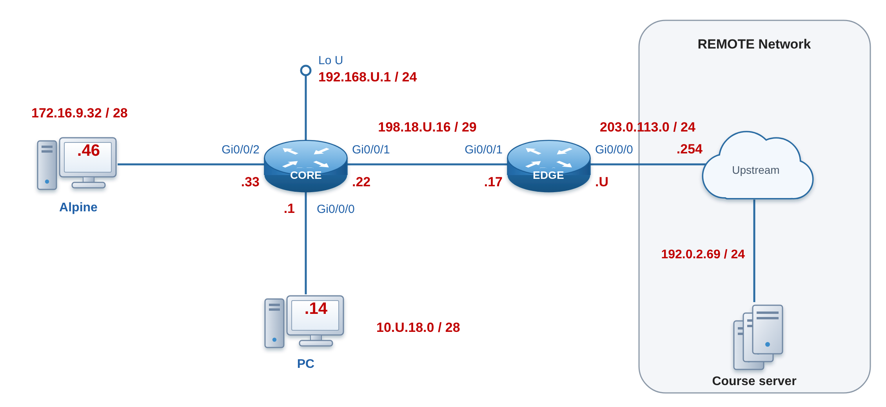

# Lab 10 — NAT Foundations: PAT, Static Port-Forwarding, and Dynamic Pools

```plaintext
Environment: Cisco IOS-XE physical lab; Windows PC (PowerShell) and Alpine.
```

---

## Section A — Start Here

### A1 — Overview

In this lab, you will deepen your understanding of IPv4 Network Address Translation (NAT) by configuring a border router to translate traffic between private internal networks and the public Internet.

This lab uses its own two-router topology (**EDGE**/**CORE**) with private addressing — it does not reuse the topology from previous weeks. Day0 provisions the EDGE/CORE addressing, OSPF, and services baseline for you, so the lab time goes to NAT. You work alone, on your own pod.

You will work through three essential NAT scenarios:

1. **Port Address Translation (PAT)** on the router's outside interface, allowing multiple inside hosts to share one public IP.
2. **Static port-forwarding**, mapping a specific TCP port on the public address to an internal server.
3. **Dynamic PAT using an address pool**, enabling inside hosts to translate to a small range of public IPs.

This hands-on exercise builds critical skills in conserving IPv4 address space and providing controlled inbound access — practical expertise for any enterprise network engineer.

### A1.1 — Mini Quick-Ref

| Task | Command | Notes |
|---|---|---|
| Mark inside interface | `ip nat inside` | under the interface facing the private network |
| Mark outside interface | `ip nat outside` | under the interface facing the public network |
| Define a standard ACL to match inside traffic | `access-list <1-99> permit [source] [wildcard]` | e.g. `access-list 16 permit 172.16.9.32 0.0.0.15` |
| PAT to the outside interface's address | `ip nat inside source list <ACL> interface <if> overload` | all matched hosts share the interface's public IP |
| Static port-forward | `ip nat inside source static <tcp\|udp> <in_addr> <in_port> <out_addr> <out_port>` | maps one public port to one internal host:port |
| Dynamic PAT pool | `ip nat pool <name> <start_ip> <end_ip> <mask>` then `ip nat inside source list <ACL> pool <name> overload` | matched hosts share the pool addresses |
| View NAT translations | `show ip nat translations` | EXEC mode |
| View NAT statistics | `show ip nat statistics` | EXEC mode |
| View ACL hit counts | `show ip access-lists <ACL>` | EXEC mode — informational only; not reliable across all platforms/IOS versions as NAT verification evidence, see C01 |

### A1.2 — Evidence Collection

All evidence in this lab is collected **manually**: you paste device prompts and command output into your evidence files as you complete each checkpoint.

- Four evidence files, one per checkpoint: `l10-c00-<username>.txt` to `l10-c03-<username>.txt`. `lab_setup.ps1` creates the C01–C03 files from the lab package; each lists the commands it needs, with a `!-- Copy results here:` slot under each one. The C00 file is created by `x_remote` in C00.
- **C00** (baseline verification) is collected automatically with `x_remote`. **C01–C03** (NAT verification) are pasted from EDGE (and CORE in C02).
- The files stay on the PC Desktop. You upload all four together in D2, once C03 gives the PC a path to the course server.

### A2 — Why This Lab Is Important

Network Address Translation (NAT) is a foundational technique in IPv4 networks, allowing organizations to:

- **Conserve scarce IPv4 addresses** by enabling multiple internal hosts to share a single public IP (PAT) or a small pool of addresses (dynamic PAT).
- **Control and secure inbound access** through static port-forwarding, exposing only necessary services to the Internet while keeping internal networks hidden.
- **Maintain address consistency** when renumbering or merging networks, since internal addressing can remain unchanged behind a NAT boundary.

By mastering PAT, static port-forwarding, and dynamic NAT pools, you'll gain practical skills that are essential for designing, operating, and troubleshooting real-world enterprise networks under IPv4 constraints.

### A3 — Objectives / Evidence Map

| Objective | Checkpoint | Points |
|---|---|---:|
| Confirm the Day0 baseline (addressing, OSPF, and services) and collect verification evidence | C00 | 3 |
| Configure and verify PAT to the exit interface's public IP (NAT Rule #1) | C01 | 4 |
| Configure and verify static port-forwarding to an internal server (NAT Rule #2) | C02 | 4 |
| Configure and verify dynamic PAT using an address pool (NAT Rule #3) | C03 | 4 |
| **Total** | | **15** |

Each scored objective requires all evidence listed in its checkpoint; successful configuration alone earns no credit.


---

## Section B — Topology and Addressing

### B1 — Topology



| Network        | Subnet                        | Routing domain                       |
| -------------- | ----------------------------- | ------------------------------------ |
| Upstream       | `203.0.113.0/24`              | Outside OSPF                         |
| EDGE–CORE      | `198.18.U.16/29`              | OSPF Area 0                          |
| PC network     | `10.U.18.0/28`                | OSPF Area 0, passive                 |
| Alpine network     | `172.16.9.32/28`              | OSPF Area 0, passive                 |
| CORE LoU       | `192.168.U.0/24`              | OSPF Area 0, passive, point-to-point |
| NAT pool (C03) | `209.10.U.2 – 209.10.U.6 /29` | Public addresses on EDGE only        |

### B2 — Addressing Table (IPv4)

Use the table below to verify and configure your devices. Replace `U` with your assigned U number (your Brightspace **U** grade; 1 to 253).

| Device             | Interface | IP Address (CIDR)  | Description                                 |
| ------------------ | --------- | ------------------ | -------------------------------------------- |
| **EDGE**             | Gi0/0/0   | `203.0.113.U/24`   | Outside interface to Internet                |
| **EDGE**             | Gi0/0/1   | `198.18.U.17/29`   | Inside interface, OSPF neighbor to CORE        |
| **CORE**             | Gi0/0/0   | `10.U.18.1/28`     | Inside gateway for dynamic NAT pool hosts    |
| **CORE**             | Gi0/0/1   | `198.18.U.22/29`   | OSPF neighbour to EDGE                         |
| **CORE**             | Gi0/0/2   | `172.16.9.33/28`   | Host receiving static port-forward (Telnet)  |
| **CORE**             | LoU       | `192.168.U.1/24`   | Private network                              |
| **Alpine (PAT host)**  | Gi0/0/2   | `172.16.9.46/28`   | Inside host for PAT translation tests        |
| **PC (Pool host)** | Gi0/0/0   | `10.U.18.14/28`    | Inside host for dynamic NAT pool tests       |
| **Remote**         | —         | `203.0.113.254/24` | External tester for Internet connectivity    |

> **Alpine Network**
> All students use **172.16.9.32/28** for their Alpine subnet.
> Your Alpine receives **172.16.9.46/28** from CORE's DHCP pool, identical across students, to illustrate how private networks overlap behind NAT.

### B3 — Baseline Requirements

**Starting state:** partially configured. Day0 (`day0_provision.py`) provisions EDGE and CORE over the console. Before C01, check that Day0 left these in place (C00 proves each one):

| Item                | Provisioned by Day0                                                                                                                                                                                      |
| ------------------- | -------------------------------------------------------------------------------------------------------------------------------------------------------------------------------------------------------- |
| Base configuration  | Hostnames, domain name, `admin` / `cisco` with enable secret `class`, SSHv2 and Telnet on the VTY lines, console logging synchronous, IPv6 unicast routing                                               |
| Addressing          | Every B2 router address, with a description on every interface                                                                                                                                           |
| OSPF process ID     | `U`                                                                                                                                                                                                      |
| Router-IDs          | EDGE = `U.0.0.17`, CORE = `U.0.0.22`                                                                                                                                                                         |
| Default route       | EDGE static default via `203.0.113.254`, originated so `0.0.0.0/0` is known across the OSPF domain                                                                                                         |
| EDGE–CORE DR election   | CORE wins (interface priority `U`)                                                                                                                                                                         |
| Passive interfaces  | All interfaces not directly connected to an OSPF neighbour                                                                                                                                               |
| Reference bandwidth | `10000 Mbps` on all OSPF-speaking routers                                                                                                                                                                |
| Convergence tuning  | CORE–LoU network type `point-to-point`<br>`198.18.U.16/29` link uses `hello 3`/`dead 6`<br> CORE's PC- and Alpine-facing interfaces have priority `0`                                                            |
| Services            | EDGE is NTP master (stratum 4); <br>CORE syncs to EDGE; <br>TFTP source-address fix applied to routers; <br>local log buffer (informational, date/time stamps) — no syslog server; <br>DHCP server on CORE: one lease each, PC `10.U.18.14` and Alpine `172.16.9.46` |
| NAT                 | **None.** No `ip nat` interface roles, ACLs, pools, or translation rules                                                                                                                                 |

> **Check the DR before you continue.** 
> - [ ] CORE must be the DR on the EDGE–CORE link (`show ip ospf neighbor` on EDGE shows CORE as `FULL/DR`). 
> - [ ] If EDGE is the DR, re-do the election: run `clear ip ospf process` on **both** routers, wait for `FULL`, and check again. This is not a configuration change.

**You build:**

- [ ] The PC and Alpine addresses (B2) and the baseline verification evidence.
- [ ] NAT Rule #1: PAT to the exit interface (EDGE).
- [ ] NAT Rule #2: static port-forwarding (EDGE).
- [ ] NAT Rule #3: dynamic PAT with an address pool (EDGE).

Make only the NAT changes that Section C specifies. Do not change the Day0 addressing, OSPF, or services. The instructor supplies the upstream, the course servers, and return routing for your pod's NAT addresses (`203.0.113.U` and the `209.10.U.0/29` pool) through EDGE.

### B4 — Management Access

| Target | How to reach it | Username / password |
|---|---|---|
| EDGE, CORE (Day0) | Console cable, 9600 baud, on the PC's COM port | `admin` / `cisco`; enable secret `class` |
| CORE (from C00) | `ssh admin@10.U.18.1` from the PC | `admin` / `cisco`; enable secret `class` |
| EDGE (from C00) | `ssh admin@198.18.U.17` from the PC | `admin` / `cisco`; enable secret `class` |
| Course server (TFTP host) | `scp`, `ssh`, and `tftp` to `192.0.2.69`, course network or working pod | `cisco` / `cisco` |

If Windows reports a key exchange error, use the flags in the C00 troubleshooting.

## Section C — Lab Tasks and Evidence

### C00 — Provision the Baseline, Confirm OSPF and Services, and Verify

#### Goal

Bring the EDGE/CORE topology to a fully operational baseline — addressing, OSPF, and supporting services — and collect verification evidence before any NAT rule is configured.

#### Why This Matters

NAT rules depend on a stable, routable network underneath them. If OSPF adjacencies, addressing, or services are not correct first, NAT translation and hit-counter evidence collected later cannot be trusted. Day0 loads the baseline for you, using the same procedure as Labs 05 and 06, so the steps are in the Day0 guide and this checkpoint gives only this lab's values and checks.

#### Action

Complete the numbered actions in order. Use the checkboxes to track the subactions within each action.

1. **Prepare the PC.** Follow the **Day0 provisioning guide**, [day0-provision-guide.md](../resources/day0-provision-guide.md), through the setup script, with `$lab = "l10"`. For this lab:

   - [ ] Use the guide's router commands (no --core-member).
   - [ ] The console port is `COM1`.
   - [ ] Setup must report `SETUP OK`. 
   - [ ] The C00 file is created later by `x_remote`.

2. **Cable the lab network.**

   - [ ] Cable the topology as in **B1**. Move the PC's BLUE NIC cable from the white jack to CORE `G0/0/0`, connect Alpine's network adapter to CORE `G0/0/2`, and connect EDGE `G0/0/0` to the course upstream jack.

3. **Provision EDGE, then CORE**, with the guide's router commands, one device at a time. EDGE is first so that the EDGE–CORE link is up when CORE is provisioned.

   - [ ] Read each device's verification summary against the table. 
   - [ ] The only row allowed to show down is EDGE G0/0/1 while CORE is not yet provisioned, and its `got` line must show the **correct address** from B2.

     | Device | Row allowed to show down at this point | Rows that must show ✔ |
     |---|---|---|
     | EDGE | G0/0/1 (CORE) | SSH, OSPF process U with Router ID `U.0.0.17`, no NAT configuration, G0/0/0 up/up |
     | CORE | none | every line |

   - [ ] Anything else (a rejected line, a failed check, NAT configuration, a wrong address, another down row): stop as the guide says. A down row not in the table is a cabling problem: see **Troubleshooting**.
   - [ ] **Final link check.** After CORE is provisioned, run the guide's `--verify-only` check on EDGE, then CORE. Every line must show ✔ on both, including EDGE `G0/0/1`.

4. **Connect the PC and Alpine with DHCP.** Day0 configures a DHCP server on CORE for both host networks; each pool has exactly one free address, so every student gets the same host addresses.

   - [ ] **PC:** set the BLUE NIC to obtain its address automatically. It must receive **10.U.18.14/28** with gateway **10.U.18.1**.
   - [ ] **Alpine:** set Alpine to DHCP (`udhcpc -i eth0`, or `iface eth0 inet dhcp` in `/etc/network/interfaces`). It must receive **172.16.9.46/28** with gateway **172.16.9.33** (see B2).
   - [ ] On CORE, confirm both leases: `show ip dhcp binding`.
   - [ ] Enable real-time log output display in your SSH sessions to the routers (`terminal monitor`). It is a per-session command, so repeat it each time you open a session.

5. **Open your management sessions** (see **B4**). From the PC, SSH to CORE and EDGE with `admin` / `cisco`:

   ```powershell
   ssh admin@10.${u}.18.1
   ssh admin@198.18.${u}.17
   ```

6. **Verify the baseline.** Review the network specifications in **B2** and **B3** and run the verification commands below on EDGE and CORE. Explore with any commands you need before you capture.

7. **CAPTURE with `x_remote`.** `x_remote` runs the C00 commands on EDGE and CORE over SSH and writes `l10-c00-<username>.txt`. You type none of the commands; the supplied manifest `x-remote-c00.yaml` contains them. Run it from the Desktop, in the PowerShell window where `$u` and `$username` are defined.

   - [ ] Generate your personal copy of the manifest. It replaces the U and username placeholders, including the output filename:

     ```powershell
     (Get-Content .\x-remote-c00.yaml -Raw).
         Replace('{U}', "$u").
         Replace('{USERNAME}', $username) |
         Set-Content .\x-remote-c00-personal.yaml -Encoding ascii
     ```

   - [ ] Run the collection:

     ```powershell
     python x_remote.py x-remote-c00-personal.yaml
     ```

   - [ ] Open `l10-c00-<username>.txt` and check it. It has one `Device:` banner per router (its address), a `|Command:` line above each output, and ends with `END OF DATA COLLECTION`. Review the results and confirm that every command has an output, on both routers. A file with only the ending line does not prove collection succeeded.
   - [ ] Do not edit the output. If a command is missing or failed, fix the cause and run the collection again.

   > **Hold your submission.** Your PC and Alpine only have private addresses, so neither can reach the course server (`192.0.2.69`) yet — that connectivity does not exist until C01's PAT rule (Alpine) and C03's pool rule (PC). **Do not upload any file yet.** You upload all four evidence files in D2, after C03.

#### Verification

Before collecting evidence, verify that the network works as designed. **Testing is your job: choose the commands, run them, and fix what does not match.** Use this design:

| Area | Design to verify |
|---|---|
| OSPF | As in **B3**: process, router IDs, CORE as DR, hello 3 / dead 6, reference bandwidth |
| Passive interfaces | CORE G0/0/0 (PC), G0/0/2 (Alpine) and Lo`U`; EDGE G0/0/0 (upstream) |
| Routes | EDGE has a default route via `203.0.113.254` and originates it in OSPF; EDGE learns the PC, Alpine and Lo`U` networks from CORE; Lo`U` appears as a /24 |
| Services | CORE is synchronized to EDGE (NTP); DHCP leases for the PC and Alpine |

Then test reachability and decide which results you expect:

| From | To | Expected now |
|---|---|---|
| PC | `10.U.18.1` (CORE) | Success |
| Alpine | `172.16.9.33` (CORE) | Success |
| PC and Alpine | `198.18.U.17` (EDGE) and `192.168.U.1` (CORE Lo`U`) | Success |
| PC and Alpine | `192.0.2.69` (course server) | **Fails** until NAT exists (C01 for Alpine, C03 for the PC) |

Each success must show 100%; re-run it until it does.

#### Success Indicator / Failure Signal

| Verification Item | Success Indicator | Failure Signal |
|---|---|---|
| Day0 provisioning | `SETUP OK`; ✔ on every line of both Day0 summaries and of the final `--verify-only` check (EDGE `G0/0/1` may show down only until CORE is provisioned) | Any ✘, NAT configuration present, a wrong address, an interface down after both devices are provisioned, or Day0 re-pushed to get past a failure |
| Host gateways | PC `ping 10.U.18.1` and Alpine `ping 172.16.9.33` show 100% success | Any loss |
| OSPF neighbours | EDGE and CORE see each other in `FULL` | Neighbour missing or not `FULL` |
| Router-ID | Matches the B3 value | Router ID auto-selected |
| DR/BDR | CORE = DR on the EDGE–CORE link | Wrong device elected DR |
| Default route | `0.0.0.0/0` known across the OSPF domain | Default route missing |
| NTP | CORE synchronized to EDGE (stratum 5) | CORE not synchronized |
| Evidence files | `l10-c00-<username>.txt` (from `x_remote`, ending with `END OF DATA COLLECTION`) and `l10-c01` to `l10-c03` exist on the Desktop | A file missing, a C00 file with no command output, or a C01–C03 slot still showing `!-- Copy results here:` with nothing under it |

#### Troubleshooting

**Host has no address**
- [ ] The NIC or `eth0` is set to DHCP and cabled to CORE `G0/0/0` (PC) or `G0/0/2` (Alpine).
- [ ] On CORE, `show ip dhcp binding` shows the lease; if not, `show running-config | section dhcp` shows the pools `PC_NET` and `VM_NET`.

**OSPF neighbour missing, wrong DR, or an interface down**
- [ ] Check the cabling against **B1** and both port labels. Day0 loaded the OSPF values, so the cause is most often cabling or the link.
- [ ] If a link stays down with correct cabling, cycle the interface (shut, then no shut) at **both ends**. Do not re-push Day0.
- [ ] If EDGE is the DR instead of CORE, use the DR box in **B3**.

**NTP not synchronized**
- [ ] Confirm the NTP peer address matches **B2**, then wait a few minutes.

**SSH key exchange error from Windows** ("no matching key exchange method")
- [ ] Use:

  ```powershell
  ssh -o KexAlgorithms=+diffie-hellman-group14-sha1 -o HostKeyAlgorithms=+ssh-rsa "admin@10.${u}.18.1"
  ```

#### C00 — Collection of Information

`x_remote` writes `l10-c00-<username>.txt`: EDGE (`198.18.U.17`) first, then CORE (`10.U.18.1`). It is complete when every command in it has an output (action 7).

Finish the file with your `!-- PROOF:` line: one sentence stating what shows the baseline is operating before any NAT rule exists. Keep the file on your Desktop and continue to C01.

> **Rerunning:** `x_remote` overwrites its output file; save a copy first if you have already added your `!-- PROOF:` line.

---

### C01 — NAT Rule #1: PAT to the Exit Interface's Public Address

#### Goal

Configure and verify Port Address Translation (PAT) so that hosts in the Alpine network share EDGE's public IP when accessing the Internet.

#### Why This Matters

PAT overload is the most common form of NAT in production networks — it is how an entire private network can reach the Internet through a single public address, conserving scarce IPv4 space.

#### Security / Translation Policy Statement

Hosts in the Alpine Network `172.16.9.32/28` must share EDGE's public IP when accessing the Internet.

#### Action


1. **Plan: choose the traffic with an ACL.** NAT does not decide by itself which traffic to translate; it asks an ACL to select the inside traffic. This is the same standard-ACL logic as Lab 09: the ACL matches on source address, a wildcard mask says which bits must match, and statements are read in order. Before you apply anything, write the one `permit` statement that matches the whole Alpine network `172.16.9.32/28` as ACL 16 in your lab notes, and work out its wildcard mask from the prefix length. You enter it in step 4, where it is graded.
2. **Identify the NAT device**: EDGE (the border router with the public-facing interface).
3. **Set inside/outside interfaces**:
    ```text
    ! On EDGE
    interface GigabitEthernet0/0/1
      ip nat inside
    interface GigabitEthernet0/0/0
      ip nat outside
    ```
4. **Create a standard ACL (16) to match the inside network**:
    ```text
    access-list 16 permit 172.16.9.32 0.0.0.15
    ```
5. **Enable PAT to the exit interface's public IP**:
    ```text
    ip nat inside source list 16 interface GigabitEthernet0/0/0 overload
    ```

Command explanation:
- **`ip nat inside source`** — Specifies that we're translating source addresses of packets coming from the **inside** network.
- **`list 16`** — Uses the **standard ACL 16** to identify which source addresses to translate (in our case, every host in `172.16.9.32/28`).
- **`interface GigabitEthernet0/0/0`** — Tells the router to use the IP address assigned to **Gi0/0/0** (the outside/public interface) as the translated address.
- **`overload`** — Enables **Port Address Translation (PAT)**, which lets **all** matched inside hosts share that single public IP by mapping their source port numbers.

> For any packet sourced from `172.16.9.32/28`, translate its private source IP to the public IP on Gi0/0/0; and because of `overload`, allow many private hosts to reuse that one public IP by differentiating them via port numbers.

#### Verification

**How we test, and why.** EDGE creates a translation only when a packet from an inside host crosses EDGE toward the outside, so a correct configuration shows nothing until there is traffic. We generate traffic from Alpine to the course server, then read EDGE's translation table and statistics. If the rule works, every flow shows Alpine's private address `172.16.9.46` mapped to EDGE's public address `203.0.113.U`. We use two kinds of traffic, ICMP (ping) and UDP/69 (TFTP), to show that PAT translates both types and tells them apart by ICMP identifier and port number.

**Testing NAT with TFTP and ICMP**

1. On **EDGE**, start from an empty table:
	```text
	EDGE# clear ip nat translation *
	```
2. From **Alpine**: **Ping the TFTP server**, `192.0.2.69`. The ping must show 100% success; re-run it until it does.
3. From **Alpine**: **Transfer a file to the TFTP server**, to generate UDP/69 traffic through the PAT translation. Create a small test file first (the file itself is not graded). Replace `{USERNAME}` with your username, without the curly brackets:
	```bash
	echo "PAT test {USERNAME}" > l10-tftp-test-{USERNAME}.txt
	tftp 192.0.2.69 -c put l10-tftp-test-{USERNAME}.txt
	```
4. **Inspect the NAT translation table**:
	```text
	EDGE# show ip nat translations
	```

Sample output:

```text
Pro  Inside global        Inside local         Outside local        Outside global
UDP  203.0.113.17:52345   172.16.9.46:52345    192.0.2.69:69        192.0.2.69:69
ICMP 203.0.113.17:1       172.16.9.46:1        192.0.2.69:0         192.0.2.69:0
```

5. **Verify NAT statistics** (authoritative evidence):
```text
EDGE# show ip nat statistics
EDGE# show access-lists 16
```
- **Total active translations** should be ≥ 2.
- **Hits** in `show ip nat statistics` should be ≥ 2. This counter increments for every packet NAT handles and is reliable regardless of platform or IOS/IOS-XE version.
- **ACL 16** hit count is informational only. Depending on platform and NAT switching path, the ACL counter may not increment even when NAT is translating correctly — do not treat 0 ACL hits as a failure if NAT statistics and translations confirm the rule is working.

#### Success Indicator / Failure Signal

| Verification Item | Success Indicator | Failure Signal |
|---|---|---|
| Ping to the server | `Success rate is 100 percent` from Alpine to `192.0.2.69` | Any loss |
| TFTP transfer | File transfer to `192.0.2.69` completes | Transfer fails or times out |
| NAT translations | ICMP and UDP/69 entries for `172.16.9.46` present | No translation entries |
| NAT statistics — Hits | ≥ 2 (from `show ip nat statistics`) | 0 hits |
| Total active translations | ≥ 2 | 0 |
| ACL 16 hits (informational only) | May show ≥ 2 hits | 0 hits is **not** by itself a failure — platform/IOS-dependent; verify against NAT statistics instead |

#### Troubleshooting

**No translations appear**
- [ ] `ip nat inside` is on `GigabitEthernet0/0/1` and `ip nat outside` is on `GigabitEthernet0/0/0`.
- [ ] ACL 16's wildcard mask matches `172.16.9.32/28` exactly (`0.0.0.15`).
- [ ] The `ip nat inside source list 16 interface GigabitEthernet0/0/0 overload` rule is present.

**Ping to the server fails**
- [ ] Alpine has `172.16.9.46/28` and gateway `172.16.9.33`, and still reaches CORE.
- [ ] EDGE has the default route (C00 evidence).

#### C01 — Collection of Information

Open `l10-c01-<username>.txt` on your Desktop. It begins with its own header:

```diff
=== C01 – PAT to Exit Interface Verification ===
```

Run each command on EDGE and paste the prompt, the command, and the raw output into the slot under it, as described below.

| Step                         | Command(s)                 | What to Include                                                                                        |
| ---------------------------- | -------------------------- | ------------------------------------------------------------------------------------------------------ |
| **1. Show NAT translations** | `show ip nat translations` | Full translation table, showing ICMP and UDP/69 (TFTP) entries for `172.16.9.46` → `203.0.113.U` to `192.0.2.69` |
| **2. Show NAT statistics** | `show ip nat statistics` | Total active translations ≥ 2; Hits ≥ 2 — this is the authoritative pass/fail evidence for translation activity |
| **3. Show ACL (informational)** | `show ip access-lists 16` | The ACL 16 permit statement and its hit count. A 0 hit count here does not indicate failure — see note above |

**What to Include:**

| Requirement | Details |
|---|---|
| Device prompt & command | Include device name and exact command |
| Full command output | Capture the entire output of each command without truncation |
| NAT translation entries | In `show ip nat translations`, confirm ICMP and UDP/69 entries mapping `172.16.9.46` → `203.0.113.U` → `192.0.2.69` |
| NAT statistics | In `show ip nat statistics`, confirm Total active translations ≥ 2 and Hits ≥ 2 |
| Comment | e.g., `!-- PROOF: PAT to exit interface functioning; ICMP and TFTP translations and NAT statistics verified.` |

Sample evidence:

```diff
=== C01 – PAT to Exit Interface Verification ===
```

```text
!-- PROOF: PAT to exit interface functioning; ICMP and TFTP translations and NAT statistics verified.

ayalac-EDGE# show ip nat translations
Pro  Inside global        Inside local         Outside local       Outside global
ICMP 203.0.113.U:1       172.16.9.46:1        192.0.2.69:0         192.0.2.69:0
UDP  203.0.113.U:52345   172.16.9.46:52345    192.0.2.69:69        192.0.2.69:69

ayalac-EDGE# show ip access-lists 16
Standard IP access list 16
    10 permit 172.16.9.32, wildcard bits 0.0.0.15 (2 matches)

ayalac-EDGE# show ip nat statistics
Total active translations: 2 (0 static, 0 extended)
Outside interfaces: 1
  GigabitEthernet0/0/0
Hits: 2  Misses: 0
```

Keep the file on your Desktop. Do not upload yet; all four files go up together in D2.

---

### C02 — NAT Rule #2: Static Port-Forwarding

#### Goal

Configure and verify a static port-forward so external hosts can reach CORE's internal Telnet server through EDGE's public IP.

#### Why This Matters

Static port-forwarding is how organizations expose a single internal service to the Internet without exposing the entire internal network — a common pattern for web servers, mail servers, and remote-management ports.

#### Security / Translation Policy Statement

Allow Internet users to Telnet to internal CORE at `172.16.9.33:23` via EDGE's public IP on TCP `2323`.

#### Action

1. **Plan: write the rule.** Before you configure anything, write the one static NAT statement in your lab notes: the protocol, the inside address and port, and the public address and port, all taken from the policy statement above. You enter it in step 2, where it is graded.
2. Code a **port-forwarding** rule on EDGE so that external hosts can connect to the telnet server on CORE:
    ```text
    ip nat inside source static <tcp/udp> <in_addr port> <out_add port>
    ```
    - Telnet is a TCP protocol.
    - Internally, the CORE telnet server is at `172.16.9.33` port `23`.
    - Outside hosts should connect to `203.0.113.U` port `2323`.

#### Verification

**How we test, and why.** A static port-forward only works for traffic that starts **outside**, so the test needs an outside host acting as an Internet user. The course server (`192.0.2.69`) plays that role. The first Telnet, to EDGE's own address, proves the outside host can reach EDGE. The second Telnet, to port `2323`, must land on CORE: the static entry translates `203.0.113.U:2323` to `172.16.9.33:23`, so the prompt you see is CORE's. The translation entry and the TCP sessions exist only while the Telnet sessions are open, so keep both open while you capture.

The test needs a host **outside** your NAT. The course server (`192.0.2.69`) is on the REMOTE network, so a Telnet from it reaches EDGE's public address the way an Internet user would. Alpine reaches the server through C01's PAT rule. Use two terminal windows on Alpine, one session each:

1. In the first Alpine window, SSH to the course server (password `cisco`), then telnet to your **EDGE** and log in (`admin` / `cisco`). Keep the connection open:
    ```bash
    ssh cisco@192.0.2.69
    ```
    ```text
    telnet 203.0.113.U
    ```
2. In the second Alpine window, SSH to the course server again, then telnet to your **CORE** through the forwarded port and log in. The prompt must show your CORE. Keep the connection open:
    ```bash
    ssh cisco@192.0.2.69
    ```
    ```text
    telnet 203.0.113.U 2323
    ```
3. With both sessions open, run these on EDGE and CORE (from your PC's SSH sessions or the consoles):

```text
EDGE:  show ip nat translations
CORE:  show tcp brief
CORE:  show users
```

#### Success Indicator / Failure Signal

| Verification Item | Success Indicator | Failure Signal |
|---|---|---|
| Telnet to EDGE | Login prompt from EDGE at `203.0.113.U` | Connection refused or times out |
| Telnet through the forward | Login prompt from CORE at `203.0.113.U 2323` | Connection refused or times out |
| NAT translations | Static entry `203.0.113.U:2323` → `172.16.9.33:23` | Entry missing |
| TCP listener check | `LISTEN` on local port 23 and `ESTAB` for the open session from `192.0.2.69` on CORE | No listener or session present |
| Active Telnet sessions | `vty` line with protocol `telnet` from `192.0.2.69` (the session to CORE) | No active sessions |

#### Troubleshooting

**Port-forward does not work**
- [ ] The static NAT statement uses `tcp`.
- [ ] The inside address and port are `172.16.9.33` and `23`.
- [ ] The outside address and port are `203.0.113.U` and `2323`.
- [ ] EDGE's interfaces still have `ip nat inside` (`Gi0/0/1`) and `ip nat outside` (`Gi0/0/0`).

**Telnet to EDGE works but 2323 fails**
- [ ] `show ip nat translations` on EDGE shows the static `tcp` entry.
- [ ] CORE's Telnet server is reachable: `show tcp brief` on CORE shows `LISTEN` on port 23.

**No outside host available**
- [ ] The course server has no Telnet client or the SSH session to it fails: ask your lab instructor to telnet to `203.0.113.U` and `203.0.113.U 2323` from outside, and capture the evidence while those sessions are open.

#### C02 — Collection of Information

Open `l10-c02-<username>.txt` on your Desktop. It begins with its own header:

```diff
=== C02 – Static Port Forwarding Verification ===
```

Paste the outputs (including device prompts) of the following commands from **EDGE**/**CORE** into the slots under each command, then add your confirmation comment at the bottom:

| Requirement | Details |
|---|---|
| NAT translations | `EDGE: show ip nat translations` — confirm a static entry mapping `203.0.113.U:2323` → `172.16.9.33:23` |
| TCP listener check | `CORE: show tcp brief` — ensure there is a `LISTEN` on local port 23 and an `ESTAB` entry for the Telnet session |
| Active Telnet sessions | `CORE: show users` — confirm at least one `vty` line with protocol `telnet` from the course server (`192.0.2.69`) to CORE is open |

**What to Include:**

| Requirement | Details |
|---|---|
| Device prompt & command | Include device name and exact command |
| Full command output | Capture the entire output of each command without truncation |
| NAT translation entry | In `show ip nat translations`, confirm a static entry mapping `203.0.113.U:2323` → `172.16.9.33:23` |
| TCP listener | In `show tcp brief` ensure there is a `LISTEN` on local port 23 and an `ESTAB` entry for the session |
| Active Telnet sessions | In `show users`, confirm at least one `vty` line with protocol `telnet` from `192.0.2.69` |
| Comment | e.g., `!-- PROOF: Static port-forward for Telnet to 172.16.9.33:23 verified; TCP listener, and sessions confirmed.` |

Sample evidence:

```diff
=== C02 – Static Port Forwarding Verification ===
```

```text
!-- PROOF: Static port-forward for Telnet to 172.16.9.33:23 verified; TCP listener and sessions present.

ayalac-EDGE# show ip nat translations
Pro Inside global          Inside local         Outside local        Outside global
tcp 203.0.113.U:2323      172.16.9.33:23       192.0.2.69:54321  192.0.2.69:54321

ayalac-CORE# show tcp brief
TCB     Local Address         Foreign Address      (state)
0xDEF   *.23                  *.*                  LISTEN
0xABC   172.16.9.33.23       192.0.2.69.54321     ESTAB

ayalac-CORE# show users
    Line       User       Host(s)              Idle       Location
   *  0 vty 2  admin     idle                 00:00:12  192.0.2.69
```

> Be sure you leave each Telnet session open while you capture these outputs.

Keep the file on your Desktop. Do not upload yet; all four files go up together in D2.

---

### C03 — NAT Rule #3: Dynamic PAT with Address Pool

#### Goal

Configure and verify dynamic PAT for the PC network using a small pool of public addresses.

#### Why This Matters

A dynamic PAT pool sits between a single-address overload and full one-to-one static NAT — it's used when a network needs more simultaneous outbound sessions than a single address can comfortably support, without dedicating a public address per host.

#### Security / Translation Policy Statement

Enable dynamic PAT for the PC network (`10.U.18.0/28`) using a pool of public addresses on EDGE.

#### Action

1. **Plan: write the pieces.** Before you configure anything, write in your lab notes the `permit` statement for ACL 18 (with its wildcard mask), the `ip nat pool` statement for `NAT_POOL` (range and mask), and the translation rule that ties them together. You enter them in step 2, where they are graded.
2. Configure NAT with overload for the network `10.U.18.0/28` to an address from the pool:
    - Identify the NAT inside and outside interfaces.
    - Code access-list `18` to permit the inside private addresses `10.U.18.0/28`.
    - Set up the NAT pool called `NAT_POOL` using addresses `209.10.U.2 – 209.10.U.6 /29`.
    - Code the translation rule with overload to translate host addresses permitted by access-list 18 to an address from the `NAT_POOL` NAT pool.

#### Verification

**How we test, and why.** As in C01, nothing is translated until traffic crosses EDGE, so we generate traffic from the inside host, here the PC (`10.U.18.14`), toward the course server, then read EDGE's tables. The difference from C01 is the translated address: the PC must appear as an address from `NAT_POOL` (`209.10.U.2` – `209.10.U.6`), not as EDGE's `203.0.113.U`. We again use ICMP and UDP/69 so both flows show in the translation table.

Generate two types of traffic from your **PC (10.U.18.14)**:

1. **ICMP test**: Ping to `192.0.2.69`. The ping must show `Lost = 0 (0% loss)`; re-run it until it does.
2. **TFTP test**: Upload a file to the TFTP server; it could be your current `l10-c03-<username>.txt`. Use the TFTP64 client, or on Windows:
    ```powershell
    tftp -i 192.0.2.69 PUT "l10-c03-$username.txt"
    ```

On **EDGE**:
```text
show ip nat translations
show ip nat statistics
show access-lists 18
```

#### Success Indicator / Failure Signal

| Verification Item | Success Indicator | Failure Signal |
|---|---|---|
| Ping to the server | `Lost = 0 (0% loss)` from the PC to `192.0.2.69` | Any loss |
| ICMP translation | Entry for `192.0.2.69` present | Entry missing |
| TFTP (UDP 69) translation | Entry for port 69 present | Entry missing |
| NAT statistics — Hits | ≥ 2 (from `show ip nat statistics`) | 0 hits |
| ACL 18 hit count (informational only) | May show matches ≥ 2 | 0 matches is **not** by itself a failure — platform/IOS-dependent; verify against NAT statistics instead |

#### Troubleshooting

**No translations appear**
- [ ] The pool range and mask match `209.10.U.2 – 209.10.U.6 /29`.
- [ ] ACL 18's wildcard mask matches `10.U.18.0/28` (`0.0.0.15`).
- [ ] The rule uses `pool NAT_POOL overload` and `list 18`.
- [ ] `ip nat inside` is on `GigabitEthernet0/0/1` and `ip nat outside` is on `GigabitEthernet0/0/0`.

**Ping from the PC fails**
- [ ] The PC has `10.U.18.14/28` and gateway `10.U.18.1`.
- [ ] The instructor's return route for `209.10.U.0/29` exists: raise your hand.

#### C03 — Collection of Information

Open `l10-c03-<username>.txt` on your Desktop. It begins with its own header:

```diff
=== C03 – Dynamic PAT Pool Verification ===
```

**What to Include:**

| Requirement | Details |
|---|---|
| Device prompt & command | Include device name and exact command for each, e.g., `ayalac-EDGE# show ip nat translations` |
| Full command output | Copy the entire output of each command without truncation |
| Translation entries | In `show ip nat translations`, confirm an ICMP entry for `192.0.2.69` and a UDP entry for port `69` (TFTP) |
| NAT statistics | In `show ip nat statistics`, confirm Total active translations and Hits ≥ 2 — this is the authoritative pass/fail evidence |
| ACL hit count (informational) | From `show access-lists 18`: include the `permit 10.U.18.0 0.0.0.15` statement for completeness; a 0 matches count does not by itself indicate failure |
| Comment | e.g., `!-- PROOF: Dynamic PAT pool NAT_POOL functioning; ICMP and TFTP translations and NAT statistics verified.` |

> This confirms that inside hosts in `10.U.18.0/28` are translating via addresses in pool `NAT_POOL`, for both standard ICMP and UDP/TFTP traffic.

Then continue to D2.

---

## Section D — Submission

### D1 — Submission Requirements

Submit four files, one per checkpoint: `l10-c00-<username>.txt` through `l10-c03-<username>.txt`. Each file has raw command output and a student-written `!-- PROOF:` line; C00 is the unedited `x_remote` output plus that line.

- [ ] Include all sections: C00–C03.
- [ ] Upload your router configurations to the course TFTP server (`192.0.2.69`), from each router:

  ```text
  EDGE# copy running-config tftp://192.0.2.69/l10-config-edge-<username>.txt
  CORE# copy running-config tftp://192.0.2.69/l10-config-core-<username>.txt
  ```

Do not submit screenshots. The lab is due **Friday at 20:00** of Week 10, through the course server.

### D2 — Submit / Validate

Submit after C03, once the pod reaches the course server through NAT. Keep every checkpoint file on your Desktop until then. Use the **Administrator: Windows PowerShell** window where `$username` is defined; if you reopened it, set `$lab = "l10"` and run `. .\lab_setup.ps1` again (C00 action 1); it keeps your existing evidence files. The PC must be on its pod address (`10.U.18.14`) behind CORE, with no cable move.

1. Upload the files with one command. Enter the server password `cisco` when prompted:

   ```powershell
   scp "l10-*-$username.txt" "cisco@192.0.2.69:/var/tftp/"
   ```

2. Validate with one non-interactive command:

   ```powershell
   ssh cisco@192.0.2.69 "ls -l /var/tftp/*$username*"
   ```

The listing must show `l10-c00-<username>.txt` through `l10-c03-<username>.txt`, each with a non-zero size. A transfer that returns without error is not confirmation.

### D3 — Clean Up Devices

After submission is confirmed, clean up EDGE and CORE with the provided script:

```text
EDGE# tclsh clean.tcl
CORE# tclsh clean.tcl
```

Expected output on each device:

```text
=== Lab Cleanup Script ===

-- Step 1: Scanning flash: for saved config files --
  No saved config files found on flash:.

-- Step 2: Removing VLANs 2-1001 --
  VLANs 2-1001 removed.

-- Step 3: Checking startup-config --
  No startup-config present.

=== Cleanup Complete - No Reload Needed ===
```

If the script is missing, report to the instructor before deleting files, erasing a configuration, or reloading. If it reports saved files or startup configuration, follow the script's own remediation output. This resets the devices for the next lab session. Do not skip this step — the following lab depends on these devices being clean.

Then:
- [ ] Power off your Cisco devices.
- [ ] Restore the PC to the course-network connection and addressing described in step 1 of the Day0 guide.
- [ ] Reboot your PC and shut down Alpine.
- [ ] Leave the pod and cables in the instructor's required end-of-session state.

---

## End of Lab 10 — NAT Foundations: PAT, Static Port-Forwarding, and Dynamic Pools
