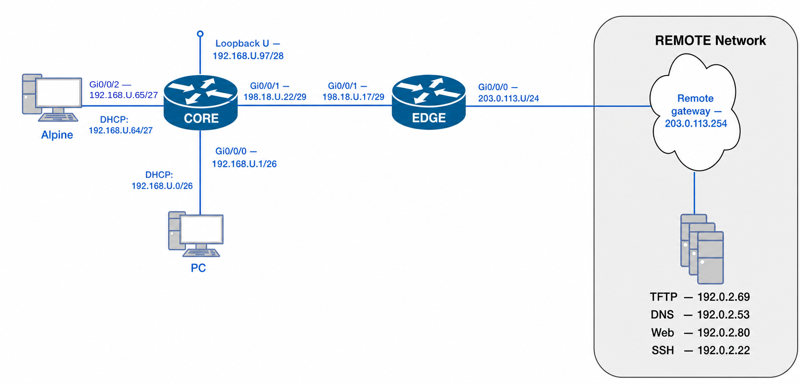

# Lab 12 - OSPF, NAT and Extended ACLs: Full-Stack Policy on a Routed Edge

```plaintext
Environment: Cisco IOS-XE physical lab; Windows PC (PowerShell); Alpine Linux VM.
```

This lab is a full-stack build on one topology: **routing, then translation, then filtering**. Each checkpoint depends on the one before it. You build OSPF (C01), then NAT (C02), then three extended ACLs (C03 to C05). The ACL checkpoints give you less help each time: C03 hands you the complete ACL, C04 gives you part of it, and in C05 you work it out yourself.

> This lab gives its instructions the way your Final SBA does: a parameter table, a build checklist and a verification step in every checkpoint. Keep your lab book up to date as you go; you will want it later.

## Your values

Wherever a command or a table shows `U`, substitute your own number. `U` is your Brightspace **U** grade.

**Identity and login**

| Item | Value |
|---|---|
| U | `your Brightspace U` |
| Router login | `admin / cisco` |
| Enable password | `class` |
| Course server login | `cisco / cisco` |

The values you need for each checkpoint (OSPF, NAT and ACL parameters) are shown in a table inside that checkpoint, right where you use them.

## Topology and addressing



> Both routers are Cisco IOS-XE routers with `Gi0/0/0` to `Gi0/0/2`. The PC and Alpine are the only hosts. The diagram is the cabling contract.

| Device | Type |
|---|---|
| EDGE, CORE | Cisco IOS-XE routers |
| PC | Windows host; console cable for Day0 |
| Alpine | Alpine Linux VM: the server/VM subnet test host and your usual SSH client |
| REMOTE | Instructor upstream and course services (not student-managed) |

All three inside networks are carved from a single block, `192.168.U.0/24`, by VLSM:

| Network | Block | Mask | Usable range | Gateway |
|---|---|---|---|---|
| PC subnet | `192.168.U.0/26` | `255.255.255.192` | `.1` to `.62` | `192.168.U.1` (CORE Gi0/0/0) |
| Server/VM subnet | `192.168.U.64/27` | `255.255.255.224` | `.65` to `.94` | `192.168.U.65` (CORE Gi0/0/2) |
| Loopback (private network) | `192.168.U.96/28` | `255.255.255.240` | `.97` to `.110` | `192.168.U.97` (CORE Loopback U) |


| Device | Interface | IP address (CIDR) | Description |
|---|---|---|---|
| **EDGE** | Gi0/0/0 | `203.0.113.U/24` | Outside interface to REMOTE; **not in OSPF** |
| **EDGE** | Gi0/0/1 | `198.18.U.17/29` | OSPF neighbour to CORE |
| **CORE** | Gi0/0/0 | `192.168.U.1/26` | PC subnet gateway |
| **CORE** | Gi0/0/1 | `198.18.U.22/29` | OSPF neighbour to EDGE |
| **CORE** | Gi0/0/2 | `192.168.U.65/27` | Server/VM subnet gateway |
| **CORE** | Loopback U | `192.168.U.97/28` | Private loopback network |
| **PC** | - | DHCP from `192.168.U.0/26` | The PC subnet test host, served by CORE |
| **Alpine** | - | DHCP from `192.168.U.64/27` | The server/VM subnet test host, served by CORE |
| **REMOTE** | - (gateway) | `203.0.113.254` | Upstream gateway |
| **TFTP server** | - | `192.0.2.69` | Course server |
| **DNS server** | - | `192.0.2.53` | |
| **Web server** | - | `192.0.2.80` | |
| **SSH server** | - | `192.0.2.22` | |

**Starting state.** Day0 provisions addressing, the default route on EDGE, NTP, DHCP and SSH. It does **not** provision OSPF, NAT or any ACL: those are your work in C01 to C05.

**Student scope:** cable and provision the pod, get the PC and Alpine addresses by DHCP, and make only the OSPF, NAT and ACL changes that Section C specifies. 

## How this lab works

### Two rules that explain every result in C03 to C05

1. **Extended ACLs can sit close to the source.** An extended ACL matches source, destination, protocol and port together, so it is precise enough to drop unwanted traffic at the first interface it enters, before it crosses the network. You will always trace the packet first, then place the ACL.
2. **An ACL on an inside interface is checked before NAT.** Inbound on an inside interface, the ACL sees the original private addresses. Inbound on the outside interface, the ACL sees a reply addressed to the translated (pool) address, because NAT has not yet translated it back. Once NAT works at C02, anything a policy blocks later is an ACL decision, so check the ACL counters first.

### The routine for every ACL (C03, C04 and C05)

Do these eight steps, in this order, every time.

| Step | What you do |
|---|---|
| 1. Follow the traffic | Write the path of the packet, interface by interface, with the direction it crosses each one |
| 2. Place the ACL | Choose the router, the interface and the direction. The first interface that sees the traffic you want to stop |
| 3. Write the ACL and bind it | Create the named ACL, then bind it with `ip access-group <name> in` or `out` |
| 4. Clear the counters | `clear access-list counters <name>`, so every count you read comes from this test run |
| 5. Test the traffic | Run each test command and **copy the command and its result into your lab book** |
| 6. Check the ACL | `show ip access-lists <name>` on the router that holds the ACL |
| 7. Check every ACE | Every ACE line must show `(n matches)` with n of 1 or more. **No matches, no points** |
| 8. Collect the show commands | Paste the `show` commands into the checkpoint's evidence file |

### One ACE per ACL carries `log`

Each ACL has exactly **one** ACE with the `log` keyword. Put it on the deny that sees the **least traffic** in your tests. Never put it on `permit ip any any`: that line matches everything and would flood the log. The first packet that matches a logged ACE is written to the log at once; later matches are summarised every five minutes. Read it with `show logging | include <ACL name>`.

### Mini quick-reference

| Task | Command | Notes |
|---|---|---|
| OSPF process | `router ospf <id>` | |
| Set router-ID | `router-id <id>` | under `router ospf` |
| Originate default route | `default-information originate` | under `router ospf`, on the router that has the real default route |
| Set DR priority | `ip ospf priority <0-255>` | under `interface`; `0` = never DR |
| Set OSPF timers | `ip ospf hello-interval <n>` / `ip ospf dead-interval <n>` | under `interface`; must match on both ends of a link |
| Point-to-point on a loopback | `ip ospf network point-to-point` | under `interface Loopback<n>` |
| Mark inside/outside for NAT | `ip nat inside` / `ip nat outside` | under the relevant `interface` |
| One ACE for a whole block | `access-list <n> permit <network> <wildcard>` | a wildcard sized to the `/24` matches every host in every sub-block |
| PAT to a named pool | `ip nat pool <name> <start> <end> netmask <mask>` then `ip nat inside source list <ACL> pool <name> overload` | |
| Named extended ACL | `ip access-list extended <NAME>` | |
| Permit/deny by protocol, source, destination, port | `permit\|deny <protocol> <source> <src-wildcard> <dest> <dest-wildcard> [eq <port>]` | e.g. `deny udp <src> <wc> host 192.0.2.69 eq 69` |
| Match ICMP echo requests only | `... echo` | `echo` is type 8 (request); replies (type 0) are not matched |
| One host / any host | `host <address>` / `any` | |
| Apply ACL to an interface | `ip access-group <NAME> in\|out` | under `interface` |
| Log one ACE | append `log` to that ACE | read with `show logging \| include <NAME>` |
| Clear ACL counters | `clear access-list counters <NAME>` | EXEC mode |
| View ACL and match counts | `show ip access-lists <NAME>` | EXEC mode |
| Which ACL is bound where | `show ip interface <if>` | look at the `access list` lines |
| NAT still translating? | `show ip nat translations` / `show ip nat statistics` | |
| Show one NAT pool | `show ip nat pool name <name>` | the keyword `name` is required before the pool name |

---

## Grading and rules

### Grading

This lab is graded out of **15 points**, with up to **3 bonus points**:

| Checkpoint | Work | Points | Bonus | Evidence file |
|---|---|---|---|---|
| C00 | Baseline provisioned and verified | gate, 0 | - | none: verified live |
| **C01** | OSPF, EDGE and CORE | **3** | - | `l12-c01-<username>.txt` |
| **C02** | NAT for all three inside networks | **3** | - | `l12-c02-<username>.txt` |
| **C03** | POLICY-VM, inbound on CORE Gi0/0/2 | **3** | +1 | `l12-c03-<username>.txt` |
| **C04** | POLICY-PC, inbound on CORE Gi0/0/0 | **3** | +1 | `l12-c04-<username>.txt` |
| **C05** | POLICY-EXTERNAL, on EDGE | **3** | +1 | `l12-c05-<username>.txt` |
| | **Base total** | **15** | **+3** | |

The bonus for C03, C04 and C05 is earned by including `show logging | include <ACL name>` output that shows a log entry from the ACE that carries `log`. It is not required to pass the checkpoint.

> **No matches, no points**
>In C03, C04 and C05 every ACE is read on its own from `show ip access-lists`. 
>An ACE line that shows no `(n matches)`, or shows 0 matches, earns nothing, even if the line is typed correctly. 
>If a line has no matches, you did not send the traffic that line is for: send it, then collect again.

### Evidence collection

- **Five evidence files, one per checkpoint:** `l12-c01-<username>.txt` to `l12-c05-<username>.txt`. The setup script in C00 creates them on your Desktop from the package templates. Each starts with its checkpoint header and lists the commands to run, with a `!-- Copy results here:` slot under each one.
- **You paste; nothing is collected for you.** Run each command on the device named in the banner line, then paste the prompt, the command and the raw output into its slot. Do not edit the output.
- **Test traffic goes in your lab book.** In C03 to C05, copy every test command and its result into your lab book as you run it. The evidence file holds the router `show` commands.
- **Upload each file as soon as its checkpoint is done.** The one exception is C01: the PC and Alpine have only private addressing until NAT works, so you upload `l12-c01-<username>.txt` together with C02's file.
- C00 is verified live at the terminal: no file is submitted for it.
- Do not submit running configurations or screenshots.


---

## C00 - provision the baseline and confirm it is stable

**Points:** 0 (gate). Nothing is submitted for this checkpoint.

Get the addressing, NTP, DHCP and SSH baseline onto both routers and confirm it is solid before you build OSPF on top of it. If addressing or DHCP is wrong here, every later checkpoint becomes impossible to diagnose cleanly. Do not start **C01** until every line of the gate table below passes.

### C00 setup checklist

- [ ] Day0 provisioning guide, [`day0-provision-guide.md`](../resources/day0-provision-guide.md), open.
- [ ] Lab content `l12.zip` downloaded to the PC.
- [ ] Setup script run with the lab value `l12` and your U; it reports `SETUP OK` with both device templates and all five evidence files present.
- [ ] EDGE and CORE cabled per the topology: EDGE `Gi0/0/1` to CORE `Gi0/0/1` (transit), EDGE `Gi0/0/0` to the upstream jack. Both port labels checked on every cable.
- [ ] **EDGE** provisioned first, then **CORE**. Do not change the order.
- [ ] Final link check (`--verify-only`) run on both devices: every line passes, including the transit interface up/up.
- [ ] PC connected to CORE `Gi0/0/0` and Alpine to CORE `Gi0/0/2`; both hosts set to obtain an address automatically.
- [ ] PC and Alpine addresses recorded in your lab book: you need both in C02 to C04.

**Download the package.** Prepare the PC by following the guide through the setup script, then run exactly this block for the download:

```powershell
Set-Location "$env:USERPROFILE\Desktop"
$lab = "l12"
scp cisco@192.0.2.69:configs/$lab.zip "$env:USERPROFILE\Desktop\"
```

The package contains `day0_provision.py`, its templates, `day0-l12.yaml` and the five evidence templates.

**Provision EDGE, then CORE.** Follow the guide's provisioning steps once for each device and move the console cable between pushes. Read each device's verification summary. Every line must pass, except the transit link row while the device at the other end is not yet provisioned:

| Device | May show down for now | Must pass |
|---|---|---|
| EDGE | Gi0/0/1 (CORE): the `got` line must still show the correct address from the addressing table, with a down status | SSH, no OSPF process, Gi0/0/0 up/up, default route |
| CORE | none for the transit link; Gi0/0/0 and Gi0/0/2 are checked for their address only, because the hosts are not connected yet | SSH, no OSPF process, Gi0/0/1, Loopback U, both DHCP pools |

> **Stop, do not re-push**
>
> Stop for a rejected configuration line, a failed SSH check, any OSPF process where the summary expects none, a wrong address, or a down row that is not in the table. Do not re-push Day0 and do not add routing. Keep the error output and raise your hand. A down row that is not in the table is a cabling problem: fix the cable and recheck, you do not need to rerun Day0.

**Final link check.** After CORE is provisioned, recheck both devices without sending any configuration. Move the console cable to each device in turn, set `$device` to `EDGE` or `CORE`, and run:

```powershell
python day0_provision.py --config day0-$lab.yaml --device $device --u $u --username $username --port $consolePort --verify-only
```

### C00 - gate table

Run these on the devices, with the hosts connected. All of them must pass.

| # | Where | Command | Required result |
|---|---|---|---|
| 1 | EDGE | `show ip interface brief` | `Gi0/0/0` is `203.0.113.U` up/up; `Gi0/0/1` is `198.18.U.17` up/up |
| 2 | CORE | `show ip interface brief` | `Gi0/0/0` `192.168.U.1`, `Gi0/0/1` `198.18.U.22`, `Gi0/0/2` `192.168.U.65`, `Loopback U` `192.168.U.97`, all up/up |
| 3 | CORE | `show ip dhcp binding` | The PC has a lease in `192.168.U.0/26` and Alpine has a lease in `192.168.U.64/27` |
| 4 | EDGE and CORE | `show ntp associations` | CORE is synchronized to EDGE (stratum 5) |
| 5 | PC | `ssh admin@198.18.U.22` | CORE login prompt. CORE answers on its transit address with no routing protocol needed |
| 6 | CORE | `ssh -l admin 198.18.U.17` | EDGE login prompt, over the directly connected transit link |
| 7 | EDGE and CORE | `show tcp brief` | Output present on both, run in the SSH sessions from rows 5 and 6, which you keep open. The command prints nothing when a router has no active session. It has no operational purpose for you: it is a submission-uniqueness check |

> **Not yet**
>
> The PC and Alpine cannot reach EDGE's address `203.0.113.U` or anything upstream until OSPF gives CORE a default route (C01), and they cannot reach `192.0.2.x` until NAT works (C02). That is expected. 
> If a host gets no lease, check that the cable is in the right CORE port (`Gi0/0/0` for the PC, `Gi0/0/2` for Alpine), then on CORE run `show ip dhcp pool` and `show ip dhcp conflict` and renew the lease on the host.

### Success Indicator / Failure Signal

| Verification item | Success indicator | Failure signal |
|---|---|---|
| Package and setup | `SETUP OK`, with all five evidence files created or kept | `SETUP FAILED: missing or invalid ...`, or an evidence file missing |
| EDGE Day0 summary | SSH, no OSPF process, Gi0/0/0 `203.0.113.U` up/up, default route via `203.0.113.254`; Gi0/0/1 `198.18.U.17` with the correct address | A rejected line, a failed SSH or OSPF check, a wrong address, or Gi0/0/0 down |
| CORE Day0 summary | SSH, no OSPF process, Gi0/0/0 `192.168.U.1`, Gi0/0/1 `198.18.U.22`, Gi0/0/2 `192.168.U.65`, Loopback U `192.168.U.97`, DHCP pools `PCPOOL` and `SERVERNET` | A rejected line, a failed SSH or OSPF check, a wrong address, or any other row down |
| Final link check | `--verify-only` shows every line passing on both devices, transit interface up/up | Any failed line, or Day0 re-pushed to get past it |
| Interfaces | Every configured interface up/up | Any interface down |
| DHCP bindings | Both end hosts leased | Either missing |
| NTP | CORE synchronized to EDGE (stratum 5) | Not synchronized |
| SSH reachability | Both routers reachable with `admin` / `cisco` | Refused or timeout |
| `show tcp brief` | Output present on both EDGE and CORE | Output missing on either device |
| Evidence files | `l12-c01-<username>.txt` to `l12-c05-<username>.txt` exist on the Desktop, with your username and U in the first lines | A file missing, or `{USERNAME}` / `{U}` still visible |

If a push fails or SSH does not come up, read the Troubleshooting section of the Day0 guide before running anything again. For any other Day0 failure, keep the error output and raise your hand before starting C01.

---

## C01 - OSPF

**Points:** 3. **Evidence file:** `l12-c01-<username>.txt`

Build a single-area OSPF domain between EDGE and CORE. OSPF is the first layer: without the adjacency and the default route that CORE learns from EDGE, the inside networks have no path out, and nothing built at C02 to C05 can be tested.

### C01 - your OSPF parameters

| Item | Value |
|---|---|
| Process ID | `U` |
| Area | `0` |
| EDGE router-ID | `U.0.0.17` |
| CORE router-ID | `U.0.0.22` |
| Reference bandwidth | `10000 Mbps` |
| DR priority (EDGE Gi0/0/1) | `U` |
| Hello / Dead (transit) | `5 / 20` |
| CORE loopback interface | `Loopback U` |


### C01 build checklist

- [ ] OSPF process `U` on **both** routers, area `0` on every OSPF interface.
- [ ] Router-IDs set **manually**: EDGE `U.0.0.17`, CORE `U.0.0.22`.
- [ ] Reference bandwidth `10000` Mbps on **both** routers.
- [ ] EDGE originates the default route into OSPF so CORE learns a way out. The static default route to `203.0.113.254` is already there from Day0: leave it alone.
- [ ] EDGE `Gi0/0/0` (the interface facing REMOTE) is **not declared in the OSPF process at all**, not even as passive.
- [ ] Every interface that is not directly connected to an OSPF neighbour is passive. That includes CORE `Loopback U`.
- [ ] EDGE wins the DR election on the transit link: priority `U` on EDGE `Gi0/0/1`.
- [ ] CORE's PC-facing and server/VM-facing interfaces never become DR: priority `0`.
- [ ] Transit link only: hello `5`, dead `20`, **matching on both ends**.
- [ ] CORE `Loopback U` uses the OSPF network type `point-to-point`.
- [ ] **No static routes on CORE.** Reachability must come from OSPF.

> **What C01 does not prove**
>
> The PC and Alpine still cannot reach `192.0.2.x`: nothing translates their private addresses yet. That is correct and expected. C02 adds it.


### C01 - Verification and collection of information

**Evidence file:** `l12-c01-<username>.txt`

**Step 1 - open your evidence file.** `l12-c01-<username>.txt` is on your Desktop. Each device starts at a banner line, and each command has a slot under it. Run the command on that device and paste the prompt, the command and the raw output into the slot.

**Step 2 - set up your sessions, and do not move the console cable.** 
- [ ] Leave the console cable on EDGE for the rest of the lab.  Configure EDGE in the console.
- [ ] From the PC, SSH into CORE with `ssh admin@198.18.U.22` and configure CORE in that session. 
- [ ] Keep both open. 

**Step 3 - wait for the adjacency to reach `FULL`, then collect the commands, one router at a time.** Run each command and paste its prompt, command and raw output into its slot in the file.

On **EDGE** (console), run these **nine** commands, in this order:

```text
show ip protocols
show ip ospf | include Reference
show ip ospf neighbor
show ip ospf interface brief
show ip ospf interface GigabitEthernet0/0/0
show ip route static | begin Gateway
show ip ospf interface GigabitEthernet0/0/1 | include Timer|Router ID|Priority
show ip ssh
show ntp associations
```

On **CORE** (the SSH session), run these **nine** commands, in this order. In the fifth, replace `U` with your own number:

```text
show ip protocols
show ip ospf | include Reference
show ip ospf interface brief
show ip ospf interface GigabitEthernet0/0/1 | include Timer|Priority
show ip ospf interface Loopback U | include Timer|Passive
show ip route ospf
show ip ssh
show ntp associations
show tcp brief
```

`show ip ospf interface GigabitEthernet0/0/0` on EDGE is expected to print **`%OSPF: OSPF not enabled on GigabitEthernet0/0/0`**. IOS refuses the command for an interface that is not part of any OSPF process, and that message is the evidence, not an error. Paste the prompt, the command and the message as they appear.

**Step 4 - three reachability tests.** 


| Test   | From   | Command                 | Required result                 | What it proves                                                                                              |
| ------ | ------ | ----------------------- | ------------------------------- | ----------------------------------------------------------------------------------------------------------- |
| **R1** | EDGE   | `ping 192.168.U.97`     | `!!!!!`                         | EDGE learned the inside networks from CORE through OSPF: before OSPF, EDGE has no route to `192.168.U.0/24` |
| **R2** | Alpine | `ping -c 4 203.0.113.U` | 4 replies                       | CORE has a default route that only EDGE could have originated, and EDGE can answer a private address        |
| **R3** | Alpine | `ping -c 4 192.0.2.69`  | **0 replies, 100% packet loss** | Negative control. Nothing translates Alpine's address yet, so the server's reply has nowhere to go          |

**Step 5 - write your `!-- PROOF:` line** at the bottom of the file: one sentence stating what shows that EDGE and CORE are FULL neighbours, EDGE is DR, CORE learned `0.0.0.0/0` through OSPF, and EDGE `GigabitEthernet0/0/0` is outside OSPF.

**Your file must show:**

| Requirement      | Detail                                                                                                            |
| ---------------- | ----------------------------------------------------------------------------------------------------------------- |
| Header line      | `=== C01 – OSPF Verification ===` as the template gives it                                                        |
| Both devices     | Output from EDGE and from CORE, each with its device prompt                                                       |
| Every command    | Every command in the template has its raw output under it; `show ip ospf interface GigabitEthernet0/0/0` shows `%OSPF: OSPF not enabled on GigabitEthernet0/0/0` |
| `show tcp brief` | Present on CORE, with the device prompt                                                                           |
| Proof line       | One `!-- PROOF:` sentence at the bottom                                                                           |

### Success Indicator / Failure Signal

| Verification item           | Success indicator                                                     | Failure signal                                                             |
| --------------------------- | --------------------------------------------------------------------- | -------------------------------------------------------------------------- |
| Adjacency                   | EDGE and CORE, state `FULL`                                           | Missing, or stuck at `INIT` / `EXSTART`                                    |
| Router-ID                   | Matches the parameter table                                           | Auto-selected                                                              |
| DR                          | EDGE wins on the transit link                                         | The wrong device elected                                                   |
| Default route               | `0.0.0.0/0` on CORE, learned through OSPF                             | Missing                                                                    |
| Reference bandwidth         | `Reference bandwidth unit is 10000 mbps` on both routers              | Default value, or only one router changed                                  |
| Passive interfaces          | Every non-neighbour interface passive, including `Loopback U`         | Any active unnecessarily, or the loopback left non-passive                 |
| EDGE Gi0/0/0                | `show ip ospf interface GigabitEthernet0/0/0` on EDGE prints `%OSPF: OSPF not enabled on GigabitEthernet0/0/0` | Any interface detail (state, timers, priority), even a passive listing: the interface is still in the process |
| Timers                      | Hello 5 and dead 20 on both ends of the transit link                  | Mismatched or default values                                               |
| R1 and R2                   | R1 `!!!!!`; R2 4 replies                                              | Any failure                                                                |
| R3                          | 100% packet loss                                                      | Any reply: something is already translating                                |
| Submission-uniqueness check | `show tcp brief` output present, with the device prompt, on CORE      | Output missing                                                             |

### Troubleshooting

- **Neighbour missing or stuck:** check interface status, area number, process ID, matching hello and dead timers, and that the two router-IDs are different.
- **No default route on CORE:** confirm EDGE has `ip route 0.0.0.0 0.0.0.0 203.0.113.254` (part of the Day0 baseline) before `default-information originate` has anything to originate.
- **EDGE loses the DR election to CORE:** the priority must be set on EDGE's `Gi0/0/1`, not CORE's.
- **R1 fails:** EDGE has no route to the loopback network. Check that CORE's loopback is in OSPF (passive, but declared) and that `show ip route ospf` on EDGE lists `192.168.U.96/28`.

> **Hold this file.** The PC and Alpine cannot reach the course server until C02's NAT rule works, so you upload `l12-c01-<username>.txt` together with C02's file.

---

## C02 - NAT

**Points:** 3. **Evidence file:** `l12-c02-<username>.txt`

Configure **one NAT rule** that covers all three inside networks at once: a single summarised ACE, the same way you would summarise routes. Every NAT command goes on **EDGE**; CORE carries no NAT configuration at all.

Make sure NAT is fully proven now, using each service the ACLs will restrict later. Then anything blocked in C03 to C05 can be diagnosed as an ACL problem with confidence, not second-guessed as a NAT problem. The test traffic exercises the PC and server/VM subnets, the two with live hosts. Nothing in this lab originates traffic from the loopback network, so its coverage is confirmed by reading the ACL, not by a traffic test.


### C02 - your NAT parameters

| Item | Value |
|---|---|
| Inside networks | `192.168.U.0/24 (all three)` |
| Selector ACL | `number U, standard` |
| ACEs in the selector | `exactly one` |
| Pool name | `<username>-POOL` |
| Pool block | `209.10.U.0/28` |
| Pool range | `first 6 usable addresses` |
| Pool netmask | `255.255.255.240` |
| Translation | `pool, overload` |


### C02 build checklist

> **The wildcard and the pool range are the marks** Work the wildcard out from the `/24` yourself, and calculate the first six usable addresses of `209.10.U.0/28` yourself. Neither is given.

- [ ] Standard ACL `U` with **exactly one** ACE permitting `192.168.U.0/24`, using the wildcard you calculate. It covers the PC, server/VM and loopback sub-blocks without listing them separately.
- [ ] Pool named with **your own username** followed by `-POOL` (not a placeholder), covering the first 6 usable addresses of `209.10.U.0/28`: not the network address, not the broadcast address.
- [ ] Pool netmask `255.255.255.240`, matching the pod's real block. Do not narrow it to a `/29`: that would describe a smaller allocation that was never carved out.
- [ ] Translation statement binds ACL `U` to your pool with `overload`.
- [ ] Identify the two EDGE interfaces involved in the translation and mark each one `ip nat inside` or `ip nat outside`.
- [ ] CORE carries no NAT commands.


### C02 - Verification and collection of information

**Evidence file:** `l12-c02-<username>.txt`

**Step 1 - generate the eight test flows**, one at a time, from the host named in the table. The first six are the specific services the ACLs will restrict later; the last two are plain reachability checks.

| # | From | Test | Command |
|---|---|---|---|
| 1 | Alpine | TFTP to the TFTP server | `tftp 192.0.2.69 -c put <any file>` |
| 2 | Alpine | SSH to the SSH server | `ssh admin@192.0.2.22` |
| 3 | Alpine | HTTP to the web server | `curl http://192.0.2.80` |
| 4 | PC | DNS query to the DNS server | `nslookup ns.cnap.cst 192.0.2.53` |
| 5 | PC | HTTP to the TFTP server's address | `curl.exe http://192.0.2.69` |
| 6 | PC | HTTPS to the web server | `curl.exe -k https://192.0.2.80` |
| 7 | Alpine | ICMP to the TFTP server | `ping -c 4 192.0.2.69` |
| 8 | PC | ICMP to the TFTP server | `ping 192.0.2.69` |

> **Alpine's TFTP syntax differs from the PC's.** On Alpine the server comes first and the transfer is a `-c` command: `tftp <host> -c put <file>`. It is not the Windows-style `tftp -i <host> put <file>`. Later checkpoints that use TFTP from Alpine use the same form. **On the PC, type `curl.exe`, not `curl`:** in Windows PowerShell, `curl` is an alias for `Invoke-WebRequest`, which rejects `-k` and `--max-time`. A web browser works instead of `curl` for tests 3, 5 and 6. Open Alpine in a regular SSH session from your PC: copy and paste work much better than in the VM console.

Every ping (tests 7 and 8) must show **100% success**: `0% packet loss` on Alpine, `Lost = 0 (0% loss)` on the PC. If a ping shows any loss, run it again until it is clean.

**Step 2 - capture each translation right after you generate its flow.** The translation table ages out on its own, especially for short flows such as one ping or one DNS query, so do not run all eight tests and then look once. After each test, run this on EDGE, filtering on that host's own DHCP-leased address:

```text
EDGE# show ip nat translations | include <that host's address>
```

Paste each host result and its EDGE result into the slots the template gives that test. Do it for all eight.

**Step 3 - capture the three review commands on EDGE:**

```text
EDGE# show ip nat statistics
EDGE# show ip access-list U
EDGE# show ip nat pool name <username>-POOL
```

`show ip nat pool` is a review command: it confirms the pool's real range. It is not pass/fail evidence by itself.

**Step 4 - write your `!-- PROOF:` line:** one sentence stating what shows that a single ACE covers the whole `/24` and that PC and server/VM traffic translated through the pool.

**Your file must show:**

| Requirement | Detail |
|---|---|
| Header line | `=== C02 – NAT Verification ===` as the template gives it |
| Translations | For each of the 8 tests, the host output and the matching EDGE entry captured at the time you ran it, including both ping outputs |
| NAT statistics | `show ip nat statistics` with `Hits:` of 8 or more |
| Selector ACL | `show ip access-list U` showing a single ACE for `192.168.U.0 0.0.0.255` |
| Pool | `show ip nat pool name <username>-POOL` with the range and the `/28` mask |
| Proof line | One `!-- PROOF:` sentence at the bottom |

### Success Indicator / Failure Signal

| Verification item | Success indicator | Failure signal |
|---|---|---|
| Translation evidence | Each of the 8 flows has a matching entry captured when you ran it (other entries in the table are fine) | Any of the 8 flows with no matching entry |
| Ping tests (7, 8) | 100% success on both | Any packet loss |
| NAT statistics, Hits | 8 or more | 0 hits |
| ACL U | One ACE, `192.168.U.0 0.0.0.255`. Hits of 8 or more are informational: check against NAT statistics if it shows 0 while translations work | More than one ACE, or the wrong network or wildcard |
| Pool range | The first 6 usable addresses of `209.10.U.0/28`, correctly calculated | Includes the network or broadcast address, or is otherwise miscounted |
| Pool mask | `/28`, matching the pod's real block | Narrowed to `/29` or otherwise different |
| Marking | Inside and outside on the correct EDGE interfaces | Reversed or missing |

### Troubleshooting

- **Some flows translate and others do not:** confirm the wildcard on ACL U is `0.0.0.255` (the full `/24`), not something narrower that excludes one sub-block.
- **Nothing translates:** confirm `ip nat inside` and `ip nat outside` are on the correct EDGE interfaces, and that the translation statement names ACL `U` and your pool.
- **A ping works but its translation is missing:** run the test again and read the table at once; entries age out.

**Upload both evidence files now.** NAT gives the PC and Alpine a path to the course server for the first time, so upload `l12-c01-<username>.txt` (held from C01) and `l12-c02-<username>.txt` together, from the PC, then validate in the same window:

```powershell
scp "l12-c01-$username.txt" "l12-c02-$username.txt" "cisco@192.0.2.69:/var/tftp/"
ssh cisco@192.0.2.69 "ls -l /var/tftp/*$username*"
```

The listing must show both files, each with a non-zero size. A transfer that returns without an error is not confirmation.

---

## C03 - Policy 1: filter the server/VM subnet (POLICY-VM)

**Points:** 3 (+1 bonus). **Evidence file:** `l12-c03-<username>.txt`

Restrict the server/VM subnet to a specific set of denied services and permit everything else. **In this checkpoint the complete ACL is given.** Your work is to understand why each line is there, place it where the traffic is first visible, and prove every line with matches.

### Security policy statement

Devices in the server/VM subnet (`192.168.U.64/27`) are **denied**:

- Web access (HTTP and HTTPS) to the web server at `192.0.2.80`
- TFTP access to the TFTP server at `192.0.2.69`
- SSH access to the SSH server at `192.0.2.22`
- ICMP echo requests (pings) to devices in the PC subnet (`192.168.U.0/26`)

All other traffic is permitted, including access to the CORE router itself.

### C03 - your ACL parameters

| Item | Value |
|---|---|
| ACL name | `POLICY-VM` |
| Device / interface | `CORE Gi0/0/2` |
| Direction | `in` |
| Server/VM network | `192.168.U.64/27` |
| PC network | `192.168.U.0/26` |
| ACE with log | `ACE 5 (ping to the PC subnet)` |

The wildcard mask is the subnet mask turned upside down: `255.255.255.224` (`/27`) becomes `0.0.0.31`, and `255.255.255.192` (`/26`) becomes `0.0.0.63`.

| ACE | Line | Action | Protocol | Source | Destination | Match | Policy line it enforces |
|---|---|---|---|---|---|---|---|
| 1 | 10 | deny | tcp | `192.168.U.64 0.0.0.31` | `host 192.0.2.80` | `eq 80` | HTTP to the web server |
| 2 | 20 | deny | tcp | `192.168.U.64 0.0.0.31` | `host 192.0.2.80` | `eq 443` | HTTPS to the web server |
| 3 | 30 | deny | udp | `192.168.U.64 0.0.0.31` | `host 192.0.2.69` | `eq 69` | TFTP to the TFTP server |
| 4 | 40 | deny | tcp | `192.168.U.64 0.0.0.31` | `host 192.0.2.22` | `eq 22` | SSH to the SSH server |
| 5 | 50 | deny | icmp | `192.168.U.64 0.0.0.31` | `192.168.U.0 0.0.0.63` | `echo`, **log** | Pings to the PC subnet |
| 6 | 60 | permit | ip | `any` | `any` | | Everything else |

The `log` keyword is on ACE 5, the ping, because it is the line that sees the least traffic: a ping test is exactly three packets, while the web, TFTP and SSH tests keep retrying. `permit ip any any` never logs.

### Step 1 - follow the traffic

Trace the two paths a packet from Alpine can take:

```text
To the Internet:  Alpine -> CORE Gi0/0/2 (in) -> CORE Gi0/0/1 (out) -> EDGE Gi0/0/1 (in) -> EDGE Gi0/0/0 (out, NAT) -> REMOTE -> server
To the PC subnet: Alpine -> CORE Gi0/0/2 (in) -> CORE Gi0/0/0 (out) -> PC           (never leaves CORE)
```

### Step 2 - place the ACL

| Device | Interface | Direction | Reason |
|---|---|---|---|
| CORE | `GigabitEthernet0/0/2` | `in` | It is the first interface all five flows cross, before routing and before NAT, so one ACL here covers the four Internet flows and the ping to the PC, which never reaches EDGE |

> **Why not on EDGE?** The ping to the PC subnet stays inside CORE and never reaches EDGE, so an ACL on EDGE could never stop it. Close to the source is also cheaper: the other four flows are dropped before they cross the transit link and reach NAT.

### Step 3 - write the ACL and bind it

On CORE. Type no `remark` lines, so each ACE keeps the line number in the table:

```text
ip access-list extended POLICY-VM
 deny tcp 192.168.U.64 0.0.0.31 host 192.0.2.80 eq 80
 deny tcp 192.168.U.64 0.0.0.31 host 192.0.2.80 eq 443
 deny udp 192.168.U.64 0.0.0.31 host 192.0.2.69 eq 69
 deny tcp 192.168.U.64 0.0.0.31 host 192.0.2.22 eq 22
 deny icmp 192.168.U.64 0.0.0.31 192.168.U.0 0.0.0.63 echo log
 permit ip any any
 exit
interface GigabitEthernet0/0/2
 ip access-group POLICY-VM in
 exit
```

### C03 build checklist

- [ ] ACL name spelled exactly `POLICY-VM`, with all five deny ACEs and the final `permit ip any any`.
- [ ] `log` on ACE 5 only; none of the other lines carries it.
- [ ] Bound `in` on CORE `GigabitEthernet0/0/2`.
- [ ] Counters cleared before the first test.

### C03 - Verification and collection of information

**Evidence file:** `l12-c03-<username>.txt`

> **Re-running a test sequence carries no penalty**
>
> Counters are cumulative. Mistyped one? Run `clear access-list counters POLICY-VM` and run the whole sequence again from the top.

### Step 4 - clear the counters

On CORE:

```text
CORE# clear access-list counters POLICY-VM
CORE# show ip access-lists POLICY-VM
```

All six lines must show no matches before you test.

### Step 5 - test the traffic (lab book)

Run each command from **Alpine** and copy the **command and its result into your lab book**. Find the PC's address with `show ip dhcp binding` on CORE. First create a small file for the TFTP test:

```bash
echo "l12 tftp test" > l12-tftp-test.txt
```

| # | ACE | Command (from Alpine) | Expected now that POLICY-VM is bound |
|---|---|---|---|
| 1 | 1 | `curl --max-time 5 http://192.0.2.80` | Blocked: times out |
| 2 | 2 | `curl --max-time 5 -k https://192.0.2.80` | Blocked: times out |
| 3 | 3 | `tftp 192.0.2.69 -c put l12-tftp-test.txt` | Blocked: no transfer. Wait about 10 seconds, then press Ctrl-C |
| 4 | 4 | `ssh -o ConnectTimeout=5 admin@192.0.2.22` | Blocked: connection times out |
| 5 | 5 | `ping -c 3 <PC-address>` | Blocked: 100% packet loss |
| 6 | 6 | `ping -c 3 192.0.2.69` | ✔ Allowed: 0% packet loss. It worked before the ACL and still does |
| 7 | 6 | `ping -c 3 192.168.U.65` | ✔ Allowed: 0% packet loss. CORE is internal and is not in the deny list |

> A timeout **is** the expected result for tests 1 to 4. Do not retry looking for a nicer error message: the evidence is the hit counter, not the client's message. Tests 6 and 7 must still work. If either one fails, one of your deny ACEs is wider than the policy.

### Step 6 and 7 - check the ACL; every ACE must have matches

On CORE:

```text
CORE# show ip access-lists POLICY-VM
```

All six lines must show `(n matches)` with n of 1 or more. **No matches, no points.** The ping line (ACE 5) shows exactly 3 matches if you ran the ping once after clearing the counters.

If `permit ip any any` shows 0 matches, the ACL is dropping traffic that should pass. Only if the ACL shows the hit but `show ip nat translations` has no matching entry is it a NAT problem. You proved NAT works at C02, so start with the ACL.

### Step 8 - collect the show commands

Run these on CORE and paste each result into `l12-c03-<username>.txt`:

```text
CORE# show ip access-lists POLICY-VM
CORE# show ip interface GigabitEthernet0/0/2 | include access list
CORE# show logging | include POLICY-VM
```

The `show logging` line is the bonus: it must show a log entry for the pings (ACE 5), for example `list POLICY-VM denied icmp 192.168.U.70 -> 192.168.U.5 (8/0), 1 packet`. Write your `!-- PROOF:` line: one sentence stating that POLICY-VM is applied inbound on Gi0/0/2, all four denied services and the ping are blocked, and internal and unlisted traffic is still permitted.

**Your file must show:**

| Requirement | Detail |
|---|---|
| Header line | `=== C03 – Policy #1 - POLICY-VM Verification ===` as the template gives it |
| Every ACE | All six lines show `(n matches)` with n of 1 or more: each ACE is credited on its own |
| Binding | `show ip interface` shows `Inbound access list is POLICY-VM` |
| Device identity | The CORE prompt appears with each command |
| Bonus (+1) | `show logging \| include POLICY-VM` shows a log entry from ACE 5 |
| Proof line | One `!-- PROOF:` sentence at the bottom |

**Answer in your lab book:**

1. The ping to the PC never leaves CORE. Why does an ACL on `Gi0/0/2` still stop it?
2. The ACL matched Alpine's private source address, `192.168.U.64/27`. Why does it not see the pool address?
3. The ping ACE counted exactly 3 after `ping -c 3`. What does that tell you the counter measures?

### Success Indicator / Failure Signal

| Verification item | Success indicator | Failure signal |
|---|---|---|
| Denied flows (tests 1 to 5) | Each one blocked | Any one succeeds |
| Permitted flows (tests 6, 7) | 100% success on both | Unexpectedly blocked, or any ping loss |
| ACL binding | `POLICY-VM` bound `in` on Gi0/0/2 | Wrong interface or direction |
| Hit counters | All six ACEs (five denies and the permit) show 1 or more matches | Any line at 0 matches |
| Log | `log` on ACE 5 only; a log entry for the ping appears in `show logging` | `log` on the permit, on several ACEs, or no log entry |

### Troubleshooting

- **Permitted traffic fails too:** confirm the ACL is bound `in`, not `out`, and that the last line is `permit ip any any`.
- **A deny has no effect:** check the wildcard masks: `0.0.0.31` for the `/27` server/VM subnet and `0.0.0.63` for the `/26` PC subnet. The ping ACE must end in `echo`.
- **An ACE shows 0 matches:** you did not send that flow. Send it, then run `show ip access-lists POLICY-VM` again.

**Upload `l12-c03-<username>.txt` now**, do not hold it for later checkpoints, and validate:

```powershell
scp "l12-c03-$username.txt" "cisco@192.0.2.69:/var/tftp/"
ssh cisco@192.0.2.69 "ls -l /var/tftp/*$username*"
```

---

## C04 - Policy 2: filter the PC subnet (POLICY-PC)

**Points:** 3 (+1 bonus). **Evidence file:** `l12-c04-<username>.txt`

Restrict the PC subnet to a specific set of denied services and permit everything else. **In this checkpoint you are given part of the information.** The policy, the path and a skeleton are given; you complete the placement, the wildcards, the ports and the protocols. One of the denies targets a single host, not the subnet, so the rest of the PC subnet keeps that service.

### Security policy statement

Devices in the PC subnet (`192.168.U.0/26`) may reach most services, except:

- DNS queries from **your own PC** (its DHCP-leased address) to the DNS server at `192.0.2.53`
- Web (HTTP) access to the TFTP server's address `192.0.2.69`
- Secure web (HTTPS) access to the web server's address `192.0.2.80`

All other traffic is permitted, including TFTP, SSH and HTTP to the web server `192.0.2.80`.

> Read the statement carefully. The HTTPS restriction is on the **web server's** address (`192.0.2.80`), not the DNS server's, and the HTTP restriction is on the **TFTP server's** address (`192.0.2.69`).

### C04 - your ACL parameters

| Item | Value |
|---|---|
| ACL name | `POLICY-PC` |
| PC network | `192.168.U.0/26` |
| Your PC's address | `from C00 (lab book)` |
| Device | `CORE` |
| Interface / direction | `you decide (step 2)` |
| ACE with log | `ACE 1 (the one-host DNS deny)` |

### Step 1 - follow the traffic

Trace the path of a packet from the PC to a server:

```text
PC -> CORE Gi0/0/0 (in) -> CORE Gi0/0/1 (out) -> EDGE Gi0/0/1 (in) -> EDGE Gi0/0/0 (out, NAT) -> REMOTE -> server
```

### Step 2 - place the ACL (plan in your lab book)

An extended ACL belongs close to the **source**. Find the first interface a packet from the PC crosses, and the direction it crosses it in. Write your answer in your lab book before you configure anything:

| Device | Interface | Direction | Reason |
|---|---|---|---|
| CORE | ______________ | ______ | ______________________________________________ |

### Step 3 - plan the ACEs (plan in your lab book)

Complete every blank in this table in your lab book: the ports, the protocols and the wildcards. You enter the result in step 4, where it is graded.

| ACE | Action | Protocol | Source | Destination | Port |
|---|---|---|---|---|---|
| 1 | deny | `udp` | `host <PC-address>` | `host 192.0.2.53` | `eq ____`, then `log` |
| 2 | deny | ______ | `192.168.U.0` wildcard ______ | `host 192.0.2.69` | `eq ____` |
| 3 | deny | `tcp` | `192.168.U.0` wildcard ______ | `host ______` | `eq ____` |
| 4 | permit | ______ | `any` | `any` | |

Two hints. The wildcard is the subnet mask turned upside down, and the PC subnet is a `/26`. And `log` goes on ACE 1 only: it is the narrowest line (one host, one service), so it sees the least traffic.

### Step 4 - write the ACL and bind it

On CORE, from your completed plan. The skeleton shows the shape, and the bind command still needs your interface and direction from step 2:

```text
ip access-list extended POLICY-PC
 deny udp host <PC-address> host 192.0.2.53 eq ___ log
 deny ___ 192.168.U.0 ___ host 192.0.2.69 eq ___
 deny tcp 192.168.U.0 ___ host ___ eq ___
 permit ___ any any
 exit
interface <your interface>
 ip access-group POLICY-PC <your direction>
 exit
```

### C04 build checklist

- [ ] ACL name spelled exactly `POLICY-PC`, with three deny ACEs and the final permit.
- [ ] ACE 1 matches your own PC with `host <PC-address>`, not the subnet's wildcard.
- [ ] ACE 2 and ACE 3 match the whole PC subnet with the wildcard you calculated, and name the destination **and** the port.
- [ ] `log` on ACE 1 only.
- [ ] Bound on the interface and in the direction you chose in step 2.
- [ ] Counters cleared before the first test.

### C04 - Verification and collection of information

**Evidence file:** `l12-c04-<username>.txt`

### Step 5 - clear the counters, then test the traffic (lab book)

On CORE:

```text
CORE# clear access-list counters POLICY-PC
CORE# show ip access-lists POLICY-PC
```

Then run each command from the **PC** (PowerShell) and copy the **command and its result into your lab book**. Create a small file for the TFTP test first, in the folder you are working in:

```powershell
echo "l12 tftp test" > l12-tftp-test.txt
```

| # | ACE | Command (from the PC) | Expected now that POLICY-PC is bound |
|---|---|---|---|
| 1 | 1 | `nslookup ns.cnap.cst 192.0.2.53` | Blocked: DNS request times out |
| 2 | 2 | `curl.exe --max-time 5 http://192.0.2.69` | Blocked: times out |
| 3 | 3 | `curl.exe -k --max-time 5 https://192.0.2.80` | Blocked: times out |
| 4 | 4 | `tftp -i 192.0.2.69 PUT l12-tftp-test.txt` | ✔ Allowed: the transfer completes |
| 5 | 4 | `ssh admin@192.0.2.22` | ✔ Allowed: a password prompt appears; press Ctrl-C |
| 6 | 4 | `curl.exe --max-time 5 http://192.0.2.80` | ✔ Allowed: the web server answers |

> Tests 4 to 6 are the controls. They prove your deny ACEs are not wider than the policy. They worked before the ACL (TFTP, SSH, HTTP to the web server) and must still work.

### Step 6 and 7 - check the ACL; every ACE must have matches

On CORE:

```text
CORE# show ip access-lists POLICY-PC
```

All four lines must show `(n matches)` with n of 1 or more. **No matches, no points.** If a line has none, you did not send its flow: send it and check again.

### Step 8 - collect the show commands

Run these on CORE and paste each result into `l12-c04-<username>.txt`. In the second command, use the interface you chose in step 2:

```text
CORE# show ip access-lists POLICY-PC
CORE# show ip interface <your interface> | include access list
CORE# show logging | include POLICY-PC
```

The `show logging` line is the bonus: it must show a log entry for the DNS deny (ACE 1). Write your `!-- PROOF:` line: one sentence stating that POLICY-PC is applied where you placed it, DNS from your PC, HTTP to `192.0.2.69` and HTTPS to `192.0.2.80` are blocked, and TFTP, SSH and HTTP to `192.0.2.80` still work.

**Your file must show:**

| Requirement | Detail |
|---|---|
| Header line | `=== C04 – Policy #2 - POLICY-PC Verification ===` as the template gives it |
| Every ACE | All four lines show `(n matches)` with n of 1 or more |
| Binding | `show ip interface` shows `Inbound access list is POLICY-PC` on the interface you chose |
| Device identity | The CORE prompt appears with each command |
| Bonus (+1) | `show logging \| include POLICY-PC` shows a log entry from ACE 1 |
| Proof line | One `!-- PROOF:` sentence at the bottom |

**Answer in your lab book:**

1. Which interface and direction did you choose, and which packets would you have missed if you had chosen the other direction?
2. ACE 1 uses `host <PC-address>` and ACE 2 uses a wildcard. What would change for the other devices in the PC subnet if ACE 1 used the wildcard?
3. Why does ACE 3 name `192.0.2.80` while ACE 2 names `192.0.2.69`?

### Success Indicator / Failure Signal

| Verification item | Success indicator | Failure signal |
|---|---|---|
| Denied flows (tests 1 to 3) | Each one blocked | Any one succeeds |
| Permitted flows (tests 4 to 6) | TFTP, SSH and HTTP to the web server all still work | Any unexpectedly blocked |
| ACL binding | `POLICY-PC` bound `in` on CORE `Gi0/0/0`, the PC's own interface | Wrong interface or direction |
| Hit counters | All four ACEs show 1 or more matches | Any line at 0 matches |
| Log | `log` on ACE 1 only; a log entry for the DNS deny appears in `show logging` | `log` on the permit, on several ACEs, or no log entry |

### Troubleshooting

- **The whole subnet's DNS is blocked, not just your PC's:** ACE 1 must use `host <PC-address>`, not the wildcard.
- **PC-to-Internet traffic breaks entirely:** a deny names a whole destination instead of one destination and one port. Every deny needs `eq <port>`.
- **An ACE shows 0 matches:** that flow was not sent after the counters were cleared. Send it, then check again.
- **Nothing is blocked:** the ACL is on an interface or in a direction the PC's packets do not cross. Check `show ip interface` against your trace.

**Upload `l12-c04-<username>.txt` now** and validate:

```powershell
scp "l12-c04-$username.txt" "cisco@192.0.2.69:/var/tftp/"
ssh cisco@192.0.2.69 "ls -l /var/tftp/*$username*"
```

---

## C05 - Policy 3: protect EDGE's public interface (POLICY-EXTERNAL)

**Points:** 3 (+1 bonus). **Evidence file:** `l12-c05-<username>.txt`

Filter traffic entering the network **from the Internet**: the opposite direction from C03 and C04. It protects EDGE's own management plane. Only EDGE's public address is reachable from outside without NAT, so this is one of the most common real-world uses of an edge-facing extended ACL. **In this checkpoint you work it out yourself.** The policy and the method are given; the ACL is yours.

### Security policy statement

External hosts are denied:

- SSH (TCP/22) to EDGE's public interface address `203.0.113.U`
- ICMP echo **requests** to EDGE's public interface address `203.0.113.U`

All other inbound traffic stays permitted. That includes ICMP echo **replies**, a different ICMP message from the echo request. The difference is what keeps every outbound flow from C02 to C04 working after this policy.

### C05 - your ACL parameters

| Item | Value |
|---|---|
| ACL name | `POLICY-EXTERNAL` |
| Protects | `EDGE public address 203.0.113.U` |
| Device | `EDGE` |
| Interface / direction | `you decide (step 2)` |
| ACE with log | `you decide: one deny` |

### Read this first: how a ping crosses EDGE

A ping is two packets. The pinging host sends an **echo request** (ICMP type 8) and the target answers with an **echo reply** (type 0). They are different messages, and in an ACL the keyword `echo` matches only the request. An ACL checks a packet when it **enters** an interface (inbound) or **leaves** one (outbound), so for each ping you ask: *which packet, on which interface, in which direction?*

| Who pings whom | Echo request | Echo reply | What your ACL must do |
|---|---|---|---|
| The course server pings EDGE (`203.0.113.U`) | Enters EDGE `Gi0/0/0` from outside, addressed to `203.0.113.U` | Never sent: EDGE does not get to answer | **Deny** the request |
| Alpine pings the course server | Leaves EDGE `Gi0/0/0` | Enters EDGE `Gi0/0/0` from outside. It is addressed to Alpine's translated (pool) address, because NAT has not untranslated it yet | **Permit** the reply: it is a type 0 message and not addressed to `203.0.113.U` |
| EDGE pings the course server | Leaves EDGE `Gi0/0/0` | Enters EDGE `Gi0/0/0`, addressed to `203.0.113.U`, as a type 0 message | **Permit** the reply. This is the case that shows why the keyword `echo` matters: without it, an ACE that denies ICMP to `203.0.113.U` would also deny EDGE's own replies |

The same reading explains SSH. When you open an SSH session from Alpine to the course server, the server's packets come back to Alpine's pool address, not to `203.0.113.U`, so your SSH ACE does not match them and your open sessions keep working.

### Step 1 - follow the traffic (lab book)

An outside host reaching EDGE's own address takes this path:

```text
Course server (192.0.2.69) -> REMOTE gateway 203.0.113.254 -> EDGE Gi0/0/0 (in) -> EDGE itself (SSH and ICMP service)
```

Copy the trace into your lab book. Then write down which of EDGE's interfaces the traffic you want to stop enters, and what the **first** place is where you can drop it. Your own management traffic from inside (for example `ssh admin@198.18.U.17` from CORE) enters EDGE on a different interface. Does your placement affect it?

### Step 2 - place the ACL (lab book)

| Device | Interface | Direction | Reason |
|---|---|---|---|
| EDGE | ______________ | ______ | ______________________________________________ |

For this policy the ACL goes close to the **destination**, because the destination is EDGE itself. That is the opposite of C03 and C04: those filtered outbound traffic close to its source.

### Step 3 - plan the ACL (lab book)

Write the ACL in your lab book before you configure it. Your plan must answer:

- How many ACEs does the policy need, and in what order?
- Which keyword restricts the ICMP ACE to echo **requests**?
- How do you name EDGE's address in the destination: with a wildcard or with `host`?
- Which deny sees the least traffic in your tests, and so carries `log`? The permit never does.

### C05 build checklist

- [ ] ACL name spelled exactly `POLICY-EXTERNAL`.
- [ ] One ACE for SSH to EDGE's address, one ACE for ICMP echo requests to EDGE's address, then a final permit of everything else.
- [ ] The ICMP ACE is limited to echo requests.
- [ ] `log` on exactly one ACE, and it is a deny.
- [ ] Bound on EDGE on the interface and in the direction you chose in step 2.

> **Test before you filter**
>
> Run the baseline in step 4, bind the ACL after it, then run the tests again. You will see each flow work first and then stop. That before-and-after is how you know the ACL, not the network, stopped it.

### C05 - Verification and collection of information

**Evidence file:** `l12-c05-<username>.txt`

### Step 4 - baseline, before you bind the ACL (lab book)

You cannot test an inbound filter from behind your own NAT boundary, so you generate the traffic from outside: the course server `192.0.2.69` acts as the Internet user. From **Alpine**, SSH into it, and run the test commands from that session. The password is `cisco`:

```bash
ssh cisco@192.0.2.69
```

Then, in the course server session:

```bash
ping -c 3 203.0.113.U
ssh -o ConnectTimeout=5 admin@203.0.113.U
```

Before the ACL, the ping gets 3 replies and the SSH command reaches EDGE's password prompt (press Ctrl-C). Copy both commands and their results into your lab book. Leave this session open, or log out and back in later.

### Step 5 - write the ACL, bind it, clear the counters

On EDGE, write `POLICY-EXTERNAL` from your plan and bind it where you decided. Then:

```text
EDGE# clear access-list counters POLICY-EXTERNAL
EDGE# show ip access-lists POLICY-EXTERNAL
```

All lines must show no matches before you test.

### Step 6 - test the traffic (lab book)

Copy every command and its result into your lab book.

| # | From | Command | Expected now that POLICY-EXTERNAL is bound |
|---|---|---|---|
| 1 | Course server (through the SSH session from Alpine) | `ping -c 3 203.0.113.U` | Blocked: 100% packet loss |
| 2 | Course server (same session) | `ssh -o ConnectTimeout=5 admin@203.0.113.U` | Blocked: the connection times out |
| 3 | Alpine (a second window) | `ping -c 3 192.0.2.69` | ✔ Allowed: 0% packet loss |
| 4 | EDGE | `ping 192.0.2.69` | ✔ Allowed: `!!!!!`, success rate 100 percent |

> **If the course server will not run `ssh` or `ping` to EDGE,** ask your instructor to run tests 1 and 2 from outside while you capture the counters.
>
> Test 3 also keeps the SSH session you opened in step 4 alive. If that session freezes after you bind the ACL, one of your ACEs is wider than the policy: re-read your SSH ACE.

### Step 7 and 8 - check the ACL; every ACE must have matches

On EDGE:

```text
EDGE# show ip access-lists POLICY-EXTERNAL
```

Every ACE line must show `(n matches)` with n of 1 or more. **No matches, no points.** Match each line to a test: the SSH ACE comes from test 2, the echo ACE from test 1, and the final permit from tests 3 and 4 (the replies come back to Alpine's pool address, or to `203.0.113.U` as type 0 messages).

### Step 9 - collect the show commands

Run these on EDGE and paste each result into `l12-c05-<username>.txt`. In the second command, use the interface you chose in step 2:

```text
EDGE# show ip access-lists POLICY-EXTERNAL
EDGE# show ip interface <your interface> | include access list
EDGE# show logging | include POLICY-EXTERNAL
```

The `show logging` line is the bonus: it must show a log entry from the one ACE that carries `log`. Write your `!-- PROOF:` line: one sentence stating that POLICY-EXTERNAL is applied where you placed it, inbound SSH and ping to EDGE are blocked, and your outbound traffic and its replies still work.

**Your file must show:**

| Requirement | Detail |
|---|---|
| Header line | `=== C05 – Policy #3 - POLICY-EXTERNAL Verification ===` as the template gives it |
| Every ACE | All lines show `(n matches)` with n of 1 or more |
| Binding | `show ip interface` shows `Inbound access list is POLICY-EXTERNAL` on the interface you chose |
| Device identity | The EDGE prompt appears with each command |
| Bonus (+1) | `show logging \| include POLICY-EXTERNAL` shows a log entry from the ACE that carries `log` |
| Proof line | One `!-- PROOF:` sentence at the bottom |

**Answer in your lab book:**

1. Why does the ping from the course server fail, but the ping from Alpine to the course server succeed, when both cross `Gi0/0/0`?
2. Why does EDGE's own `ping 192.0.2.69` still work? Which keyword makes that possible?
3. Why did your open SSH session from Alpine keep working while SSH to `203.0.113.U` was blocked?

### Success Indicator / Failure Signal

| Verification item | Success indicator | Failure signal |
|---|---|---|
| Ping to EDGE from the course server | 100% packet loss | Any reply |
| SSH to EDGE from the course server | Connection times out | A login prompt |
| Ping from Alpine to the course server | 0% packet loss | Any loss |
| Ping from EDGE to the course server | `!!!!!`, 100 percent | Any `.` |
| ACL binding | `POLICY-EXTERNAL` bound `in` on EDGE `Gi0/0/0` | Wrong interface or direction |
| Hit counters | Every ACE shows 1 or more matches | Any line at 0 matches |
| Log | `log` on exactly one ACE, a deny; a log entry for it appears in `show logging` | `log` on the permit, on several ACEs, or no log entry |

### Troubleshooting

- **Outbound traffic or EDGE's own pings fail after the ACL:** you matched plain `icmp` instead of `icmp ... echo`. Without `echo` the ACE matches every ICMP type, including replies.
- **Your SSH session to the course server freezes:** an ACE matches SSH without naming EDGE's address. The ACE must name `203.0.113.U` as the destination.
- **An ACE shows 0 matches:** that flow was not sent after the counters were cleared. Check the table in step 6 and send it again.
- **The course server cannot reach EDGE even before the ACL:** the route back to `203.0.113.U` is an infrastructure problem. Flag it to your instructor.

**Upload `l12-c05-<username>.txt` now** and validate:

```powershell
scp "l12-c05-$username.txt" "cisco@192.0.2.69:/var/tftp/"
ssh cisco@192.0.2.69 "ls -l /var/tftp/*$username*"
```

---

## Section D — Submission

### D1 — Submission Requirements

Submit **five files**, one per checkpoint: `l12-c01-<username>.txt` through `l12-c05-<username>.txt`. Each file has raw command output and a student-written `!-- PROOF:` line. C00 has no submission.

- [ ] Include all sections: C01 to C05.
- [ ] Every ACE line in C03, C04 and C05 shows at least one match.
- [ ] The test commands and results for C03 to C05 are in your lab book.

Do not submit running configurations or screenshots. The lab is due **Friday at 20:00** of Week 12, through the course server.

### D2 — Submit / Validate

Upload each file as soon as its checkpoint is complete, except C01, which is held until C02 (the PC and Alpine reach the course server only once NAT works):

| File | Uploaded when |
|---|---|
| `l12-c01-<username>.txt` | Held from C01, uploaded together with C02's file at the end of C02 |
| `l12-c02-<username>.txt` | At the end of C02 |
| `l12-c03-<username>.txt` | Immediately after C03 |
| `l12-c04-<username>.txt` | Immediately after C04 |
| `l12-c05-<username>.txt` | Immediately after C05 |

Use the **Administrator: Windows PowerShell** window where `$username` is defined. If you reopened it, set `$lab = "l12"` and run `. .\lab_setup.ps1` again (C00); it keeps your existing evidence files.

1. Upload the file or files for the checkpoint. Enter the server password `cisco` when prompted. For example, at the end of C02:

   ```powershell
   scp "l12-c01-$username.txt" "l12-c02-$username.txt" "cisco@192.0.2.69:/var/tftp/"
   ```

   For C03, C04 and C05, upload that checkpoint's file by itself, for example `scp "l12-c03-$username.txt" "cisco@192.0.2.69:/var/tftp/"`.

2. Validate with one non-interactive command, every time:

   ```powershell
   ssh cisco@192.0.2.69 "ls -l /var/tftp/*$username*"
   ```

The listing must show every file uploaded so far, each with a non-zero size. A transfer that returns without error is not confirmation. Confirm all five files `l12-c01-<username>.txt` to `l12-c05-<username>.txt` are present before you clean up.

### D3 — Clean Up Devices

After final submission is confirmed, clean up EDGE and CORE with the provided TCL script. Do not save the configuration.

```text
EDGE# tclsh clean.tcl
CORE# tclsh clean.tcl
```

Expected output on each device:

```text
=== Lab Cleanup Script ===

-- Step 1: Scanning flash: for saved config files --
  No saved config files found on flash:.

-- Step 2: Removing VLANs 2-1001 --
  VLANs 2-1001 removed.

-- Step 3: Checking startup-config --
  No startup-config present.

=== Cleanup Complete - No Reload Needed ===
```

If the script is missing, report it to the instructor before deleting files, erasing a configuration or reloading. If it reports saved files or a startup configuration, follow the script's own remediation output.

Then:

- [ ] Power off your Cisco devices.
- [ ] Reboot your PC and shut down Alpine.
- [ ] Leave the pod and cables in the instructor's required end-of-session state.

This lab does not carry forward: nothing after Lab 12 reuses this topology.

---

## End of Lab 12 — OSPF, NAT, and Extended ACLs: Full-Stack Policy on a Routed Edge
