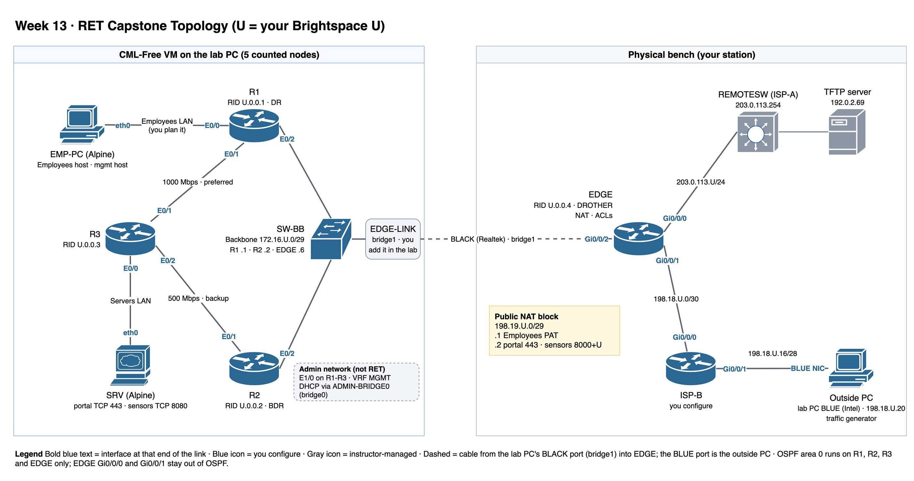

# Lab 13 - RET Capstone: Connect the Headquarters to Two Providers

```plaintext
Environment: CML-Free 2.10, lab file 13-RET-capstone.yaml (lab "RET Network": IOL-XE routers, Alpine hosts);
Cisco IOS-XE physical lab; Windows lab PC (PowerShell).
```

> **Rideau Environmental Technologies (RET), Kanata North.** In Week 11 you advised RET on what to buy and why. RET has now approved the design, and you are the junior network engineer building it. Vanessa Lopez's message to you is short: *"Our employees need the Internet, our municipal customers need the portal, and our field sensors need somewhere to send their readings. Build it, prove it works, and leave nothing open that should not be."*
>
> Meet the company again before you start: **[cst8371-ret.netlify.app](https://cst8371-ret.netlify.app)** is RET's public website, with its services, its people and the Junior Network Engineer role you are now doing. The customer portal you publish in Phase 5 is the one its customers sign in to.
>
> This time you get **requirements, not steps**. You decide the addressing inside RET, you place every ACL, and you prove each requirement with evidence.

**What you deliver**

1. An addressing and design plan: `l13-addressing-<username>.csv`, exported from the planner page `ret-capstone-planner.html` in your `l13.zip` package. The page runs offline in any browser.
2. A working network: three routers in CML, the physical EDGE, and your own ISP-B.
3. Six evidence files, `l13-c01-<username>.txt` to `l13-c06-<username>.txt`, uploaded with `scp` to the course server `192.0.2.69`.

**The five phases**

| Phase | Where | You build | Checkpoint |
|---|---|---|---|
| 1. Addressing | CML, home or lab | Your internal addressing plan, interfaces up | C01 |
| 2. Routing | CML, home or lab | OSPF area 0, preferred path and failover | C02 |
| 3. Internal policy | CML, home or lab | Employees-to-Servers and management ACLs | C03 |
| - | Lab | Connect CML to EDGE through `bridge1` | C00 (gate) |
| 4. Providers | Lab: CML + bench | EDGE in OSPF, DR/BDR, both providers, ISP-B | C04 |
| 5. Publish | Lab: bench | NAT and the outside-facing ACL, then traffic tests | C05, C06 |

**Gates.** Do not start Phase 4 until C00 passes. Do not start NAT (Phase 5) until C02 passes. Do not bind any outside-facing ACL until C05 passes.

### Where you work: home first, then the lab

Phases 1 to 3 need only CML-Free, so you can do them at home. Phases 4 and 5 need the physical bench.

1. **Download** `l13.zip`: from Brightspace at home, or in the lab with `scp cisco@192.0.2.69:configs/l13.zip "$env:USERPROFILE\Desktop\"`. Extract it with no wrapper folder. **Import** `13-RET-capstone.yaml` into CML. It opens as the lab **RET Network**.
   - At home, copy `l13-c01.txt` to `l13-c03.txt` as `l13-c0N-<username>.txt` and replace `{USERNAME}` and `{U}` in their first lines yourself. In the lab, `lab_setup.ps1` creates the rest and never overwrites a file you already have.
2. **Work Phases 1 to 3** anywhere.
3. **Save your work into the lab file** before you leave a CML session:
   - On R1, R2 and R3: `write memory`.
   - In CML, extract the configurations of all nodes (select the nodes, then **Extract configurations**), so the routers' running configurations are stored in the lab.
   - EMP-PC and SRV forget anything typed at the shell when they restart. Put their address and default route in each node's **Config** tab (`node.cfg`); the file has a marked place for them.
   - **Download** the lab and keep the YAML file, for example as `13-RET-capstone-<username>.yaml`.
4. **In the lab:** import your YAML into the lab PC's CML, start it, and check that your configurations are there. Then follow `13-RET-capstone-bridge-guide.md` (C00) and continue with Phase 4.

### The admin network (E1/0)

R1, R2 and R3 have an admin interface, `Ethernet1/0`. It is in its own VRF, `MGMT`, gets its address by DHCP from `ADMIN-BRIDGE0` (the CML System Bridge), and lets you SSH into the routers from your own computer.

- It is **not part of RET**: never address it, never put it in OSPF, never use it in an ACL except the management ACL (P3-R3).
- Find its address with `show ip interface brief | include 1/0`. The address is different at home and in the lab.

---

## Your values

Wherever a table shows `U`, use your own number: your Brightspace **U** grade. A value written `8000+U` means you do the arithmetic (for U = 23, use `8023`).

| Item | Value |
|---|---|
| U | `your Brightspace U` |
| Router login | `admin / cisco` |
| Enable password | `class` |
| Course server login | `cisco / cisco` |

---

## Topology



> The diagram is the cabling contract. Blue devices are yours to configure. Gray devices belong to the instructor. The dashed line is a real cable: it runs from the lab PC's **BLACK** (Realtek) port, bridged into CML as `bridge1`, to EDGE `Gi0/0/2`. The lab PC's **BLUE** (Intel) port is the outside PC, cabled to ISP-B `Gi0/0/1`. Use `13-RET-capstone-bridge-guide.md` to set up the bridge in the lab.

| Device | Type | Managed by |
|---|---|---|
| R1, R2 | CML IOL-XE core routers | You |
| R3 | CML IOL-XE distribution router (Servers LAN) | You |
| EMP-PC | CML Alpine: Employees test host, and the only management host | You |
| SRV | CML Alpine: portal on TCP 443 (plain HTTP, no TLS) and sensor service on TCP 8080. The CML lab file starts both services | You (addressing only) |
| SW-BB | CML unmanaged switch: the backbone segment. In the lab file | Provided |
| EDGE-LINK | External Connector on `bridge1`. You add it in the lab (bridge guide) | You |
| SW-ADMIN, ADMIN-BRIDGE0 | Admin network on `E1/0` (VRF `MGMT`, DHCP, System Bridge). Not part of RET. In the lab file | Provided; do not change |
| EDGE | Physical IOS-XE router. Starts **clean**: you configure everything on the console, from the hostname up (no Day0) | You |
| ISP-B | Physical IOS-XE router: the second provider. Starts **clean**: you configure everything on the console (no Day0) | You |
| Outside PC | The lab PC itself, through its **BLUE** (Intel) port. It runs the traffic generator and uploads your evidence | You |
| REMOTESW (ISP-A) | Instructor L3 switch: the default route and the course servers | Instructor |

### Given addressing (everything that touches the bench)

| Device           | Interface | Address          | Notes                                                             |
| ---------------- | --------- | ---------------- | ----------------------------------------------------------------- |
| R1               | E0/2      | `172.16.U.1/29`  | Backbone segment (SW-BB)                                          |
| R2               | E0/2      | `172.16.U.2/29`  | Backbone segment (SW-BB)                                          |
| EDGE             | Gi0/0/2   | `172.16.U.6/29`  | Backbone segment, through the bridge                              |
| EDGE             | Gi0/0/0   | `203.0.113.U/24` | To REMOTESW (ISP-A), gateway `203.0.113.254`                      |
| EDGE             | Gi0/0/1   | `198.18.U.1/30`  | To ISP-B                                                          |
| ISP-B            | Gi0/0/0   | `198.18.U.2/30`  | To EDGE                                                           |
| ISP-B            | Gi0/0/1   | `198.18.U.17/28` | Outside LAN gateway                                               |
| Outside PC       | BLUE (Intel) | `198.18.U.20/28` | No default gateway on this adapter; two static routes instead (P4-R9) |
| Public NAT block | -         | `198.19.U.0/29`  | `.1` Employees PAT; `.2` portal and sensors                       |
| TFTP server      | -         | `192.0.2.69`     | Evidence uploads (`scp`) and the listing check (`ssh`)            |
| Web server       | -         | `192.0.2.80`     | Employee Internet test                                            |

**What ISP-A already knows.** 
- REMOTESW holds two return routes toward your EDGE, `203.0.113.U`: one for your public block `198.19.U.0/29` and one for your outside network `198.18.U.16/28`. 
- You do not configure them, but you rely on both: the first carries replies to RET's published services, and the second carries replies to your evidence uploads.

### Addressing you choose (Phase 1)

Everything inside RET comes from **one block: `10.U.0.0/23`**. You carve it.

---

## Grading and rules

This capstone replaces Lab 13 and is worth **3% of your final grade**, graded out of **20 points**. Grading is automatic and checks the behaviour of your devices against your evidence and your own planner CSV.

| Part | Checkpoint | Work | Points | Evidence file |
|---|---|---|---|---|
| | C00 | In the lab: `bridge1` proven | gate, 0 | verified live |
| **A** | C01 | Addressing plan and interfaces | 2 | `l13-c01-<username>.txt` |
| **A** | C02 | OSPF, preferred path, failover | 5 | `l13-c02-<username>.txt` |
| **A** | C03 | Internal policy ACLs | 5 | `l13-c03-<username>.txt` |
| **B** | C04 | EDGE, DR/BDR, both providers | 3 | `l13-c04-<username>.txt` |
| **B** | C05 | NAT | 3 | `l13-c05-<username>.txt` |
| **B** | C06 | Outside-facing ACL and traffic tests | 2 | `l13-c06-<username>.txt` |
| | | **Part A 12 (60%) · Part B 8 (40%)** | **20** | |

**Due: Friday, December 4, 2026, 8:00 PM.** Submissions are accepted with no late penalty until **Monday, December 14, 2026, 9:00 AM**. The files on the server at that time are the ones graded.

**Rules that apply to every checkpoint**

- **Requirements, not steps.** Every requirement has an ID (P2-R4, and so on). Your evidence must prove each ID in its checkpoint.
- **Your plan is graded against your devices.** The grader reads your values (subnets, gateways, loopbacks) from `l13-addressing-<username>.csv`. If you change the design, export the planner again; the CSV and the devices must agree.
- **No AI tools.** Do not use AI tools (ChatGPT, Copilot, Claude, Gemini or similar) for any part of this capstone: the plan, the configurations, the evidence, the `!-- PROOF:` lines or the Reflection. This capstone shows what you can build and troubleshoot on your own, which is exactly what the Final SBA will ask of you with no help available.
- **No matches, no points.** Every ACE in every ACL must show `(n matches)` with n of 1 or more, exactly as in Lab 12. Each ACL has exactly one ACE that carries `log`.
- **Every graded ping is 100%.** Run each one until the ARP entries are learned, then collect.
- Evidence files follow the Lab 12 format: the `=== C0N ===` header, the device prompt, the command and its raw output, and a `!-- PROOF:` line at the bottom. Do not edit the output. `show tcp brief` appears once in every file, on the device you are connected to by SSH.
- **Start from the templates.** `l13-c01.txt` to `l13-c06.txt` in your package list every command, device by device, with a slot under each. The setup script copies them to your Desktop as `l13-c0N-<username>.txt` with your username and U filled in. Replace each `<placeholder>` in a command with your own value before you run it.

**If you cannot connect to EDGE.** Your C00 gate leaves evidence either way.
1. Retry on a spare station or in another slot.
2. If the cause is lab infrastructure, Part A counts 100% and Part B is excused (not a zero).
3. If the cause is your own configuration, Part B earns what your evidence shows.

---

## Phase 1 - Addressing (C01)

### Why this matters

RET's employee count is growing from 85 to 150 people. Phones, laptops and test devices bring the Employees network to more than 200 addresses within three years. A plan that fits today and fails in year two is a redesign. You carve one block so that the routes summarise cleanly at the edge, the same way you summarised one NAT ACE for a whole `/24` in Lab 12.

### Requirements

- [ ] **P1-R1** Every internal network comes from `10.U.0.0/23`.
  - No two networks overlap.
  - Every subnet starts on a valid boundary for its prefix.
- [ ] **P1-R2** The Employees subnet holds at least **200** hosts.
- [ ] **P1-R3** The Servers subnet holds at least **30** hosts.
- [ ] **P1-R4** R1-R3 and R2-R3 are `/30` point-to-point links.
- [ ] **P1-R5** R1, R2 and R3 each have one loopback with a `/32` from the block.
- [ ] **P1-R6** Host and gateway addresses:
  - Each LAN gateway is the **first** usable address of its subnet.
  - EMP-PC is the **10th** usable address of Employees.
  - SRV is the **10th** usable address of Servers.
  - Both hosts are addressed statically.
- [ ] **P1-R7** The plan is recorded in the planner and exported as `l13-addressing-<username>.csv`.
- [ ] **P1-R8** Every interface in the topology is up/up with its planned or given address, and each directly connected pair can reach each other.

### C01 - Collection of information

**Evidence file:** `l13-c01-<username>.txt`

**Step 1 - routers.** On **R1**, **R2** and **R3**, run these **two** commands:

```text
show ip interface brief
show ip interface brief | include Loopback
```

**Step 2 - hosts.** On **EMP-PC** and **SRV**, run these **two** commands:

```text
ip -4 addr show eth0
ip route
```

**Step 3 - one ping across each link.** Replace the placeholders with your own addresses:

| From | Command |
|---|---|
| EMP-PC | `ping -c 4 <Employees gateway>` |
| SRV | `ping -c 4 <Servers gateway>` |
| R1 | `ping <R3 address on the R1-R3 link>` |
| R2 | `ping <R3 address on the R2-R3 link>` |
| R1 | `ping 172.16.U.2` |

**Step 4 - write your `!-- PROOF:` line:** one sentence naming the output that shows the Employees and Servers prefixes, and why the Employees prefix you chose is the smallest one that meets P1-R2.

### Success Indicator / Failure Signal

| Item | Success | Failure |
|---|---|---|
| Plan | CSV inside the block, no overlaps, sizes met | Overlap, a subnet off its boundary, or a size too small |
| Interfaces | All up/up with the CSV addresses | Any mismatch between the CSV and the device |
| Pings | 100% on every link | Any loss |

> **Hold C01 to C03.** Nothing inside CML can reach the course server until Phase 4. You upload these files from the outside PC at C04.

---

## Phase 2 - Routing and OSPF, inside CML (C02)

You configured every command you need here in Lab 12. The capstone tests whether you can apply them to a bigger design.

### C02 - your OSPF parameters

| Parameter                     | Value                                                                    |
| ----------------------------- | ------------------------------------------------------------------------ |
| Process ID                    | `U` (same on every router)                                               |
| Area                          | `0` only                                                                 |
| Router IDs                    | R1 `U.0.0.1`, R2 `U.0.0.2`, R3 `U.0.0.3` (and EDGE `U.0.0.4` in Phase 4) |
| Reference bandwidth           | `10000 Mbps` on every router                                             |
| Link bandwidth                | R1-R3 `1000 Mbps`<br> R2-R3 `500 Mbps`<br>backbone E0/2 `1000 Mbps`      |
| Hello / Dead, R1-R3 and R2-R3 | `10 / 40` (the default; leave it)                                        |
| Hello / Dead, backbone        | `5 / 20`                                                                 |
| Loopback network type         | point-to-point                                                           |

### Requirements

- [ ] **P2-R1** OSPF process `U`, area 0, on every OSPF interface of R1, R2 and R3.
- [ ] **P2-R2** Router IDs set **manually** to the table values.
- [ ] **P2-R3** Costs:
  - Reference bandwidth `10000` on **all** routers.
  - Link bandwidths set so the cost is the same on both ends of each link.
  - The expected cost of each link recorded in the planner.
- [ ] **P2-R4** R1-R3 is the preferred path between Employees and Servers; R2-R3 is the backup. Prove it from the routing table.
- [ ] **P2-R5** Passive interfaces:
  - Every interface that does not face an OSPF neighbour is passive: both LANs and every loopback.
  - Interfaces that face a neighbour are **not** passive.
- [ ] **P2-R6** Loopbacks use network type point-to-point, so each one appears as a `/32`.
- [ ] **P2-R7** Timers match on both ends of every link they apply to.
- [ ] **P2-R8** **No static routes** on R1, R2 or R3.
- [ ] **P2-R9** Every internal network is reachable from every router.
- [ ] **P2-R10** **Failover:**
  - With R1-R3 shut, Employees and Servers still reach each other through R2, with no manual change.
  - After the link is restored, the preferred path returns.

### C02 - Collection of information

**Evidence file:** `l13-c02-<username>.txt`

**Step 1 - wait for every adjacency to reach `FULL`.** Then, on **R1**, **R2** and **R3**, run these **six** commands, in this order:

```text
show ip protocols
show ip ospf | include Reference
show ip ospf neighbor
show ip ospf interface brief
show ip route ospf
show ip route static
```

**Step 2 - the failover test.** Collect this pair three times, in the slots marked **BEFORE**, **FAILED** and **RESTORED**:

On **R3**:

```text
show ip route <Employees network>
```

On **SRV**:

```text
ping -c 4 <EMP-PC address>
```

| Slot | Do this first |
|---|---|
| BEFORE | Nothing: every link up |
| FAILED | Shut R1 `E0/1` and wait for R3's routing table to change |
| RESTORED | Bring R1 `E0/1` back up and wait for the R1-R3 adjacency to reach `FULL` |

**Step 3 - write your `!-- PROOF:` line:** one sentence naming the outputs that show all adjacencies FULL, the cost of each path, the preferred next hop, the backup next hop during the failure, and the return to the preferred path.

### Success Indicator / Failure Signal

| Item | Success | Failure |
|---|---|---|
| Adjacencies | All FULL | Stuck at INIT or EXSTART, or missing |
| Router IDs | Match the table | Auto-selected |
| Reference bandwidth | `10000 mbps` on all three | Default on any router |
| Costs | Match your planner; equal on both ends | Bandwidth set on one end only |
| Passive | Exactly the non-neighbour interfaces | A LAN not passive, or a neighbour link passive |
| Static routes | None | Any |
| Failover | Next hop changes to R2, then returns | No change, or a manual fix needed |

---

## Phase 3 - Internal users and policy (C03)

### Security policy statement

RET's servers hold customer data. Employees use the portal and name services and nothing else on the server network. Only the IT management workstation (EMP-PC) may manage network devices.

### Requirements

- [ ] **P3-R1** From the Employees network to the Servers network:
  - Permitted: TCP 80, TCP 443, UDP 53, and ICMP echo for troubleshooting.
  - Everything else to Servers is denied and counted.
- [ ] **P3-R2** Employees traffic to any destination other than the Servers network is **not** affected by P3-R1.
- [ ] **P3-R3** Management access:
  - SSH to R1, R2 and R3 (and EDGE in Phase 4) is accepted only from EMP-PC's address and from the admin network on `E1/0`.
  - Any other source is refused and counted.
  - SSH through `E1/0` still works after the ACL is applied. `E1/0` is in a VRF: find out how `access-class` treats connections that arrive in a VRF.
  - The admin network is different at home and in the lab: update the ACL when you move.
- [ ] **P3-R4** The ACL is placed as close to the source as the policy allows. Your planner records the router, interface and direction, and why.
- [ ] **P3-R5** OSPF stays FULL everywhere after every ACL is bound.
- [ ] **P3-R6** Every ACE has matches. Exactly one ACE per ACL carries `log`.

**Traffic you must generate** (record each command and result in your lab book):

| Test | From | To | Expected |
|---|---|---|---|
| T1 | EMP-PC | SRV, TCP 443 (portal page) | Page returned |
| T2 | EMP-PC | SRV, UDP 53 (a name lookup against SRV) | Packets counted as permitted (no answer is expected) |
| T3 | EMP-PC | SRV, TCP 8080 | Refused, counted |
| T4 | EMP-PC | SRV, SSH | Refused, counted |
| T5 | EMP-PC | ping SRV | 100% |
| T6 | EMP-PC | SSH to the loopbacks of R1, R2 and R3 | Login prompt on each |
| T7 | SRV | SSH to the loopbacks of R1, R2 and R3 | Refused and counted on each |
| T8 | EMP-PC | SRV, TCP 80 | Permitted by the ACL; SRV refuses the connection because nothing listens on 80 |
| T9 | Your computer | SSH to the `E1/0` address of R1, R2 and R3 | Login prompt on each |

### C03 - Collection of information

**Evidence file:** `l13-c03-<username>.txt`

**Step 1 - clear the counters, then run T1 to T9.** Record each test command and its result in your lab book.

**Step 2 - the ACLs.** On the router that holds each ACL, run these **three** commands. Use your own ACL name and interface:

```text
show ip access-lists <name>
show ip interface <interface> | include access list
show logging | include <name>
```

**Step 3 - every router.** On **R1**, **R2** and **R3**, run these **three** commands:

```text
show ip ospf neighbor
show running-config | section line vty
show ip access-lists <management ACL name>
```

**Step 4 - write your `!-- PROOF:` line:** one sentence naming the ACE lines that prove T1 to T9 and the output that shows OSPF still FULL.

### Success Indicator / Failure Signal

| Item | Success | Failure |
|---|---|---|
| Permitted flows | T1, T2, T5, T6, T9 work; T8 counted as permitted | Any fails |
| Denied flows | T3, T4, T7 fail and are counted | Not counted, or allowed |
| Placement | Closest to the source; reason recorded | Placed on the server side with no reason |
| OSPF | Still FULL | An adjacency lost after binding |
| Matches | Every ACE has matches | Any ACE at 0 |

---

## C00 - In the lab: connect CML to EDGE

**Points:** 0 (gate). Nothing is submitted.

The bridge is the riskiest part of this capstone. Prove it in your first 20 minutes at the bench, not your last.

- [ ] `l13.zip` is extracted on the lab PC's Desktop and `. .\lab_setup.ps1` with the lab value `l13` and your U prints `SETUP OK`.
- [ ] EDGE and ISP-B start clean. If either still has a configuration from someone else, erase it and reload, as in Lab 12 D3.
- [ ] **C00-R1** EDGE base, configured by you on the console (there is no Day0 in this lab):
  - hostname `EDGE`;
  - user `admin`, password `cisco`, privilege 15; enable secret `class`;
  - SSH version 2, with local login on the vty lines;
  - the three interface addresses from *Given addressing*, each interface up;
  - nothing else yet: no routes, no OSPF, no NAT, no ACLs (those are Phases 4 and 5).
- [ ] **C00-R2** ISP-B base, on the console: hostname `ISP-B`, the same user and enable secret. Its addressing and route come in Phase 4 (P4-R8).
- [ ] Your lab file is imported into the lab PC's CML and your Phase 1 to 3 configurations are present.
- [ ] You followed `13-RET-capstone-bridge-guide.md`: VMnet2, Network Adapter 2, `bridge1`, the `EDGE-LINK` label, and the `EDGE-LINK` External Connector linked to `SW-BB`.
- [ ] The lab PC's **BLACK** (Realtek) port is cabled to EDGE `Gi0/0/2`, and its **BLUE** (Intel) port to ISP-B `Gi0/0/1`.

| # | Device | Command | Required result |
|---|---|---|---|
| 1 | R1 | `ping 172.16.U.6 repeat 5` | `!!!!!` (the first dot is ARP; repeat it) |
| 2 | R1 | `show ip arp 172.16.U.6` | An entry for EDGE with its MAC address |
| 3 | R2 | `ping 172.16.U.6 repeat 5` | `!!!!!` |
| 4 | Lab PC | The CML web interface | Still loads |

> If row 1 fails, stop and call your instructor **now**. A bridge fault found now is an infrastructure fault; one found on the last day is not recoverable.

---

## Phase 4 - Connect EDGE and the providers (C04)

### C04 - your parameters (added to the Phase 2 table)

| Parameter | Value |
|---|---|
| EDGE router ID | `U.0.0.4` |
| DR priority on the backbone | R1 `200`, R2 `100`, EDGE `0` |
| Hello / Dead, backbone | `5 / 20` on R1, R2 **and** EDGE |
| ISP-A default route | via `203.0.113.254` |
| Outside network behind ISP-B | `198.18.U.16/28` |

### Requirements

- [ ] **P4-R1** R1 and R2 form FULL adjacencies with EDGE across the backbone segment.
- [ ] **P4-R2** DR election:
  - **R1 is DR, R2 is BDR, EDGE is DROTHER.**
  - The planner says in one sentence why EDGE should never be DR here.
  - The roles are proven from the neighbour tables.
- [ ] **P4-R3** Backbone timers are `5 / 20` and match on all three routers.
- [ ] **P4-R4** You add **exactly two static routes on EDGE**:
  - the default route `0.0.0.0/0` via ISP-A, `203.0.113.254`;
  - a route to the outside network `198.18.U.16/28` via ISP-B, `198.18.U.2`.
  - EDGE does **not** redistribute either static route into OSPF. The default route that EDGE originates already carries RET's traffic to the outside network; EDGE's own table then picks ISP-B.
- [ ] **P4-R5** EDGE originates the default route into OSPF. R1, R2 and R3 learn it as an OSPF external route.
- [ ] **P4-R6** EDGE `Gi0/0/0` and `Gi0/0/1` are **not declared in OSPF at all**, not even as passive.
- [ ] **P4-R7** R1, R2 and R3 still have no static routes.
- [ ] **P4-R8** You configure **ISP-B**:
  - the given addressing on both interfaces;
  - **one static route**: the default route `0.0.0.0/0` via EDGE, `198.18.U.1`;
  - no OSPF and no NAT.
- [ ] **P4-R9** The outside PC reaches the outside world **through ISP-B only**:
  - The **BLUE** (Intel) adapter has `198.18.U.20/28` and **no** default gateway. Find its Windows name with `Get-NetAdapter`.
  - Two **non-persistent** routes send `192.0.2.0/24` and `198.19.U.0/29` to `198.18.U.17`, so they disappear on reboot.
  - The lab PC's own default gateway is unchanged, and the BLACK (Realtek) adapter keeps no address: it belongs to CML.
  - Use an administrator PowerShell (right-click Windows PowerShell, **Run as administrator**).
- [ ] **P4-R10** Redundancy still holds with EDGE attached: with R1-R3 shut, R3 still has the default route and reaches EDGE.

> **Election is not pre-emptive.** If the adjacencies formed before you set the priorities, the old DR stays DR. The Reflection asks you why.

> **Do not ping the outside PC.** The Windows firewall drops incoming echo requests, so a failed ping to `198.18.U.20` proves nothing. Every test in this capstone starts **from** the outside PC instead.

### Upload C01 to C04

From the outside PC, upload `l13-c01` to `l13-c03`, then `l13-c04-<username>.txt` and `l13-addressing-<username>.csv`, to `192.0.2.69` with `scp`, as in every lab. The upload crosses ISP-B, EDGE and ISP-A, so a successful upload is itself proof of the physical path.

Put the exported CSV on your Desktop beside the evidence files first (the browser saves it to Downloads). Then, in PowerShell:

```powershell
Set-Location "$env:USERPROFILE\Desktop"
$username = "<username>"
scp "l13-c01-$username.txt" "l13-c02-$username.txt" "l13-c03-$username.txt" "l13-c04-$username.txt" "l13-addressing-$username.csv" "cisco@192.0.2.69:/var/tftp/"
ssh cisco@192.0.2.69 "ls -l /var/tftp/*$username*"
```

The listing must show all five files, each with a non-zero size. A transfer that returns without an error is not confirmation.

### C04 - Collection of information

**Evidence file:** `l13-c04-<username>.txt`

**Step 1 - R1 and R2.** On each, run these **three** commands:

```text
show ip ospf neighbor
show ip ospf interface Ethernet0/2 | include State|Priority|Timer
show ip route 0.0.0.0
```

**Step 2 - R3.** Run this command:

```text
show ip route ospf | include 0.0.0.0
```

**Step 3 - EDGE.** Run these **eight** commands, in this order:

```text
show ip interface brief
show ip ssh
show ip ospf neighbor
show ip ospf interface GigabitEthernet0/0/0
show ip ospf interface GigabitEthernet0/0/1
show ip route static
ping 192.0.2.69
ping 198.18.U.17
```

The two `show ip ospf interface` commands must print `%OSPF: OSPF not enabled on ...`. That message is the evidence, not an error.

**Step 4 - ISP-B.** Run these **two** commands:

```text
show ip route static
show ip interface brief
```

**Step 5 - Outside PC.** In PowerShell, run these **four** commands:

```powershell
route print -4 192.0.2.*
route print -4 198.19.*
ping 198.18.U.1
Test-NetConnection 192.0.2.69 -Port 22
```

**Step 6 - redundancy.** Shut R1 `E0/1`, then run on **R3**, in the slot marked **FAILED**:

```text
show ip route ospf | include 0.0.0.0
ping 172.16.U.6
```

Bring R1 `E0/1` back up afterwards.

**Step 7 - management of EDGE.** Record both tests in your lab book, then run `show ip access-lists <your management ACL>` on **EDGE**:

| Test | From | Command | Expected |
|---|---|---|---|
| M1 | EMP-PC | `ssh admin@172.16.U.6` | Login prompt |
| M2 | SRV | `ssh admin@172.16.U.6` | Refused and counted |

**Step 8 - write your `!-- PROOF:` line:** one sentence naming the outputs that show R1 DR, R2 BDR and EDGE DROTHER, the `O*E2` default route on R1, R2 and R3, the two outside interfaces outside OSPF, and EDGE's two static routes.

### Success Indicator / Failure Signal

| Item | Success | Failure |
|---|---|---|
| Roles | R1 DR, R2 BDR, EDGE DROTHER | EDGE elected DR, or the roles reversed |
| Timers | `5 / 20` on all three | One router at the default |
| Default route | `O*E2 0.0.0.0/0` on R1, R2, R3 | Missing, or a static default on an internal router |
| Outside interfaces | "OSPF not enabled" on both | Listed, even as passive |
| EDGE statics | Exactly two, and no redistribution into OSPF | Missing, extra, or `O E2 198.18.U.16/28` on an internal router |
| EDGE management | M1 login prompt; M2 refused and counted on the management ACL | M2 allowed, or M1 refused |
| Upload | All five files listed on the server | Missing files |

---

## Phase 5 - Publish RET to the Internet (C05, C06)

### C05 - your NAT parameters

| Item | Value |
|---|---|
| Employees PAT address | `198.19.U.1` |
| Portal | `198.19.U.2`, TCP `443` to SRV TCP `443` |
| Sensor service | `198.19.U.2`, TCP `8000+U` to SRV TCP `8080` |
| Outside interfaces | Both `Gi0/0/0` and `Gi0/0/1` |

### NAT requirements (C05)

- [ ] **P5-R1** Employees PAT:
  - Employees reach `192.0.2.80` and the outside network using the single address `198.19.U.1`.
  - Servers and loopbacks are not translated by this rule.
- [ ] **P5-R2** Customers reach the portal at `198.19.U.2` on TCP 443, from **both** provider sides.
- [ ] **P5-R3** Sensors reach the sensor service at `198.19.U.2` on TCP `8000+U`.
- [ ] **P5-R4** NAT roles:
  - Correct on all three EDGE interfaces.
  - R1, R2, R3 and ISP-B carry no NAT configuration.
- [ ] **P5-R5** RET uses **two** public addresses, not three. Your planner says in one sentence what that saves and what it costs (link back to your Week 11 public IPv4 recommendation).

### C05 - Collection of information

**Evidence file:** `l13-c05-<username>.txt`

**Step 1 - three tests.** Record each command and its result in your lab book:

| Test | From | What |
|---|---|---|
| N1 | EMP-PC | Fetch the page on `http://192.0.2.80/` |
| N2 | Outside PC | Fetch `http://198.19.U.2:443/` |
| N3 | Outside PC | Send one sensor reading to `198.19.U.2` port `8000+U` (`ret-gen` with a count of 1) |

**Step 2 - EDGE.** Straight after the tests, run these **three** commands:

```text
show ip nat translations
show ip nat statistics
show ip interface brief
```

**Step 3 - write your `!-- PROOF:` line:** one sentence naming the translation lines that show the Employees PAT, the portal and the sensor mapping.

### External policy requirements (C06)

**Security policy statement.** From the Internet (either provider), only the published services may enter RET. Return traffic for connections RET started must still work. Evidence uploads from the outside PC must still work.

- [ ] **P5-R6** Inbound from either provider:
  - Only TCP 443 and TCP `8000+U` to the published address are permitted into RET.
  - Everything else into RET is denied and counted.
- [ ] **P5-R7** The ACL is written against the **public** address. It is checked before NAT translates the packet, so the inside address of SRV never appears in it.
- [ ] **P5-R8** Replies to Employees connections still arrive.
- [ ] **P5-R9** From the outside PC, these still work:
  - The `scp` uploads to `192.0.2.69`.
  - The SSH listing check (D2).
  - Both are SSH sessions (TCP 22) that cross EDGE between ISP-B and ISP-A, in both directions.
- [ ] **P5-R10** SSH to EDGE from either provider is refused and counted.
- [ ] **P5-R11** The Phase 3 policy still holds, and OSPF is still FULL.

### Traffic generator

Your `l13.zip` package contains two versions of the traffic generator. They send the same traffic, use the same token and print the same summary. Run the one that matches the outside host.

**macOS, Linux or Alpine** (Python 3, standard library only; on Alpine, `apk add python3` first):

```bash
python3 ret-gen.py --username <username> --u <U>
```

**Windows**, in the same PowerShell window you use for the lab:

```powershell
.\ret-gen.ps1 -Username <username> -U <U>
```

What it does:

- Sends 20 portal requests: HTTP GET to `198.19.U.2` port 443.
- Sends 20 sensor readings: HTTP POST to `198.19.U.2` port `8000+U`, with sensor ID `RET-S` followed by U as three digits.
- Adds a token derived from your username and U to every request.
- Prints a summary and saves it as `l13-gen-<username>.txt` on your Desktop.

A request counts as **delivered** when SRV sends back any HTTP response. The sensor endpoint always answers `501 Not Implemented`: SRV's web server has no handler for readings, but the answer proves the reading crossed EDGE, NAT and your ACL and reached SRV. `501` is the expected result and counts as delivered.

- [ ] **P5-R12** The summary shows `delivered=20 failed=0` for both the portal and the sensor.
- [ ] **P5-R13** Clear the counters, run the generator once, then read the ACL. The matches on your permit ACEs for TCP 443 and TCP `8000+U` are each at least 20.
- [ ] **P5-R14** The token in your summary matches your username and U. A summary copied from another student fails this check.

### C06 - Collection of information

**Evidence file:** `l13-c06-<username>.txt`

**Step 1 - clear the counters, then run X1 to X7.** Record each command and result in your lab book. Paste the generator summary (X1) into the **Outside PC** section of the file.

| Test | From | What | Expected |
|---|---|---|---|
| X1 | Outside PC | The traffic generator, once | `delivered=20 failed=0`, twice |
| X2 | EMP-PC | Fetch `http://192.0.2.80/` | Page returned |
| X3 | EMP-PC | `ping -c 4 192.0.2.80` | 100% |
| X4 | Outside PC | Upload `l13-c05-<username>.txt` with `scp` | File listed on the server |
| X5 | Outside PC | The D2 SSH listing check | Listing shown |
| X6 | Outside PC | `ssh admin@198.18.U.1` | Refused, counted |
| X7 | Outside PC | `ping 198.19.U.2` | 100% loss, counted |

**Step 2 - EDGE.** Run these **six** commands, in this order. Use your own ACL name:

```text
show ip access-lists <name>
show ip interface GigabitEthernet0/0/0 | include access list
show ip interface GigabitEthernet0/0/1 | include access list
show logging | include <name>
show ip nat translations
show ip ospf neighbor
```

**Step 3 - write your `!-- PROOF:` line:** one sentence naming the ACE lines that prove X1 to X7 and the generator line that shows every request delivered. Then answer the Reflection under `!-- REFLECTION:` at the bottom of the same file.

**Step 4 - upload** `l13-c05`, `l13-c06` and the final `l13-addressing-<username>.csv`. The latest upload is graded.

```powershell
scp "l13-c05-$username.txt" "l13-c06-$username.txt" "l13-addressing-$username.csv" "cisco@192.0.2.69:/var/tftp/"
ssh cisco@192.0.2.69 "ls -l /var/tftp/*$username*"
```

### Success Indicator / Failure Signal

| Item | Success | Failure |
|---|---|---|
| Portal and sensors | Delivered from the outside PC; generator totals and ACL counters agree | Any request lost, or counts that do not add up |
| ACL target | Public address only | SRV's inside address in the outside ACL |
| Employees | Still reach `192.0.2.80` | Replies dropped by the inbound ACL |
| Uploads | The final `scp` upload is listed on the server | Upload blocked by your own ACL |
| SSH to EDGE from outside | Refused, counted | Allowed |
| Matches | Every ACE has matches | Any ACE at 0 |

---

## Reflection (answer in your C06 file, under `!-- REFLECTION:`)

Each answer must name the line of **your own** evidence that supports it.

1. Which router became DR on the backbone segment, and which output proves it?
2. Suppose you raised R2's priority above R1's after the adjacencies were FULL, and R1 stayed DR. Why, and what would change it?
3. Why would an inbound outside ACL written against SRV's inside address fail here?
4. Which timer values must match on a link, and what does the neighbour table show when they do not?

---

## Troubleshooting (symptoms and where to look; no fixes)

| Symptom | Subsystems to check |
|---|---|
| R1 cannot ping EDGE at C00 | Ext-conn label, `bridge1` port, NIC cable, the hypervisor's bridged adapter |
| Neighbour stuck in INIT or EXSTART | Timers, area, mask, MTU, duplicate router IDs |
| R2-R3 carries traffic while R1-R3 is up | Bandwidth on one end only, reference bandwidth on one router |
| A LAN is advertised but a neighbour never forms | Which interfaces are passive |
| EDGE became DR | Where the priority was set, and when the election ran |
| Internal routers have no default route | EDGE's static default, the origination, ACLs on the backbone |
| Adjacency drops after an ACL is bound | What the ACL does to OSPF on that interface |
| The outside PC reaches nothing | The NIC's address, its routes, ISP-B's default route, EDGE's route to the outside network |
| The portal works from one provider only | NAT outside role on each interface; the ACL on each interface |
| `scp` or the SSH listing hangs from the outside PC | The replies from `192.0.2.69` through your outside ACL; the routes back to `198.18.U.16/28` |
| SSH through `E1/0` stopped working after P3-R3 | How `access-class` treats connections that arrive in a VRF; whether the management ACL permits the admin subnet you see on `E1/0` |
| SSH through `E1/0` works at home but not in the lab | The admin subnet changed: compare `show ip interface brief \| include 1/0` with your management ACL |
| `E1/0` has no address | `ADMIN-BRIDGE0` still set to System Bridge; the lab PC's or home network's DHCP |
| Your configurations are missing after you import the lab in the lab | `write memory` and Extract configurations before the download; host lines in `node.cfg`, not typed at the shell |
| SRV answers nothing on 443 or 8080 | SRV's `node.cfg` service lines unchanged; `netstat -tln` on SRV |

---

## Section D - Submission

### D1 - Submission requirements

- Six evidence files `l13-c01-<username>.txt` to `l13-c06-<username>.txt` and `l13-addressing-<username>.csv`, uploaded to `192.0.2.69` from the outside PC.
- The CSV matches your final devices.
- The course server is the only submission point. There is no Brightspace dropbox for this capstone.

### D2 - Validate

```powershell
ssh cisco@192.0.2.69 "ls -l /var/tftp/*$username*"
```

Seven files, the latest timestamps after your final test run.

### D3 - Clean up

- Physical routers: before you erase EDGE and ISP-B, copy `show running-config` from each into a text file (for example `l13-edge-<username>.txt`) if you need another lab session: there is no Day0, so you paste your own configuration back next time. Then erase both, as in Lab 12 D3.
- Remove the outside PC's static routes and the BLUE (Intel) adapter's address.
- Stop the CML lab and download it. Leave `bridge1`, VMnet2 and Network Adapter 2 in place.

## End of Lab 13 - RET Capstone
