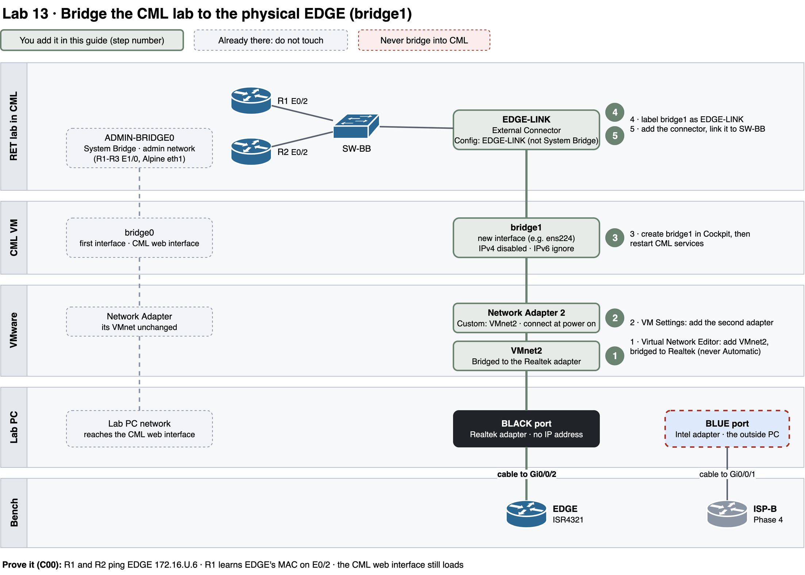

# Lab 13 - Connect CML to the Physical EDGE (bridge1)

```plaintext
Environment: lab PC (Windows, VMware Workstation Pro) running the CML-Free VM; physical EDGE router on your bench.
```

The lab PC has two bench network ports, and each one has a fixed job:

| Port | Windows adapter | Job in this capstone |
|---|---|---|
| **BLACK** | Realtek | Bridged into CML as `bridge1`; cabled to EDGE `Gi0/0/2` (this guide) |
| **BLUE** | Intel | The outside PC; cabled to ISP-B `Gi0/0/1` (Phase 4, P4-R9). **Never bridge it into CML** |

Your CML-Free VM has **one** network adapter. CML uses it for its web interface, and your lab connects to it through the `ADMIN-BRIDGE0` connector (the admin network on `E1/0`). To reach the physical EDGE, the VM needs a **second** adapter, bridged to the lab PC's Ethernet port that is cabled to EDGE. Inside CML, that adapter becomes a new bridge, `bridge1`, and an External Connector in your lab uses it.

**When:** at the lab station, after Phases 1 to 3 and before C00. You do not need any of this at home.
**Time:** about 20 minutes the first time.



Read the diagram from the top down. The green path is what you build in this guide; each green box carries the number of its step. The grey dashed path is the CML web interface's own network: leave it alone.

> **Do not touch the first adapter.** It carries the CML web interface and `bridge0`. Every step below adds something new; nothing changes what already works.

---

## Before you start

- [ ] Your RET Network lab (`13-RET-capstone.yaml`) is imported in this CML VM and **stopped**.
- [ ] The cable from the lab PC's **BLACK** port is plugged into EDGE `Gi0/0/2`.
- [ ] You know the Windows name of the BLACK port's adapter: the **Realtek** one. In PowerShell, `Get-NetAdapter | Format-Table Name, InterfaceDescription, Status` lists it (for example `Ethernet 2`, *Realtek PCIe GbE Family Controller*). Write the name in your lab book. To be sure, unplug the BLACK cable and check that this adapter's status changes to `Disconnected`, then plug it back in.
- [ ] You can open VMware Workstation's **Virtual Network Editor** with **Change Settings** (administrator). If you cannot, stop and call your instructor.

---

## Step 1 - Create a bridged VMware network for the BLACK port

1. Shut down the CML VM (CML web interface: **Tools > System Administration > Shut down**, or power off from VMware once CML has stopped).
2. In VMware Workstation: **Edit > Virtual Network Editor > Change Settings**.
3. Note what `VMnet0` is set to and **leave it alone**.
4. **Add Network...**, choose `VMnet2` (or the first free VMnet number).
5. Select the new VMnet, choose **Bridged (connect VMs directly to the external network)**, and set **Bridged to** the **Realtek** adapter. Never choose "Automatic", and never the Intel adapter.
6. **Apply**, then **OK**.

> If the editor only offers Host-only for the new VMnet, or if no adapter appears in the list, check that **VMware Bridge Protocol** is ticked in the Realtek adapter's Windows properties. If it still fails, call your instructor.

## Step 2 - Give the CML VM a second adapter

1. **VM > Settings > Add... > Network Adapter > Finish**. It appears as **Network Adapter 2**.
2. Select it and choose **Custom: Specific virtual network**, then `VMnet2`.
3. Tick **Connected** and **Connect at power on**. **OK**.
4. Power the VM on and wait until the CML web interface loads again.

**Check:** the CML web interface opens exactly as before. If it does not, you changed the first adapter: undo it.

## Step 3 - Create `bridge1` inside the CML VM

1. Open Cockpit: `https://<CML address>:9090`, and sign in with the CML system administrator account (the one you created when you installed CML).
2. Go to **Networking**. You see the first interface (in `bridge0`) and a new interface with no bridge (often `ens224` or `ens256`). Write its name in your lab book.
3. **Add bridge**. Name: `bridge1`. Port: tick the **new** interface only.
4. Open `bridge1` and set **IPv4: Disabled** and **IPv6: Ignore**. The bridge is a wire; it needs no address.
5. Check that both the new interface and `bridge1` are **active**. Do not edit `bridge0`.
6. Restart CML so it registers the bridge: in Cockpit go to **Cisco Modeling Labs > Restart Services** (or reboot the VM).

## Step 4 - Label the bridge in CML

1. CML web interface: **Tools > System Administration > External Connectors**.
2. Find the row with Device Name `bridge1`. Click its label and change it to `EDGE-LINK`. **Save**.
3. Leave **Protected** on. It lets IPv4 and ARP through, which is everything OSPF, NAT and ping need.

## Step 5 - Add the connector to your lab

1. Open the RET Network lab (stopped).
2. Drag an **External Connector** onto the canvas, next to `SW-BB`. Name it `EDGE-LINK`.
3. In its **Config** tab choose `EDGE-LINK`, **not** "System Bridge" or "NAT".
4. Link it to a free port on `SW-BB`.
5. Do **not** change `ADMIN-BRIDGE0`: it stays on System Bridge.
6. Start the lab.

External Connectors and unmanaged switches do not count toward the 5-node limit.

## Step 6 - Prove it (this is C00 in the brief)

Give R1 and R2 their backbone addresses (`172.16.U.1/29` and `172.16.U.2/29` on `E0/2`) if they do not have them yet, then:

| # | Where | Command | Pass |
|---|---|---|---|
| 1 | R1 | `ping 172.16.U.6 repeat 5` | `!!!!!` (repeat once if the first dot is ARP) |
| 2 | R1 | `show ip arp 172.16.U.6` | EDGE's MAC address on `Ethernet0/2` |
| 3 | R2 | `ping 172.16.U.6 repeat 5` | `!!!!!` |
| 4 | Lab PC browser | CML web interface | Still loads |

All four pass: go on to Phase 4. Any fails: use the table below, then call your instructor. A bench or bridge fault found here is handled as an infrastructure fault (see "If you cannot connect to EDGE" in the brief).

---

## When it fails

| Symptom | Look at |
|---|---|
| CML web interface gone after Step 1 or 2 | You changed `VMnet0` or the first adapter. Put them back |
| `bridge1` not in the External Connectors list | CML not restarted after Step 3, or `bridge1` not active in Cockpit |
| The connector shows the web interface's network | The connector is set to "System Bridge". Choose `EDGE-LINK` |
| R1 ping to EDGE fails, no ARP entry | Network Adapter 2 not Connected; VMnet2 bridged to the wrong Windows adapter; cable in the wrong EDGE port; EDGE `Gi0/0/2` shut |
| Ping works, OSPF stuck later in INIT or EXSTART | Timers and MTU (Phase 4 troubleshooting), not the bridge |
| VMware: "no un-bridged host network adapters" | Automatic bridging has claimed every adapter. Bind VMnet2 to one specific adapter |

## Leaving the station

- Stop your lab and **download** it (your YAML is your work).
- Leave `bridge1`, VMnet2 and Network Adapter 2 in place unless your instructor says otherwise: the next student on this PC needs the same setup.
